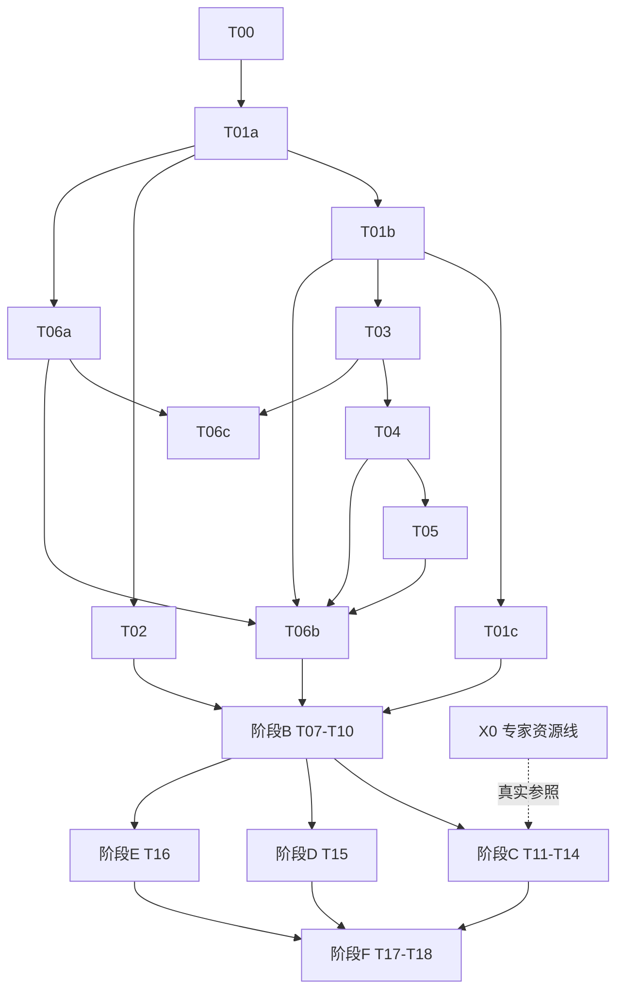

# AnatoBind-MRI v5.1 实施计划（2026-11-06 修订：以 GitHub 仓库内容为基线）

> **For agentic workers:** REQUIRED SUB-SKILL: Use superpowers:subagent-driven-development (recommended) or superpowers:executing-plans to implement this plan task-by-task. Steps use checkbox (`- [ ]`) syntax for tracking.

**Goal:** 在 GitHub 现有 v4.1 代码上，分阶段交付 Proposal v5.1 要求的同一观察 A/U/S/核心 R 统一输出、独立参照评价、二维/三维八项能力和范围化结论链；本修订先交付可独立验收的阶段 A（契约、签名资格、可靠评价）。

**Architecture:** 代码继续放在 `anatobind/v41/` 包内，v5.1 以 `_v5` 后缀的新入口和新模块加入，v41 函数与 144 项旧测试保持原行为。阶段 A 只用合成数据和 CPU；阶段 B–F 在本文件 §1 列出路线图，各阶段开始前按本文件阶段 A 的粒度细化后写回本文件，再执行。

**Tech Stack:** Python ≥3.9（本机 `.venv` 为 3.9.6；数据服务器为 3.11），NumPy、SciPy、PyTorch、PyYAML、pytest（均已安装）；Google DeepMind surface-distance 源码按固定提交内置（仅 T06a）。不新增运行时依赖。

**Spec:** [Proposal_v5.md](Proposal_v5.md)，v5.1，SHA256 `b25b0e1beae512320b29beeba2b0eac367cf62e94304d70c28100da1fb006dbf`。其 §1–12 是本计划的约束依据；本计划与之冲突时以 Proposal 为准。

**本次修订（相对提交 `8dc38be` 的上一版）：**
- 执行基线改为 GitHub `sober235/FoundationModel_v1` 当前内容（本地 `restart-dev`，代码与 `main`/`d7cbd5b` 相同）。上一版依赖的 `02a2447`、`9c972f9` 不在仓库内，相关“复用/适配”假设全部取消，缺失模块改为新建。远端 `docs/skm-a-200step-summary-20261106` 报告的服务器实现与试训结果不作为本计划任何任务的完成证据。
- 拆成阶段：阶段 A（T00–T06c）在本文件详写；阶段 B–F 只保留路线图及必须纳入的审查项。
- 吸收 2026-11-06 计划审查：缺陷探针改为本仓库实测值（§0.2）；未落实的 Proposal 要求逐项指派任务（§1.2 最后一列）；`memory.md` 私有路径、T17 能力标准、专家资源、执行主机列为待研究者决定事项（§1.3）；实例/关系字典结构在 T01b 定义；T03/T13 共用。
- 上一版中 `migrate_v41` 移到 T07（真实记录迁移处），各 schema 移到首次使用它的任务，避免 T01 一次性建 18 个契约。

## Global Constraints

1. Proposal_v5 §1–12 约束所有任务；“正常”只指已复核范围内未见已启用目标异常（§1.1），不得扩成病理正常或全病种排除。
2. v41 已有函数、CLI 与 `tests/v41` 行为不变；v5.1 一律新增 `_v5` 入口或新模块。每个任务结束时 `pytest_cpu tests/v41` 仍为 `144 passed`。
3. Python 3.9 兼容：每个新模块首行 `from __future__ import annotations`；不用 `match`、运行时 `X | Y`（`isinstance` 用元组）、`dataclass(slots=/kw_only=)`、`zip(strict=)`。
4. 不执行 pip/conda 安装或升级；只用已装包。surface-distance 只按 T06a 固定提交内置原文。
5. v5 错误统一抛 `V5Error(code, path)`（T01a 定义）；`str(error)` 只含 code 与字段路径，绝不回显输入值、路径或病例标识。
6. Git 只接纳代码、合成测试、脱敏汇总和模板。逐文件 `git add`（禁止 `git add .`、目录或通配），提交前运行 `git diff --cached --check`；提交信息不加 AI/Co-Authored-By 署名行；未经研究者明确同意不 push。
7. 模板中的临床定义、批准人、阈值、容差、预算、种子保持 `null`；测试中的批准人只能是字符串 `"synthetic-fixture"`。
8. 部署函数（`derive_state_map_v5` 及后续推理）只接收预测数组、接受/原因图和合法几何；GT、复核图、可见性真值、资格图不得成为其参数。
9. `annotation_unknown`、`not_observable`、`predictive_uncertain` 分开；未知不等于阴性；框不产生密集正负资格；positive-only 不产生阴性资格；pseudo 与专家通道分开。
10. 患者是统计单位；参照集在预测前冻结并带 hash；漏检、拒判、无预测关系不缩小分母；空分母返回 `None`（不是 0、1 或 NaN）。
11. Proposal 中的候选值（训练种子 17/29/43、bootstrap 2000 次、置信水平 0.95、统计种子 20261101、划分 0.6/0.2/0.2）不得写成任何函数默认值，只能作为测试或登记的显式输入。
12. 医学数组、逐例记录、权重和预测只能写入仓库外 `$PRIVATE_ROOT`（目录 700、文件 600）；阶段 A 不读真实数据。
13. 测试一律经 `pytest_cpu`（§2.0）在 CPU 上运行。

## Review Focus

1. 空情形（无病灶患者、空 mask、零合格体素）应返回 `None` 并附原因，不能补 0/1/NaN —— T04 `test_no_positive_patients_returns_none`、T05 `test_empty_returns_none`、T06a `test_both_empty_dice_is_none`、T06b `test_empty_state_class_returns_none`。
2. 非有限数值（NaN/inf 的 logit、差值、单边空表面距离）应显式报错或给 `None`，不能静默传播 —— T02 `test_nonfinite_supported_logit_raises`、T05 `test_non_finite_value_rejected`、T06a `test_one_sided_empty_is_failure_not_inf`。
3. 输出与参照之间身份漂移（mode、网格、scope、checkpoint 不一致）应拒绝 —— T01b `test_joint_output_rejects`、T06b `test_identity_mismatch_rejected`。
4. 实例、结果行或病灶中出现重复或未知 ID 应拒绝 —— T03 `test_duplicate_ids_rejected`、T04 `test_unknown_or_duplicate_outcome_rejected`、T05 `test_duplicate_row_rejected`。
5. 各向异性或未知体素间距：毫米指标按真实间距计算或返回 `None`，绝不假设 1 mm —— T06a `test_anisotropic_matches_reference`、`test_unknown_geometry_does_not_block_dice_or_invent_mm`、T06c `test_volume_error_needs_physical_volume`。

---

## 0. 基线事实（2026-11-06 在本仓库核实）

### 0.1 现有代码

`anatobind/v41/` 共约 2 844 行：`schema, paths, inventory, identity, splits, ontology, labels, geometry, geometry_qc, audits, overlays, registry, eligibility, losses, cli`，`adapters/{isles,skm}`，`evaluation/{instances,joint,relations,statistics,segmentation,selective}`。`tests/v41` 共 18 个测试文件，本机 `144 passed`（Python 3.9.6，1.38 s）。

不存在、需在后续阶段新建：`engine/`（登记、训练、推理）、`models/`、`experiments/`、`annotation.py`、`datasets.py`、`legacy_exposure.py`，以及上一版引用的 20 个 `tests/v41` 文件。

### 0.2 已复现的 v41 缺陷（本仓库实测）

| 位置 | 实测 | 由谁修复 |
| --- | --- | --- |
| `evaluation/instances.py` `match_instances` | 六对 IoU 1/9 合格匹配对五对 IoU 2/3 匹配，返回 5 对（代价 `-(2+IoU)`） | T03 |
| `evaluation/joint.py` `joint_score` | 两个有参照病灶、第二个漏检且 `relation_ok=None` 时分母为 1，`patient_mean_j=1.0` | T04 |
| `evaluation/statistics.py` `paired_patient_bootstrap` | 100 行值 1 的患者对 1 行值 0 的患者，估计为池化 0.990 而非患者等权 0.5；`n_boot=0` 抛 `IndexError` | T05 |
| `eligibility.py` `build_eligibility` | positive-only 以 `target > 0` 给所有类别通道赋资格；正负资格未分开 | T02 |
| `losses.py` | 全 ignore 时返回 `logits.sum() * 0.0`，logit 含 inf 时得 NaN | T02 |
| `evaluation/segmentation.py` | NSD 为无权边界体素比例，HD95 为两向距离合并后的普通分位数 | T06a |

### 0.3 环境

本机：`.venv` Python 3.9.6、torch 2.8.0、numpy 2.0.2、scipy 1.13.1，无 CUDA、无医学数据。阶段 A 全部可在本机完成。阶段 B 起涉及真实数据或 GPU 的步骤需在数据服务器执行（决定事项 D4）。

---

## 1. 阶段路线图

### 1.1 依赖



阶段 A 内部按 T00 → T01a → T01b → T01c → T02 → T03 → T04 → T05 → T06a → T06b → T06c 顺序串行执行。

### 1.2 各阶段范围

| 阶段 | 任务 | 在当前基线上要新建或改造的内容 | 前置门/条件 | 必须纳入（含审查补齐项） |
| --- | --- | --- | --- | --- |
| A | T00–T06c | 见 §2 | 无 | 见 §2 |
| B | T07 来源/可见性/几何 | `source_policy_v5.py`；`migrate_v41`；适配 `adapters/`、`geometry_qc` | 真实只读核验需数据访问批准 | 降采样对薄软骨/小病灶的信息损失报告（§3.2）；可逆仿射往返 `1e-4 voxel` 软件测试；离散标签重采样与原网格回写分别验证 |
| B | T08 曝光与划分 | 扩展 `identity.py`、`splits.py`；新建曝光账本 | 曝光/划分签核 | SKM 官方患者组优先；曝光 unknown 不因换 seed 消失 |
| B | T09a/b/c 登记、训练、推理 | 新建 `engine/registration_v5.py`、H5/NIfTI 读取、patch 采样、可恢复训练核、`perception.py`（调用 T01b 的 `derive_state_map_v5`）与 `perception_io.py`（ArrayRef 落盘 schema 在此建） | G-BASE-A/U | 训练只接收影像/FOV/模式；checkpoint 保存模型、优化器、调度器、scaler、RNG、采样器 |
| B | T10 模块基线 | 新建残差 U-Net 的 A-only、U-only、shared-AU | G-BASE-A/U、资源批准 | GPU 单 batch、小样本过拟合、显存/吞吐实测后再锁 patch/batch/精度（§6.3），实测结果写入 `reports/v5/` |
| C | T11 标注桥接 | 新建 `annotation_v5.py`（导出/导入、读者版本、仲裁字段） | X0 落实 | 二维单层可判读字段；框不转体素 |
| C | T12 联合参照发布 | 新建 `reference_release_v5.py`，复用 T04 `freeze_reference_set_v5`、T06b `build_state_reference_v5` | G-ANNOTATION | 辅助关系不能认证核心 R |
| C | T13 联合模型与核心归属 | 新建共享编码器双解码器、AnatoBind 软融合、2D/3D 实例与归属 | G-JOINT | R 在 class-only / class+position / image-only / geometry-only / learned 信息条件下对照（§7.1） |
| C | T14 H1 | 新建 `experiments/h1_v5.py` | G-JOINT | 接受/拒判策略的设计与开发集校准（§2.1、§8.4）；J 提高不能认证 S |
| D | T15 H2（ISLES） | 新建缺标生成器与同信息臂 | G-H2；不依赖专家 | 按大小与按可见性两种偏置遗漏（§7.2） |
| E | T16 双模式 | 新建观察适配模型（单 checkpoint 2D/3D） | G-H3-ENG | 二维只读当前平面 |
| F | T17 八格能力/H3 | 新建 `evaluation/capability.py`、`experiments/h3_v5.py` | G-H3-SCI；D1 | 八格每格绑定 scope/checkpoint/支持/门槛/区间 |
| F | T18a/b/c 锁定评价与证据 | 新建批次账本、锁定评分、完成判定 | G-LOCKED | 能力/假设/研究包三类状态分开 |

### 1.3 研究者决定事项（2026-11-06 已决定；实现与运行状态见 `reports/v5/status.md` `decisions`）

| ID | 事项 | 影响 | 决定（2026-11-06） |
| --- | --- | --- | --- |
| D1 | 能力标准：上一版要求每格同时满足“批准的绝对下限”和“相对专用模型非劣”；Proposal §8.5 允许绝对要求、读者容差、批准的参照比较三选一 | T17；T06b 模板字段 `standard_kind` 保持 `null` | `reference_comparison`，保留 H3 对同场景专用二维／三维系统的预注册非劣；容差与约束在独立测试前依据专家／开发证据冻结；政策实例待联合 scope 冻结后建立 |
| D2 | `memory.md` 含服务器私有路径且被 Git 跟踪（文件头声明不得提交）。选项：仅移出索引并加入 `.gitignore`；另行重写历史；保留 | T00 只登记 blocker，不改文件 | 移出索引并忽略（FX3 已实施）；历史不改写，另行审查 |
| D3 | 专家资源与替代场景（X0） | 阶段 C 的真实部分与核心目标验证 | 保留 SKM 联合场景，先准备 20–30 次非锁定开发扫描试点；人员未落实前保持 `BLOCKED_EXPERT_REVIEW` |
| D4 | 真实数据执行主机（数据服务器）与该主机上的解释器 | 阶段 B 起的真实数据步骤 | 选定 148 数据服务器；只读预检通过前不登记为就绪 |

### 1.4 X0：专家资源线（非代码，现在即可并行）

按 Proposal §5.1–5.2：指定标注负责人、主读者、独立复读者、仲裁者、工具和预算；书面写出 E1/E2 上所选软骨异常的体素边界与不确定带规则；在 20–30 次非锁定开发扫描上试点，记录每例用时、可判读率和复读一致性；若无法形成可靠体素场景，由研究者决定替代场景或保持未完成。未落实前，阶段 C 的真实数据部分为 `BLOCKED_EXPERT_REVIEW`。

---

## 2. 阶段 A 任务

### 2.0 共用约定

```bash
PY=.venv/bin/python3   # 本机；数据服务器上改为已核验的解释器
pytest_cpu() { env PYTHONNOUSERSITE=1 CUDA_VISIBLE_DEVICES= PYTHONPATH=. "$PY" -m pytest -q -p no:cacheprovider "$@"; }
```

- 每个任务提交前，把 `reports/v5/status.md` 中本任务行的 `code_status` 改为 `PASS`、`test_evidence` 填“测试文件: N passed”，并在同一提交中暂存该文件。
- 合成工厂集中在 `tests/v5/factories.py`（T01a 创建，后续任务只追加函数）。合成名称只用 `tissue_a/tissue_b`、`target_a/target_b`。
- 新功能的红测以 `ImportError`/`AttributeError` 失败为预期；行为修复的红测以断言失败为预期。

### T00：基线状态与追踪登记

**Files:**
- Create: `reports/v5/status.md`、`reports/v5/traceability.md`、`tests/v5/__init__.py`（空文件）、`tests/v5/test_status_docs.py`
- Modify: `README.md`「## 当前边界」下第一段

**Interfaces:**
- Produces: `reports/v5/status.md` 以 `---` 包围的 YAML 头，后续任务更新其中自己的行。

- [ ] **Step 1：写失败测试 `tests/v5/test_status_docs.py`**

```python
TASK_IDS = ["T00", "T01a", "T01b", "T01c", "T02", "T03", "T04", "T05", "T06a", "T06b", "T06c",
            "T07", "T08", "T09a", "T09b", "T09c", "T10", "T11", "T12", "T13", "T14", "T15",
            "T16", "T17", "T18a", "T18b", "T18c"]

def _front_matter() -> dict:
    text = Path("reports/v5/status.md").read_text(encoding="utf-8")
    assert text.startswith("---\n")
    return yaml.safe_load(text.split("---\n")[1])

def test_historical_evidence_is_not_v51_pass():
    meta = _front_matter()
    assert meta["scientific_conclusion"] == "NOT_EVALUATED"
    assert meta["core_target_validated"] is None
    assert meta["study_package_complete"] is False
    assert meta["spec_sha256"] == "b25b0e1beae512320b29beeba2b0eac367cf62e94304d70c28100da1fb006dbf"

def test_every_task_has_five_separate_statuses():
    tasks = _front_matter()["tasks"]
    assert list(tasks) == TASK_IDS
    for row in tasks.values():
        assert set(row) == {"code_status", "test_evidence", "data_run_status",
                            "approval_status", "scientific_conclusion"}
        assert row["scientific_conclusion"] == "NOT_EVALUATED"

def test_known_blockers_are_recorded():
    meta = _front_matter()
    assert {"D1", "D2", "D3", "D4"} <= set(meta["open_decisions"])
    assert "PRIVATE_PATHS_TRACKED:memory.md" in meta["blockers"]
    assert "BLOCKED_EXPERT_REVIEW" in meta["blockers"]
```

- [ ] **Step 2：运行确认失败**

Run: `pytest_cpu tests/v5/test_status_docs.py`
Expected: 3 failed（`FileNotFoundError`）

- [ ] **Step 3：写 `reports/v5/status.md`、`reports/v5/traceability.md`，改 README**

YAML 头键：`plan_revision: "2026-11-06"`、`execution_base`（文字说明 GitHub `restart-dev`、代码与 `d7cbd5b` 相同）、`spec_sha256`、`scientific_conclusion: NOT_EVALUATED`、`core_target_validated: null`、`study_package_complete: false`、`historical_evidence`（`v41_local_tests: "144 passed, Python 3.9.6, 2026-11-06"`；1094 项与 SKM-A 200 步两份报告标为“historical; code not in this repository”）、`open_decisions: [D1, D2, D3, D4]`、`blockers: ["PRIVATE_PATHS_TRACKED:memory.md", "BLOCKED_EXPERT_REVIEW"]`、`tasks`（按 `TASK_IDS` 顺序；T00 `code_status: PASS`，其余 `TODO`；`data_run_status` 在 T00–T06c 为 `NOT_APPLICABLE`、其余为 `NOT_STARTED`；`approval_status` 在 T00–T06c 为 `NOT_REQUIRED`、其余为 `PENDING`）。YAML 头之后用表格复述 §0.2 的实测缺陷。`traceability.md` 复制 §3 的表并加一列“状态”。README 该段替换为：“执行基线：GitHub 当前内容（`restart-dev`，代码与 `d7cbd5b` 相同），见 plan_v5.md 2026-11-06 修订；`9bef283`/`02a2447` 不再作为执行依据。”不写任何私有路径或病例值。

- [ ] **Step 4：运行确认通过**

Run: `pytest_cpu tests/v5/test_status_docs.py tests/v41`
Expected: `147 passed`

- [ ] **Step 5：提交**

```bash
git add reports/v5/status.md reports/v5/traceability.md tests/v5/__init__.py tests/v5/test_status_docs.py README.md
git diff --cached --check
git commit -m "Record v5.1 baseline status on the GitHub code base"
```

### T01a：ActiveScope 与 v5.1 样本契约

**Files:**
- Modify: `anatobind/v41/schema.py:39-47`（`load_schema` 增加可选 `schema_dir`，缓存键改为 `(schema_dir, name)`）
- Create: `anatobind/v41/contracts_v5.py`、`schemas/v5/scope.schema.json`、`schemas/v5/sample.schema.json`、`schemas/v5/annotation.schema.json`、`configs/v5/scope_isles_u.yaml`、`configs/v5/scope_skm_a.yaml`、`configs/v5/scope_skm_joint.template.yaml`、`tests/v5/factories.py`、`tests/v5/test_contracts_scope.py`

**Interfaces:**
- Consumes: `schema.validate_against`、`schema.SchemaError`、`schema.AnnotationRecord`/`SampleRecord` 字段。
- Produces（`contracts_v5.py`）：
  - `class V5Error(ValueError)`：属性 `code: str`、`path: str`；`str(e) == f"{code} at {path}"`。
  - `SCHEMA_VERSION_V5 = "v5.1"`
  - `canonical_sha256(value: object) -> str`：`json.dumps(value, sort_keys=True, separators=(",", ":"), ensure_ascii=False).encode("utf-8")` 的 SHA256；含 ndarray 时抛 `V5Error("NON_JSON_VALUE")`。
  - `array_sha256(array: np.ndarray) -> str`：SHA256 of `f"{array.dtype.str}|{list(array.shape)}|".encode() + np.ascontiguousarray(array).tobytes()`。
  - `@dataclass(frozen=True) class ActiveScope`：`schema_version, scope_id, scope_kind, anatomy_classes, state_anatomy_classes, abnormality_classes, relation_type, relation_predicate, relation_contract, input_modalities, observation_mode, normal_claim_scope, reference_policy_id`；属性 `scope_hash`（全部字段的 `canonical_sha256`）、`state_tissue_ids -> tuple[int, ...]`；方法 `tissue_id(name: str) -> int`（`anatomy_classes` 下标 + 1，背景为 0）。
  - `validate_scope_v5(record: dict) -> ActiveScope`
  - `@dataclass(frozen=True) class AnnotationV5`：`AnnotationRecord` 全部字段 + `annotation_modalities: list[str]`、`visibility_region_path: str | None`。
  - `@dataclass(frozen=True) class SampleV5`：`SampleRecord` 全部字段（`annotation_records: list[AnnotationV5]`）+ `active_scope_id, reference_policy_id, model_modalities, index_alignment_status, physical_geometry_status`。
  - `validate_sample_v5(record: dict) -> SampleV5`
- Produces（`tests/v5/factories.py`）：`FIXTURE_APPROVER = "synthetic-fixture"`、`make_scope(**overrides) -> dict`、`make_module_scope(task: str, **overrides) -> dict`、`make_sample_v5(annotation: dict | None = None, **overrides) -> dict`。

**工厂默认值：**

| 工厂 | 值 |
| --- | --- |
| `make_scope()` | `schema_version "v5.1"`，`scope_id "synthetic_joint"`，`scope_kind "joint"`，`anatomy_classes ["tissue_a","tissue_b"]`，`state_anatomy_classes ["tissue_a","tissue_b"]`，`abnormality_classes ["target_a","target_b"]`，`relation_type "host_binding"`，`relation_predicate "overlaps"`，`relation_contract {target_question "which tissue hosts the lesion", predicate "overlaps", reference_method "independent_expert_host", display_name "located_in", completion_role "core_host_binding"}`，`input_modalities ["synthetic_e1","synthetic_e2"]`，`observation_mode "3d"`，`normal_claim_scope "no_enabled_target_in_reviewed_state_tissues"`，`reference_policy_id "synthetic_policy_v1"` |
| `make_module_scope("A")` | `scope_id "synthetic_a"`，`scope_kind "module"`，`anatomy_classes ["tissue_a","tissue_b"]`，`abnormality_classes []`，`state_anatomy_classes []`，`relation_type/relation_predicate/relation_contract` 均 `None`，其余同上 |
| `make_module_scope("U")` | 同上但 `scope_id "synthetic_u"`、`anatomy_classes []`、`abnormality_classes ["target_a"]` |
| `make_sample_v5()` | `tests/v41/conftest.py::_sample` 的字段与值，改 `schema_version "v5.1"`，加 `active_scope_id "synthetic_joint"`、`reference_policy_id "synthetic_policy_v1"`、`model_modalities ["qdess_e1"]`、`index_alignment_status "unknown"`、`physical_geometry_status "unknown"`；注释 `annotation_uid "ann-v5-0001"`、`class_scope ["target_a"]`，加 `annotation_modalities ["qdess_e1"]`、`visibility_region_path None` |

**Schema 枚举：** `scope_kind {module, joint}`；`observation_mode {2d, 3d}`；`completion_role {core_host_binding, auxiliary_spatial}`；`index_alignment_status`、`physical_geometry_status {verified, failed, unknown}`；注释各枚举沿用 v41 annotation schema（`adjudication_status` 无 `accepted`）。

- [ ] **Step 1：写失败测试 `tests/v5/test_contracts_scope.py`**

```python
def test_scope_hash_is_canonical_and_content_bound():
    a, b = validate_scope_v5(make_scope()), validate_scope_v5(make_scope())
    assert a.scope_hash == b.scope_hash and len(a.scope_hash) == 64
    assert validate_scope_v5(make_scope(abnormality_classes=["target_a"])).scope_hash != a.scope_hash

@pytest.mark.parametrize("override, code", [
    ({"state_anatomy_classes": []}, "STATE_CLASSES_REQUIRED"),
    ({"state_anatomy_classes": ["tissue_x"]}, "STATE_CLASSES_NOT_SUBSET"),
    ({"abnormality_classes": []}, "JOINT_REQUIRES_U"),
    ({"relation_contract": None}, "RELATION_CONTRACT_REQUIRED"),
    ({"relation_predicate": "abuts"}, "PREDICATE_MISMATCH"),
    ({"anatomy_classes": ["tissue_a", "tissue_a"]}, "DUPLICATE_CLASS"),
    ({"observation_mode": "4d"}, "INVALID_ENUM"),
])
def test_joint_scope_rules(override, code):
    with pytest.raises(V5Error) as error:
        validate_scope_v5(make_scope(**override))
    assert error.value.code == code

def test_module_scope_cannot_claim_state_or_relation():
    with pytest.raises(V5Error) as error:
        validate_scope_v5(make_module_scope("A", state_anatomy_classes=["tissue_a"]))
    assert error.value.code == "MODULE_SCOPE_CANNOT_CLAIM_STATE"
    assert validate_scope_v5(make_module_scope("U")).anatomy_classes == []

def test_tissue_ids_start_at_one():
    scope = validate_scope_v5(make_scope())
    assert (scope.tissue_id("tissue_a"), scope.tissue_id("tissue_b")) == (1, 2)
    assert scope.state_tissue_ids == (1, 2)

def test_errors_never_echo_values(secret_values):
    record = make_scope(extra_field=secret_values[0])
    with pytest.raises(V5Error) as error:
        validate_scope_v5(record)
    assert error.value.code == "UNKNOWN_FIELD" and secret_values[0] not in str(error.value)

@pytest.mark.parametrize("annotation, code", [
    ({"input_visibility": "visible", "visibility_evidence": None}, "VISIBILITY_EVIDENCE_REQUIRED"),
    ({"input_visibility": "limited", "visibility_evidence": "synthetic"}, "LIMITED_VISIBILITY_REGION_REQUIRED"),
    ({"adjudication_status": "accepted"}, "INVALID_ENUM"),
])
def test_sample_visibility_and_adjudication_rules(annotation, code):
    with pytest.raises(V5Error) as error:
        validate_sample_v5(make_sample_v5(annotation=annotation))
    assert error.value.code == code

def test_model_modalities_must_be_declared():
    with pytest.raises(V5Error) as error:
        validate_sample_v5(make_sample_v5(model_modalities=["qdess_e2"]))
    assert error.value.code == "MODEL_MODALITY_UNKNOWN"

def test_joint_template_is_not_a_valid_scope_until_filled():
    template = yaml.safe_load(Path("configs/v5/scope_skm_joint.template.yaml").read_text())
    with pytest.raises(V5Error):
        validate_scope_v5(template)
    for name in ("scope_isles_u", "scope_skm_a"):
        validate_scope_v5(yaml.safe_load(Path(f"configs/v5/{name}.yaml").read_text()))
```

`secret_values` 是 `tests/v41/conftest.py` 的 fixture，不在 `tests/v5` 可见范围内，在 `tests/v5/test_contracts_scope.py` 内用同值 `"/private/zz_patient_root/case_000777"` 定义同名 fixture。

- [ ] **Step 2：运行确认失败**

Run: `pytest_cpu tests/v5/test_contracts_scope.py`
Expected: collection error（`ImportError: cannot import name 'validate_scope_v5'`）

- [ ] **Step 3：实现**

`load_schema(name: str, schema_dir: Path | None = None) -> dict`（`None` 即 v41 目录，旧调用不变）。`contracts_v5` 先用 `validate_against` 校验 `schemas/v5/*`，把 `SchemaError` 转为同 code/path 的 `V5Error`，再执行跨字段规则：joint 需非空 U 类、非空且为子集的 `state_anatomy_classes`、非空 `relation_contract` 且 `relation_predicate == relation_contract["predicate"]`；module 需 `state_anatomy_classes == []`（否则 `MODULE_SCOPE_CANNOT_CLAIM_STATE`）、`relation_contract is None`（否则 `MODULE_SCOPE_CANNOT_CLAIM_RELATION`）、A/U 类至少一个非空（否则 `EMPTY_SCOPE`）；任何类别列表重复抛 `DUPLICATE_CLASS`。样本规则：`input_visibility != "unknown"` 需非空 `visibility_evidence`；`limited` 需 `visibility_region_path`；`model_modalities ⊆ modality_names`。三份 scope 配置：`scope_isles_u`（module U，`abnormality_classes ["ischemic_infarct"]`，`input_modalities ["dwi","adc"]`，`reference_policy_id "isles_released_reference_v1"`）；`scope_skm_a`（module A，`anatomy_classes` 为 `configs/v41/ontology.yaml` 中 `skm_a6_v1` 的六个 `name`，按 1–6 顺序，`input_modalities ["qdess_e1","qdess_e2"]`）；`scope_skm_joint.template`（anatomy 同 A6，`state_anatomy_classes`、`abnormality_classes`、`relation_contract`、`relation_predicate` 均为 `null`）。

- [ ] **Step 4：运行确认通过**

Run: `pytest_cpu tests/v5 tests/v41`
Expected: 全部通过，0 failed；`tests/v41` 计 144 passed

- [ ] **Step 5：提交**

```bash
git add anatobind/v41/schema.py anatobind/v41/contracts_v5.py schemas/v5/scope.schema.json schemas/v5/sample.schema.json schemas/v5/annotation.schema.json configs/v5/scope_isles_u.yaml configs/v5/scope_skm_a.yaml configs/v5/scope_skm_joint.template.yaml tests/v5/factories.py tests/v5/test_contracts_scope.py reports/v5/status.md
git diff --cached --check
git commit -m "Add v5.1 scope and sample contracts"
```

### T01b：组织状态规则与 PerceptionOutput/ModuleOutput 契约

**Files:**
- Create: `anatobind/v41/state_rule_v5.py`、`tests/v5/test_contracts_outputs.py`
- Modify: `anatobind/v41/contracts_v5.py`（追加）、`tests/v5/factories.py`（追加 `make_joint_output`、`make_module_output`）

**Interfaces:**
- Consumes: T01a `ActiveScope`、`V5Error`。
- Produces（`state_rule_v5.py`）：
  - 常量 `TARGET_NEGATIVE = 0`、`TARGET_POSITIVE = 1`、`NOT_ASSESSABLE = 2`；`REASON_BITS = {"out_of_fov": 1, "out_of_scope": 2, "anatomy_uncertain": 4, "abnormality_uncertain": 8, "input_insufficient": 16}`。
  - `derive_state_map_v5(anatomy_map, anatomy_accepted, anatomy_reason, abnormality_map, abnormality_accepted, abnormality_reason, state_tissue_ids: tuple[int, ...]) -> tuple[np.ndarray, np.ndarray]`，返回 `(state uint8, state_reason uint8)`。只接受这些预测/接受/原因数组，不接受任何参照参数。
- Produces（`contracts_v5.py`）：
  - `@dataclass(frozen=True) class PerceptionOutput`，字段即下表 17 个键；`validate_perception_output_v5(output: dict, scope: ActiveScope) -> PerceptionOutput`。
  - `@dataclass(frozen=True) class ModuleOutput`；`validate_module_output_v5(output: dict, scope: ActiveScope) -> ModuleOutput`。
- Produces（factories）：`make_joint_output(scope: ActiveScope, *, anatomy_map=None, abnormality_map=None, anatomy_accepted=None, abnormality_accepted=None, **fields) -> dict`：不给数组时返回下方固定样例；给任一数组时，未给的接受图默认全 True（`anatomy_map` 含 -1 时调用方必须同时给 `anatomy_accepted`），被拒位置的原因填 `anatomy_uncertain`/`abnormality_uncertain`，S 与 S 原因由 `derive_state_map_v5` 计算，实例与关系沿用固定样例。`make_module_output(scope: ActiveScope, task: str, **fields) -> dict`。

**状态规则（Proposal §2.1，实现须与此逐位一致）：**

```text
in_state = anatomy_accepted & isin(anatomy_map, state_tissue_ids)
pos      = any_c(abnormality_accepted & abnormality_map)
all_neg  = all_c(abnormality_accepted) & ~any_c(abnormality_map)
state    = 1 where in_state & pos; 0 where in_state & all_neg; else 2
reason   = anatomy_reason                      where ~anatomy_accepted
         | out_of_scope                        where anatomy_accepted & ~isin(anatomy_map, state_tissue_ids)
         | OR_c(abnormality_reason[~accepted]) where in_state & ~pos & ~all_neg（结果为 0 时填 abnormality_uncertain）
```

**PerceptionOutput 键与约束（`C = len(scope.abnormality_classes)`，空间形状 `sp` 在 2d 为 `[Y,X]`，在 3d 为 `[Z,Y,X]`）：**

| 键 | 约束 |
| --- | --- |
| `output_kind`, `output_version` | `"joint"`, `"v5.1"` |
| `observation_uid`, `mode`, `scope_id`, `scope_hash`, `checkpoint_sha256`, `state_policy_hash` | mode 等于 `scope.observation_mode`；scope 两项与 `scope` 一致；hash 为 64 位小写十六进制 |
| `anatomy_map` | 整数 `sp`；值 ∈ {-1, 0, 1..K}；-1 当且仅当 `acceptance["anatomy"]` 为 False |
| `abnormality_map` | bool `[C, *sp]` |
| `tissue_state_map` | uint8 `sp`；值 ∈ {0,1,2}；必须等于 `derive_state_map_v5` 的结果 |
| `abnormal_instances` | 列表；每项键恰为 `instance_uid, class_name, mask, bbox, candidate_set_hash, accepted`；mask 为 bool `sp`；`class_name ∈ scope.abnormality_classes`；`bbox` 为长度 `2*ndim` 的半开整数框；`instance_uid` 唯一 |
| `tissue_relations` | 列表；每项键恰为 `instance_uid, predicate, tissue_ids, status, accepted, completion_role`；`instance_uid` 必须存在于实例；`predicate`、`completion_role` 等于 scope 的 `relation_contract`；`status ∈ {bound, no_host, unknown, out_of_scope}`，`bound` 需非空 `tissue_ids`，其余需空 |
| `acceptance`, `reason` | 键恰为 `anatomy, abnormality, state, relations`；空间项形状同对应图；`reason` 为 uint8，值 < 32；每个位置 accepted ⇔ reason == 0；`acceptance["state"] == (tissue_state_map != 2)`；`relations` 键为有关系的 `instance_uid` |
| `geometry` | 键恰为 `shape, axis_order, spacing_mm, affine, units_reliable, transform_chain`；`shape == list(sp)` |
| `provenance` | 键恰为 `input_sha256, model_sha256, output_policy_version`；`model_sha256 == checkpoint_sha256` |

错误码：`MISSING_FIELD`、`UNKNOWN_FIELD`、`OUTPUT_KIND_MISMATCH`、`OUTPUT_VERSION_MISMATCH`、`SCOPE_MISMATCH`、`MODE_MISMATCH`、`GRID_MISMATCH`、`DTYPE_MISMATCH`、`ARRAY_REQUIRED`、`ANATOMY_ID_OUT_OF_RANGE`、`ANATOMY_REJECTION_MISMATCH`、`STATE_CODE_INVALID`、`REASON_CODE_INVALID`、`REASON_ACCEPTANCE_MISMATCH`、`STATE_COMPOSITION_VIOLATION`、`DUPLICATE_INSTANCE_ID`、`UNKNOWN_INSTANCE`、`PREDICATE_MISMATCH`、`RELATION_STATUS_INVALID`、`PROVENANCE_MISMATCH`、`INVALID_HASH`。

**ModuleOutput：** 键为 `output_kind "module", output_version, observation_uid, mode, scope_id, scope_hash, checkpoint_sha256, enabled_tasks, disabled_tasks, anatomy_map, abnormality_map, acceptance, reason, geometry, provenance`；`scope.scope_kind == "module"`；`enabled_tasks` 为 `{A, U}` 的非空子集，`disabled_tasks == {A,U,S,R} − enabled`（否则 `MODULE_TASKS_INVALID`）；未启用任务的图为 `None`，`acceptance`/`reason` 只含启用任务的键。

**固定样例**（`make_joint_output(scope)` 无数组参数时，形状 `[1,2,2]`，`observation_uid "obs-synth-1"`，`checkpoint_sha256 = model_sha256 = "b"*64`，`state_policy_hash "d"*64`，`input_sha256 "a"*64`）：

| 体素 | anatomy | A 接受/原因 | U(a,b) | U 接受(a,b)/原因(a,b) | S | S 原因 |
| --- | --- | --- | --- | --- | --- | --- |
| (0,0,0) | 1 | T/0 | (1,0) | (T,T)/(0,0) | 1 | 0 |
| (0,0,1) | 1 | T/0 | (0,0) | (T,T)/(0,0) | 0 | 0 |
| (0,1,0) | -1 | F/4 | (1,0) | (T,T)/(0,0) | 2 | 4 |
| (0,1,1) | 2 | T/0 | (0,0) | (T,F)/(0,8) | 2 | 8 |

实例 `inst-1`（`target_a`，mask 为 (0,0,0) 与 (0,1,0)，`bbox [0,0,0,1,2,1]`，`candidate_set_hash "c"*64`，`accepted True`）；关系 `{instance_uid "inst-1", predicate "overlaps", tissue_ids [1], status "bound", accepted True, completion_role "core_host_binding"}`；`acceptance["relations"] {"inst-1": True}`，`reason["relations"] {"inst-1": 0}`；geometry `{shape [1,2,2], axis_order "zyx", spacing_mm None, affine None, units_reliable False, transform_chain []}`。

- [ ] **Step 1：写失败测试 `tests/v5/test_contracts_outputs.py`**

```python
SCOPE = validate_scope_v5(make_scope())

def test_fixture_is_valid_and_keeps_u_under_anatomy_rejection():
    out = validate_perception_output_v5(make_joint_output(SCOPE), SCOPE)
    assert out.tissue_state_map[0, 1, 0] == 2 and out.reason["state"][0, 1, 0] == 4
    assert bool(out.abnormality_map[0, 0, 1, 0]) is True

def test_rejected_class_blocks_negative_but_not_accepted_positive():
    out = validate_perception_output_v5(make_joint_output(SCOPE), SCOPE)
    assert out.tissue_state_map[0, 1, 1] == 2
    assert out.tissue_state_map[0, 0, 0] == 1

def _mutate(path, value):
    out = make_joint_output(SCOPE)
    target = out
    for key in path[:-1]:
        target = target[key]
    target[path[-1]] = value
    return out

@pytest.mark.parametrize("path, value, code", [
    (("scope_hash",), "e" * 64, "SCOPE_MISMATCH"),
    (("mode",), "2d", "MODE_MISMATCH"),
    (("tissue_state_map",), np.zeros((1, 2, 3), np.uint8), "GRID_MISMATCH"),
    (("reference_mask",), np.zeros((1, 2, 2), bool), "UNKNOWN_FIELD"),
    (("provenance", "model_sha256"), "f" * 64, "PROVENANCE_MISMATCH"),
    (("tissue_state_map",), np.array([[[0, 0], [2, 2]]], np.uint8), "STATE_COMPOSITION_VIOLATION"),
])
def test_joint_output_rejects(path, value, code):
    with pytest.raises(V5Error) as error:
        validate_perception_output_v5(_mutate(path, value), SCOPE)
    assert error.value.code == code

def test_joint_output_requires_state_map():
    out = make_joint_output(SCOPE)
    out.pop("tissue_state_map")
    with pytest.raises(V5Error) as error:
        validate_perception_output_v5(out, SCOPE)
    assert error.value.code == "MISSING_FIELD"

@pytest.mark.parametrize("status, tissue_ids", [("bound", []), ("unknown", [1])])
def test_relation_status_rules(status, tissue_ids):
    out = make_joint_output(SCOPE)
    out["tissue_relations"][0].update(status=status, tissue_ids=tissue_ids)
    with pytest.raises(V5Error) as error:
        validate_perception_output_v5(out, SCOPE)
    assert error.value.code == "RELATION_STATUS_INVALID"

def test_module_output_cannot_carry_state():
    scope = validate_scope_v5(make_module_scope("A"))
    out = make_module_output(scope, "A")
    validate_module_output_v5(out, scope)
    out["tissue_state_map"] = np.zeros((1, 2, 2), np.uint8)
    with pytest.raises(V5Error) as error:
        validate_module_output_v5(out, scope)
    assert error.value.code == "UNKNOWN_FIELD"
    bad = make_module_output(scope, "A", disabled_tasks=["U", "R"])
    with pytest.raises(V5Error) as error:
        validate_module_output_v5(bad, scope)
    assert error.value.code == "MODULE_TASKS_INVALID"

def test_state_rule_signature_has_no_reference_inputs():
    params = set(inspect.signature(derive_state_map_v5).parameters)
    assert not params & {"truth", "reference", "review", "visibility", "eligible", "gt"}
```

- [ ] **Step 2：运行确认失败**

Run: `pytest_cpu tests/v5/test_contracts_outputs.py`
Expected: collection error（`ImportError`）

- [ ] **Step 3：实现 `derive_state_map_v5`、两个验证器与两个工厂**

验证顺序：键集合 → kind/version → scope/mode → 数组类型与形状 → 取值范围 → 接受/原因一致 → 状态组合（调用 `derive_state_map_v5` 后逐元素比较）→ 实例与关系 → provenance。

- [ ] **Step 4：运行确认通过**

Run: `pytest_cpu tests/v5 tests/v41`
Expected: 全部通过，0 failed

- [ ] **Step 5：提交**

```bash
git add anatobind/v41/state_rule_v5.py anatobind/v41/contracts_v5.py tests/v5/factories.py tests/v5/test_contracts_outputs.py reports/v5/status.md
git diff --cached --check
git commit -m "Add tissue-state rule and closed v5.1 output contracts"
```

### T01c：按任务与 scope 的准入门

**Files:**
- Create: `anatobind/v41/gates_v5.py`、`configs/v5/approvals.template.yaml`、`tests/v5/test_gates_v5.py`
- Modify: `tests/v5/factories.py`（追加 `make_evidence(keys) -> dict`、`make_approvals(scope, keys) -> dict`）

**Interfaces:**
- Consumes: T01a `ActiveScope`、`V5Error`。
- Produces: `GATE_REQUIREMENTS: dict[str, dict]`；`evaluate_gate_v5(gate_id: str, scope: ActiveScope, evidence: dict, approvals: dict) -> dict`，返回键 `gate_id, scope_id, scope_hash, engineering_status ("PASS"|"BLOCKED"), scientific_conclusion ("NOT_EVALUATED"), blockers (sorted list[str]), evidence_hashes (sorted list[str])`。

**门要求表（Proposal §9；表外的键一律忽略，不阻塞）：**

| gate_id | evidence 键 | approval 键 | scope 规则（不满足即 blocker） |
| --- | --- | --- | --- |
| `G-DATA` | readability, semantics, identity, pairing, task_geometry, provenance | data_use | 无 |
| `G-BASE-A` | g_data, supervision_policy, input_policy, frozen_dev_split, training_smoke | resources | `anatomy_classes` 非空 |
| `G-BASE-U` | 同 G-BASE-A | resources | `abnormality_classes` 非空 |
| `G-ANNOTATION` | readers, quality, review_regions, visibility_regions, voxel_u_reference, state_reference, core_relation_basis | clinical_definition, reader_policy | joint |
| `G-JOINT` | qualified_same_case_cohort, unified_output_chain, state_counterexamples, corrected_evaluators | resources | joint 且 `completion_role == core_host_binding` |
| `G-H2` | complete_dev_reference, public_information_hash, negative_support, isolation | resources | `abnormality_classes` 非空 |
| `G-H3-ENG` | single_slice_boundary, shared_weights, synthetic_and_module_data | （无） | 无 |
| `G-H3-SCI` | two_mode_references, shared_weights, dedicated_baselines, capability_standards, noninferiority_policy | capability_standards, noninferiority_margins | joint 且 core_host_binding |
| `G-LOCKED` | frozen_models, frozen_metrics, frozen_thresholds, evaluator_validation, independence | independence, unseal | 无 |

evidence 项合格条件：`{"status": "PASS", "sha256": <64 位小写十六进制>}`。approval 项合格条件：`approved_by`、`approved_at` 为非空字符串，且 `scope_hash == scope.scope_hash`。blocker 字符串：`EVIDENCE_MISSING:<键>`、`APPROVAL_MISSING:<键>`、`APPROVAL_SCOPE_MISMATCH:<键>`、`SCOPE_TASK_MISMATCH`、`CORE_RELATION_REQUIRED`（joint 但为 auxiliary_spatial）。未知 gate 抛 `V5Error("UNKNOWN_GATE")`。

- [ ] **Step 1：写失败测试 `tests/v5/test_gates_v5.py`**

```python
A_SCOPE = validate_scope_v5(make_module_scope("A"))
BASE_KEYS = ["g_data", "supervision_policy", "input_policy", "frozen_dev_split", "training_smoke"]

def test_a_only_gate_ignores_unrelated_nulls():
    evidence = {**make_evidence(BASE_KEYS), "near_mm": None}
    approvals = {**make_approvals(A_SCOPE, ["resources"]), "noninferiority_margins": None,
                 "u_clinical_signoff": None}
    decision = evaluate_gate_v5("G-BASE-A", A_SCOPE, evidence, approvals)
    assert decision["engineering_status"] == "PASS" and decision["blockers"] == []
    assert decision["scientific_conclusion"] == "NOT_EVALUATED"

def test_missing_evidence_and_null_approval_are_named():
    evidence = make_evidence(BASE_KEYS[:-1])
    decision = evaluate_gate_v5("G-BASE-A", A_SCOPE, evidence, {"resources": None})
    assert decision["engineering_status"] == "BLOCKED"
    assert decision["blockers"] == ["APPROVAL_MISSING:resources", "EVIDENCE_MISSING:training_smoke"]

def test_approval_is_bound_to_scope_hash():
    other = validate_scope_v5(make_module_scope("A", scope_id="other_a"))
    decision = evaluate_gate_v5("G-BASE-A", A_SCOPE, make_evidence(BASE_KEYS), make_approvals(other, ["resources"]))
    assert "APPROVAL_SCOPE_MISMATCH:resources" in decision["blockers"]

def test_evidence_needs_pass_and_valid_hash():
    evidence = make_evidence(BASE_KEYS)
    evidence["training_smoke"] = {"status": "PASS", "sha256": "x"}
    decision = evaluate_gate_v5("G-BASE-A", A_SCOPE, evidence, make_approvals(A_SCOPE, ["resources"]))
    assert "EVIDENCE_MISSING:training_smoke" in decision["blockers"]

def test_u_gate_rejects_anatomy_only_scope():
    decision = evaluate_gate_v5("G-BASE-U", A_SCOPE, make_evidence(BASE_KEYS), make_approvals(A_SCOPE, ["resources"]))
    assert "SCOPE_TASK_MISMATCH" in decision["blockers"]

def test_joint_gate_requires_core_relation():
    contract = {**make_scope()["relation_contract"], "completion_role": "auxiliary_spatial"}
    scope = validate_scope_v5(make_scope(relation_contract=contract))
    keys = ["qualified_same_case_cohort", "unified_output_chain", "state_counterexamples", "corrected_evaluators"]
    decision = evaluate_gate_v5("G-JOINT", scope, make_evidence(keys), make_approvals(scope, ["resources"]))
    assert "CORE_RELATION_REQUIRED" in decision["blockers"]

def test_unknown_gate_and_null_template():
    with pytest.raises(V5Error) as error:
        evaluate_gate_v5("G-ALL", A_SCOPE, {}, {})
    assert error.value.code == "UNKNOWN_GATE"
    template = yaml.safe_load(Path("configs/v5/approvals.template.yaml").read_text())
    assert template and all(value is None for gate in template.values() for value in gate.values())
```

- [ ] **Step 2：运行确认失败**

Run: `pytest_cpu tests/v5/test_gates_v5.py`
Expected: collection error（`ImportError`）

- [ ] **Step 3：实现 `gates_v5.py` 与模板**

`GATE_REQUIREMENTS` 逐字照抄上表。`approvals.template.yaml` 只列出有 approval 键的 gate（`G-H3-ENG` 不出现），每个 gate 下列出其 approval 键，值全为 `null`。`evaluate_gate_v5` 不读文件、不写文件。

- [ ] **Step 4：运行确认通过**

Run: `pytest_cpu tests/v5 tests/v41`
Expected: 全部通过，0 failed

- [ ] **Step 5：提交**

```bash
git add anatobind/v41/gates_v5.py configs/v5/approvals.template.yaml tests/v5/factories.py tests/v5/test_gates_v5.py reports/v5/status.md
git diff --cached --check
git commit -m "Add scoped v5.1 admission gates"
```

### T02：可见性感知的正负签名资格与损失

**Files:**
- Modify: `anatobind/v41/eligibility.py`、`anatobind/v41/losses.py`（均为文件末尾追加，不改 v41 函数）
- Create: `tests/v5/test_eligibility_gradients.py`

**Interfaces:**
- Consumes: T01a `SampleV5`、`V5Error`；`eligibility.QUALIFIED_PROVENANCE`、`PSEUDO_PROVENANCE`、`NEVER_SUPERVISE`、`LOCALIZATION_ONLY`。
- Produces:
  - `build_eligibility_v5(record: SampleV5, task: str, classes: list[str], targets: dict[str, np.ndarray], review_regions: dict[str, np.ndarray], visibility_regions: dict[str, np.ndarray], valid_fov: np.ndarray, policy: dict, channel: str) -> tuple[np.ndarray, np.ndarray]`：返回 bool `(e_pos, e_neg)`，形状 `[len(classes), *valid_fov.shape]`。`policy` 键：`track ("observable_target"|"released_reference")`、`reference_policy_id`、`class_values`（positive-only 必需，`{类名: 标签整数}`）、`allow_unknown_visibility`（仅 released_reference）。`channel ∈ {"expert","pseudo"}`。
  - `masked_objective_v5(logits: torch.Tensor, target: torch.Tensor, e_pos: torch.Tensor, e_neg: torch.Tensor, task_spec: dict) -> torch.Tensor`。`task_spec = {"kind": "sigmoid"|"softmax", "ce_weight": float, "dice_weight": float}`。sigmoid：logits/target `[B,C,*sp]`，监督位置为 `(target==1 & e_pos) | (target==0 & e_neg)`，BCE 取均值，Dice 分子分母只计监督位置。softmax（互斥 A）：logits `[B,K+1,*sp]`（0 为背景），target `[B,*sp]` 类别下标，e_pos/e_neg `[B,K,*sp]`；只在 K 类正负资格全为 True 的位置计 CE 与 Dice。

**资格规则：** 注释不合格（`quality_status != accepted`、`provenance_type ∈ NEVER_SUPERVISE`、`representation ∈ LOCALIZATION_ONLY`、`intended_role == "excluded"`、`task` 不符）→ 无资格；`channel == "expert"` 只收 `QUALIFIED_PROVENANCE` 且 `reference_role != "unverified"` 且 `intended_role != "pseudo_only"`；`channel == "pseudo"` 只收其余可监督注释。`target_complete` → 该注释类别在 FOV 内正负皆可；`region_complete` → 仅复核区域内正负；`positive_only` → 仅 `targets[annotation_uid] == class_values[类]` 处为正，无阴性，缺 `class_values` 抛 `POSITIVE_ONLY_CLASS_MAP_REQUIRED`。可见性在 `observable_target` 下：`visible` 全量、`limited` 仅 `visibility_regions[visibility_region_path]`、`unobservable`/`unknown` 无；在 `released_reference` 下：`visible`/`limited` 全量，`unknown` 仅当 `allow_unknown_visibility is True` 且 `policy["reference_policy_id"] == record.reference_policy_id`，`unobservable` 无。最后与 `valid_fov` 求交。

**损失规则：** 无监督位置时返回 `logits.masked_fill(~mask, 0).sum() * 0.0`（有限、连在计算图上）；监督位置出现非有限 logit 抛 `NON_FINITE_LOGITS`；`ce_weight + dice_weight <= 0` 或任一为负抛 `INVALID_LOSS_WEIGHTS`。

- [ ] **Step 1：写失败测试 `tests/v5/test_eligibility_gradients.py`**

```python
OBS = {"track": "observable_target", "reference_policy_id": "synthetic_policy_v1"}
FOV = np.ones(8, bool)

def _elig(annotation, policy=OBS, fov=FOV, targets=None, vis=None, channel="expert", classes=("target_a",)):
    record = validate_sample_v5(make_sample_v5(annotation=annotation))
    return build_eligibility_v5(record, "U", list(classes), targets or {}, {}, vis or {}, fov, policy, channel)

@pytest.mark.parametrize("visibility, evidence", [("unknown", None), ("unobservable", "synthetic")])
def test_observable_track_unknown_or_unobservable_has_no_support(visibility, evidence):
    e_pos, e_neg = _elig({"input_visibility": visibility, "visibility_evidence": evidence})
    assert not e_pos.any() and not e_neg.any()

def test_limited_uses_only_visibility_region():
    region = np.array([1, 1, 0, 0, 0, 0, 0, 0], bool)
    e_pos, e_neg = _elig({"input_visibility": "limited", "visibility_evidence": "synthetic",
                          "visibility_region_path": "vis/r1"}, vis={"vis/r1": region})
    assert e_pos[0].tolist() == region.tolist() and e_neg[0].tolist() == region.tolist()

def test_padding_outside_fov_has_no_support_even_if_complete():
    fov = np.array([1, 1, 1, 1, 1, 1, 0, 0], bool)
    e_pos, e_neg = _elig({}, fov=fov)
    assert not e_pos[0, 6:].any() and not e_neg[0, 6:].any() and e_pos[0, :6].all()

def test_positive_only_is_class_specific():
    policy = {**OBS, "class_values": {"target_a": 1, "target_b": 2}}
    targets = {"ann-v5-0001": np.array([1, 2, 0, 0, 0, 0, 0, 0])}
    e_pos, e_neg = _elig({"completeness": "positive_only", "class_scope": ["target_a", "target_b"]},
                         policy=policy, targets=targets, classes=("target_a", "target_b"))
    assert e_pos[0, :2].tolist() == [True, False] and e_pos[1, :2].tolist() == [False, True]
    assert not e_pos[:, 2:].any() and not e_neg.any()

def test_positive_only_requires_class_map():
    with pytest.raises(V5Error) as error:
        _elig({"completeness": "positive_only"}, targets={"ann-v5-0001": np.ones(8, int)})
    assert error.value.code == "POSITIVE_ONLY_CLASS_MAP_REQUIRED"

def test_pseudo_only_needs_pseudo_channel():
    pseudo = {"provenance_type": "automated", "intended_role": "pseudo_only", "reference_role": "pseudo_only"}
    assert not _elig(pseudo)[0].any()
    assert _elig(pseudo, channel="pseudo")[0].all()

def test_released_reference_unknown_needs_bound_policy():
    released = {"track": "released_reference", "reference_policy_id": "synthetic_policy_v1",
                "allow_unknown_visibility": True}
    unknown = {"input_visibility": "unknown", "visibility_evidence": None}
    assert _elig(unknown, policy=released)[0].all()
    assert not _elig(unknown, policy={**released, "reference_policy_id": "other"})[0].any()

def test_box_never_gives_dense_support():
    assert not _elig({"representation": "bbox"})[0].any()

SIG = {"kind": "sigmoid", "ce_weight": 1.0, "dice_weight": 0.0}

def test_signed_bce_ignores_unsupported_sign():
    target = torch.tensor([[[1.0, 0.0, 0.0, 0.0]]])
    e_pos = torch.tensor([[[True, False, False, False]]])
    e_neg = torch.zeros_like(e_pos)
    base = masked_objective_v5(torch.zeros(1, 1, 4), target, e_pos, e_neg, SIG)
    moved = torch.zeros(1, 1, 4); moved[0, 0, 1:] = 50.0
    assert torch.isclose(base, torch.tensor(math.log(2.0)))
    assert torch.isclose(masked_objective_v5(moved, target, e_pos, e_neg, SIG), base)

def test_all_ignored_is_finite_graph_connected_zero():
    logits = torch.tensor([[[float("inf"), -float("inf"), 0.0]]], requires_grad=True)
    none = torch.zeros(1, 1, 3, dtype=torch.bool)
    loss = masked_objective_v5(logits, torch.zeros(1, 1, 3), none, none, SIG)
    loss.backward()
    assert loss.item() == 0.0 and torch.isfinite(logits.grad).all() and not logits.grad.any()

def test_nonfinite_supported_logit_raises():
    support = torch.ones(1, 1, 2, dtype=torch.bool)
    with pytest.raises(V5Error) as error:
        masked_objective_v5(torch.tensor([[[float("nan"), 0.0]]]), torch.zeros(1, 1, 2), support, support, SIG)
    assert error.value.code == "NON_FINITE_LOGITS"

def test_invalid_weights_raise():
    support = torch.ones(1, 1, 2, dtype=torch.bool)
    with pytest.raises(V5Error) as error:
        masked_objective_v5(torch.zeros(1, 1, 2), torch.zeros(1, 1, 2), support, support,
                            {"kind": "sigmoid", "ce_weight": 0.0, "dice_weight": 0.0})
    assert error.value.code == "INVALID_LOSS_WEIGHTS"

def test_softmax_requires_complete_class_support():
    spec = {"kind": "softmax", "ce_weight": 1.0, "dice_weight": 1.0}
    target = torch.tensor([[1, 2]])
    e_pos = torch.ones(1, 2, 2, dtype=torch.bool)
    e_neg = torch.tensor([[[True, True], [True, False]]])
    base = masked_objective_v5(torch.zeros(1, 3, 2), target, e_pos, e_neg, spec)
    moved = torch.zeros(1, 3, 2); moved[0, :, 1] = torch.tensor([9.0, -9.0, 3.0])
    assert torch.isclose(masked_objective_v5(moved, target, e_pos, e_neg, spec), base)
```

- [ ] **Step 2：运行确认失败**

Run: `pytest_cpu tests/v5/test_eligibility_gradients.py`
Expected: collection error（`ImportError`）

- [ ] **Step 3：实现 `build_eligibility_v5` 与 `masked_objective_v5`**

- [ ] **Step 4：运行确认通过**

Run: `pytest_cpu tests/v5 tests/v41`
Expected: 全部通过，0 failed；`tests/v41/test_eligibility_losses.py` 不变且通过

- [ ] **Step 5：提交**

```bash
git add anatobind/v41/eligibility.py anatobind/v41/losses.py tests/v5/test_eligibility_gradients.py reports/v5/status.md
git diff --cached --check
git commit -m "Add visibility-aware signed supervision for v5.1"
```

### T03：最大基数优先的确定性一对一匹配

**Files:**
- Modify: `anatobind/v41/evaluation/instances.py`（追加，`match_instances` 保持原样）
- Create: `tests/v5/test_matching_cardinality.py`

**Interfaces:**
- Consumes: T01a `V5Error`。实例字典键沿用 T01b 的实例结构，匹配只读取 `instance_uid`、`class_name`、`mask`。
- Produces: `match_instances_v5(pred: list[dict], truth: list[dict], policy: dict) -> list[tuple[int, int]]`；`policy = {"iou_match_threshold": float, "class_aware": bool}`；返回原列表下标对，按预测下标升序。

**算法：** 先校验 `0 < threshold <= 1` 且有限（否则 `INVALID_IOU_THRESHOLD`，空输入也校验）、mask 形状一致（否则 `MASK_SHAPE_MISMATCH`）、各侧 `instance_uid` 唯一（否则 `DUPLICATE_INSTANCE_ID`）。两侧按 `instance_uid` 排序后建矩阵；合格边为 `IoU >= threshold` 且（`class_aware` 时）同类；合格边权重 `M + IoU`，其中 `M = min(n_pred, n_truth) + 1`，非合格边权重 0；`scipy.optimize.linear_sum_assignment(weights, maximize=True)` 后丢弃非合格对，再映射回原下标。`M` 大于任何一组匹配的 IoU 总和差，故先最大化配对数、再最大化 IoU 和；先排序保证输入重排后结果的 ID 对不变。

- [ ] **Step 1：写失败测试 `tests/v5/test_matching_cardinality.py`**

```python
def _interval(start, stop, uid, cls="target_a"):
    mask = np.zeros((680, 1, 1), bool); mask[start:stop] = True
    return {"instance_uid": uid, "class_name": cls, "mask": mask}

TRUTH = [_interval(100 * i, 100 * i + 100, f"t{i}") for i in range(6)]
PRED = [_interval(100 * i + 80, 100 * i + 180, f"p{i}") for i in range(6)]
POLICY = {"iou_match_threshold": 0.1, "class_aware": True}

def test_six_eligible_matches_beat_five_high_iou():
    pairs = match_instances_v5(PRED, TRUTH, POLICY)
    assert len(pairs) == 6
    assert len({i for i, _ in pairs}) == len({j for _, j in pairs}) == 6
    assert len(match_instances(PRED, TRUTH, POLICY)) == 5   # v41 历史行为保留

def _oracle(ious, threshold):
    best = (0, 0.0)
    n_pred, n_truth = ious.shape
    for k in range(min(n_pred, n_truth) + 1):
        for rows in itertools.combinations(range(n_pred), k):
            for cols in itertools.permutations(range(n_truth), k):
                if all(ious[r, c] >= threshold for r, c in zip(rows, cols)):
                    best = max(best, (k, sum(ious[r, c] for r, c in zip(rows, cols))))
    return best

@pytest.mark.parametrize("seed", range(40))
def test_matches_exhaustive_oracle(seed):
    rng = np.random.default_rng(seed)
    n_pred, n_truth = rng.integers(1, 5, size=2)
    pred = [{"instance_uid": f"p{i}", "class_name": "target_a", "mask": rng.random((6, 6)) < 0.4}
            for i in range(n_pred)]
    truth = [{"instance_uid": f"t{j}", "class_name": "target_a", "mask": rng.random((6, 6)) < 0.4}
             for j in range(n_truth)]
    ious = np.array([[iou(p["mask"], t["mask"]) for t in truth] for p in pred])
    pairs = match_instances_v5(pred, truth, {"iou_match_threshold": 0.1, "class_aware": True})
    k, total = _oracle(ious, 0.1)
    assert len(pairs) == k
    assert math.isclose(sum(ious[i, j] for i, j in pairs), total, abs_tol=1e-12)

def test_input_order_does_not_change_id_pairs():
    ids = {(PRED[i]["instance_uid"], TRUTH[j]["instance_uid"]) for i, j in match_instances_v5(PRED, TRUTH, POLICY)}
    pred_r, truth_r = PRED[::-1], TRUTH[::-1]
    ids_r = {(pred_r[i]["instance_uid"], truth_r[j]["instance_uid"])
             for i, j in match_instances_v5(pred_r, truth_r, POLICY)}
    assert ids == ids_r

def test_class_mismatch_is_not_matched():
    pred = [dict(PRED[0], class_name="target_b")]
    assert match_instances_v5(pred, TRUTH[:1], POLICY) == []

@pytest.mark.parametrize("threshold", [0.0, -0.1, 1.5, float("nan")])
def test_invalid_threshold_rejected_even_when_empty(threshold):
    with pytest.raises(V5Error) as error:
        match_instances_v5([], [], {"iou_match_threshold": threshold, "class_aware": True})
    assert error.value.code == "INVALID_IOU_THRESHOLD"

def test_duplicate_ids_rejected():
    with pytest.raises(V5Error) as error:
        match_instances_v5([PRED[0], PRED[0]], TRUTH, POLICY)
    assert error.value.code == "DUPLICATE_INSTANCE_ID"

def test_shape_mismatch_rejected():
    bad = {"instance_uid": "p9", "class_name": "target_a", "mask": np.zeros((10, 1, 1), bool)}
    with pytest.raises(V5Error) as error:
        match_instances_v5([bad], TRUTH, POLICY)
    assert error.value.code == "MASK_SHAPE_MISMATCH"
```

`iou` 在测试文件内定义为交集/并集，并集为 0 时为 0.0。

- [ ] **Step 2：运行确认失败**

Run: `pytest_cpu tests/v5/test_matching_cardinality.py`
Expected: collection error（`ImportError: cannot import name 'match_instances_v5'`）

- [ ] **Step 3：实现 `match_instances_v5`**

- [ ] **Step 4：运行确认通过**

Run: `pytest_cpu tests/v5 tests/v41`
Expected: 全部通过，0 failed

- [ ] **Step 5：提交**

```bash
git add anatobind/v41/evaluation/instances.py tests/v5/test_matching_cardinality.py reports/v5/status.md
git diff --cached --check
git commit -m "Add cardinality-first instance matching with stable ties"
```

### T04：冻结参照与预测结果分离的联合评价

**Files:**
- Create: `anatobind/v41/evaluation/reference.py`、`tests/v5/test_joint_reference_denominator.py`
- Modify: `anatobind/v41/evaluation/joint.py`、`anatobind/v41/evaluation/relations.py`（均追加）、`tests/v5/factories.py`（追加 `make_reference_lesion(**overrides) -> ReferenceLesion`）

**Interfaces:**
- Consumes: T01a `canonical_sha256`、`V5Error`。
- Produces（`reference.py`）：
  - `@dataclass(frozen=True) class ReferenceLesion`：`patient_uid: str, instance_uid: str, a_reference_available: bool, u_reference_available: bool, r_reference_available: bool, eligible: bool, visibility_qualified: bool, exclusion_reason: str | None, truth_relation_set: tuple[str, ...]`。不得含任何预测字段。
  - `@dataclass(frozen=True) class LesionOutcome`：`reference_instance_uid: str, detected: bool, extent_ok: bool, relation_correct: bool | None, accepted: bool, prediction_status: str`（`matched|missed|rejected|no_relation`）。
  - `freeze_reference_set_v5(refs: list[ReferenceLesion], patient_uids: list[str], policy: dict) -> dict`：返回 `{"reference_set_hash", "policy_id", "lesions" (按 (patient_uid, instance_uid) 排序的 dict 列表), "patient_uids" (排序), "joint_eligible_uids" (G 集合 uid 列表)}`；`G` 为 `eligible and visibility_qualified and a/u/r 三项可用` 的病灶。`reference_set_hash = canonical_sha256({"policy_id", "lesions", "patient_uids"})`。病灶 `patient_uid` 不在 `patient_uids` 中抛 `UNKNOWN_PATIENT`，重复 uid 抛 `DUPLICATE_REFERENCE`。
- Produces（`joint.py`）：`joint_score_v5(frozen: dict, outcomes: list[LesionOutcome]) -> dict`，返回 `j_numerator, j_denominator, patient_mean_j, lesion_pooled_j, per_patient {uid: {"numerator", "denominator", "j"}}, excluded_counts {原因: 数量}, n_negative_patients, reference_set_hash`。
- Produces（`relations.py`）：`relation_scores_v5(frozen: dict, predicted_sets: dict[str, list[str] | None]) -> dict`，返回 `exact_match_rate, n_with_reference, n_empty_truth_sets, n_missing_prediction, per_tissue {tissue: {"tp","fp","fn","precision","recall","f1"}}`。

**规则：** 进入前重算 hash，与 `frozen["reference_set_hash"]` 不符抛 `REFERENCE_HASH_MISMATCH`。成功 = `detected and extent_ok and relation_correct is True and accepted`。缺 outcome 的 G 病灶记为失败；未知 uid 抛 `UNKNOWN_REFERENCE_INSTANCE`，重复 outcome 抛 `DUPLICATE_OUTCOME`。不在 G 的病灶按原因计入 `excluded_counts`（`R_REFERENCE_UNAVAILABLE`、`A_REFERENCE_UNAVAILABLE`、`U_REFERENCE_UNAVAILABLE`、`NOT_ELIGIBLE`、`VISIBILITY_UNQUALIFIED`，按此优先级取第一个）。无病灶患者计入 `n_negative_patients`，不进 J。没有 `|G_i| > 0` 的患者时，`patient_mean_j` 与 `lesion_pooled_j` 为 `None`。关系：`predicted_sets[uid] is None` 表示无预测（计 `n_missing_prediction`，判为不匹配），`[]` 表示预测空组织集合；精确匹配按集合相等。

- [ ] **Step 1：写失败测试 `tests/v5/test_joint_reference_denominator.py`**

```python
def _frozen(refs, patients):
    return freeze_reference_set_v5(refs, patients, {"policy_id": "synthetic_ref_v1"})

REFS = [make_reference_lesion(patient_uid="p1", instance_uid="l1"),
        make_reference_lesion(patient_uid="p1", instance_uid="l2")]
OK = LesionOutcome("l1", True, True, True, True, "matched")

@pytest.mark.parametrize("second", [
    [], [LesionOutcome("l2", False, False, None, False, "missed")],
    [LesionOutcome("l2", True, True, True, False, "rejected")],
    [LesionOutcome("l2", True, True, None, True, "no_relation")],
])
def test_missing_outcome_keeps_frozen_denominator(second):
    frozen = _frozen(REFS, ["p1"])
    result = joint_score_v5(frozen, [OK, *second])
    assert result["j_denominator"] == 2
    assert result["patient_mean_j"] == 0.5
    assert result["reference_set_hash"] == frozen["reference_set_hash"]

def test_empty_relation_set_differs_from_missing_reference():
    refs = [make_reference_lesion(instance_uid="l1", truth_relation_set=()),
            make_reference_lesion(instance_uid="l2", r_reference_available=False)]
    result = joint_score_v5(_frozen(refs, ["p1"]), [])
    assert result["j_denominator"] == 1
    assert result["excluded_counts"] == {"R_REFERENCE_UNAVAILABLE": 1}

def test_negative_patient_not_in_positive_j():
    result = joint_score_v5(_frozen(REFS, ["p1", "p2"]), [OK])
    assert result["n_negative_patients"] == 1 and set(result["per_patient"]) == {"p1"}

def test_no_positive_patients_returns_none():
    result = joint_score_v5(_frozen([], ["p1"]), [])
    assert result["patient_mean_j"] is None and result["lesion_pooled_j"] is None

@pytest.mark.parametrize("outcomes, code", [
    ([LesionOutcome("l9", True, True, True, True, "matched")], "UNKNOWN_REFERENCE_INSTANCE"),
    ([OK, OK], "DUPLICATE_OUTCOME"),
])
def test_unknown_or_duplicate_outcome_rejected(outcomes, code):
    with pytest.raises(V5Error) as error:
        joint_score_v5(_frozen(REFS, ["p1"]), outcomes)
    assert error.value.code == code

def test_tampered_reference_rejected():
    frozen = _frozen(REFS, ["p1"])
    frozen["lesions"] = frozen["lesions"][:1]
    with pytest.raises(V5Error) as error:
        joint_score_v5(frozen, [OK])
    assert error.value.code == "REFERENCE_HASH_MISMATCH"

def test_reference_lesion_has_no_prediction_fields():
    names = {f.name for f in dataclasses.fields(ReferenceLesion)}
    assert not names & {"detected", "score", "confidence", "probability", "accepted"}

def test_relation_exact_match_and_missing_prediction():
    refs = [make_reference_lesion(instance_uid="l1", truth_relation_set=("tissue_a",)),
            make_reference_lesion(instance_uid="l2", truth_relation_set=())]
    result = relation_scores_v5(_frozen(refs, ["p1"]), {"l1": ["tissue_a"], "l2": None})
    assert result["exact_match_rate"] == 0.5
    assert result["n_empty_truth_sets"] == 1 and result["n_missing_prediction"] == 1
    assert result["per_tissue"]["tissue_a"]["recall"] == 1.0
```

`make_reference_lesion` 默认：`patient_uid "p1"`、`instance_uid "l1"`、三项可用 True、`eligible True`、`visibility_qualified True`、`exclusion_reason None`、`truth_relation_set ("tissue_a",)`。

- [ ] **Step 2：运行确认失败**

Run: `pytest_cpu tests/v5/test_joint_reference_denominator.py`
Expected: collection error（`ImportError`）

- [ ] **Step 3：实现 `reference.py`、`joint_score_v5`、`relation_scores_v5`**

- [ ] **Step 4：运行确认通过**

Run: `pytest_cpu tests/v5 tests/v41`
Expected: 全部通过，0 failed；`tests/v41/test_metrics.py::test_joint_score_excludes_missing_relation_reference_from_denominator` 仍通过（v41 历史行为）

- [ ] **Step 5：提交**

```bash
git add anatobind/v41/evaluation/reference.py anatobind/v41/evaluation/joint.py anatobind/v41/evaluation/relations.py tests/v5/factories.py tests/v5/test_joint_reference_denominator.py reports/v5/status.md
git diff --cached --check
git commit -m "Separate frozen reference availability from prediction outcomes"
```

### T05：患者等权、配对差值与可配置置信区间

**Files:**
- Modify: `anatobind/v41/evaluation/statistics.py`（追加，`paired_patient_bootstrap` 保持原样）
- Create: `tests/v5/test_patient_statistics.py`

**Interfaces:**
- Consumes: T04 `joint_score_v5` 的 `per_patient`；T01a `V5Error`。
- Produces:
  - `@dataclass(frozen=True) class PatientContrast`：`patient_uid: str, method_value: float, comparator_value: float, delta: float, seed_policy_id: str`。
  - `patient_bootstrap_v5(patient_values: dict[str, float], seed: int, n_boot: int, ci_level: float) -> dict`：返回 `estimate, ci, ci_level, n_patients, n_boot, seed, statistic_version ("patient_bootstrap_v5.1")`；`estimate` 为患者值均值；`ci` 为按患者有放回重抽样后 `np.percentile(reps, [100*(1-ci_level)/2, 100*(1+ci_level)/2])` 的列表；空输入时 `estimate`、`ci` 为 `None`。
  - `make_patient_contrasts_v5(method_rows: list[dict], comparator_rows: list[dict], policy: dict) -> list[PatientContrast]`：行键 `patient_uid, scan_uid, seed, value`；`policy = {"seeds": list[int], "seed_policy_id": str}`；先每 (患者, seed) 对扫描求均值，再对 `policy["seeds"]` 等权求均值，最后每患者一行 `delta = method - comparator`，按 `patient_uid` 排序。
  - `paired_patient_bootstrap_v5(rows: list[PatientContrast], seed: int, n_boot: int, ci_level: float) -> dict`：对 `{r.patient_uid: r.delta}` 调用 `patient_bootstrap_v5`。
  - `seed_variation_v5(rows: list[dict], policy: dict) -> dict`：返回 `{"per_seed": {seed: 患者等权均值}, "range": max - min}`。

**错误码：** `n_boot <= 0` → `INVALID_N_BOOT`；`ci_level` 不在开区间 (0,1) → `INVALID_CI_LEVEL`；非有限值 → `NON_FINITE_VALUE`；同 (患者, 扫描, seed) 重复行 → `DUPLICATE_ROW`；患者缺 `policy["seeds"]` 中任一 seed → `MISSING_SEED`；患者只出现在一侧 → `UNPAIRED_PATIENT`。

- [ ] **Step 1：写失败测试 `tests/v5/test_patient_statistics.py`**

```python
def test_unequal_lesion_counts_preserve_patient_mean():
    refs = [make_reference_lesion(patient_uid="p1", instance_uid=f"a{i}") for i in range(100)]
    refs.append(make_reference_lesion(patient_uid="p2", instance_uid="b0"))
    frozen = freeze_reference_set_v5(refs, ["p1", "p2"], {"policy_id": "synthetic_ref_v1"})
    outcomes = [LesionOutcome(f"a{i}", True, True, True, True, "matched") for i in range(100)]
    joint = joint_score_v5(frozen, outcomes)
    values = {uid: row["j"] for uid, row in joint["per_patient"].items()}
    result = patient_bootstrap_v5(values, seed=7, n_boot=200, ci_level=0.9)
    assert result["estimate"] == 0.5 and result["n_patients"] == 2
    assert math.isclose(joint["lesion_pooled_j"], 100 / 101)
    assert result["ci_level"] == 0.9 and "ci95" not in result

def _rows(values):
    return [{"patient_uid": p, "scan_uid": s, "seed": k, "value": v} for (p, s, k), v in values.items()]

METHOD = _rows({("p1", "s1", 17): 1.0, ("p1", "s2", 17): 0.0, ("p1", "s1", 29): 1.0, ("p1", "s2", 29): 1.0,
                ("p2", "s1", 17): 0.0, ("p2", "s1", 29): 0.0})
COMPARATOR = _rows({("p1", "s1", 17): 0.5, ("p1", "s2", 17): 0.5, ("p1", "s1", 29): 0.5, ("p1", "s2", 29): 0.5,
                    ("p2", "s1", 17): 0.0, ("p2", "s1", 29): 0.0})
POLICY = {"seeds": [17, 29], "seed_policy_id": "synthetic_seeds"}

def test_contrasts_average_scans_then_seeds_one_row_per_patient():
    contrasts = make_patient_contrasts_v5(METHOD, COMPARATOR, POLICY)
    assert [c.patient_uid for c in contrasts] == ["p1", "p2"]
    assert math.isclose(contrasts[0].delta, 0.25) and contrasts[1].delta == 0.0
    result = paired_patient_bootstrap_v5(contrasts, seed=3, n_boot=100, ci_level=0.95)
    assert result["n_patients"] == 2 and math.isclose(result["estimate"], 0.125)
    assert result == paired_patient_bootstrap_v5(contrasts, seed=3, n_boot=100, ci_level=0.95)

@pytest.mark.parametrize("method, code", [
    (METHOD + METHOD[:1], "DUPLICATE_ROW"),
    ([r for r in METHOD if not (r["patient_uid"] == "p2" and r["seed"] == 29)], "MISSING_SEED"),
    ([r for r in METHOD if r["patient_uid"] == "p1"] + _rows({("p3", "s1", 17): 0.0, ("p3", "s1", 29): 0.0}),
     "UNPAIRED_PATIENT"),
])
def test_duplicate_row_rejected(method, code):
    with pytest.raises(V5Error) as error:
        make_patient_contrasts_v5(method, COMPARATOR, POLICY)
    assert error.value.code == code

@pytest.mark.parametrize("kwargs, code", [
    ({"n_boot": 0, "ci_level": 0.95}, "INVALID_N_BOOT"),
    ({"n_boot": 10, "ci_level": 1.0}, "INVALID_CI_LEVEL"),
])
def test_invalid_interval_policy_rejected(kwargs, code):
    with pytest.raises(V5Error) as error:
        patient_bootstrap_v5({"p1": 1.0}, seed=0, **kwargs)
    assert error.value.code == code

def test_non_finite_value_rejected():
    with pytest.raises(V5Error) as error:
        patient_bootstrap_v5({"p1": float("nan")}, seed=0, n_boot=10, ci_level=0.95)
    assert error.value.code == "NON_FINITE_VALUE"

def test_empty_returns_none():
    result = patient_bootstrap_v5({}, seed=0, n_boot=10, ci_level=0.95)
    assert result["estimate"] is None and result["ci"] is None and result["n_patients"] == 0

def test_seed_variation_is_reported_separately():
    variation = seed_variation_v5(METHOD, POLICY)
    assert variation["per_seed"] == {17: 0.25, 29: 0.5} and variation["range"] == 0.25
```

- [ ] **Step 2：运行确认失败**

Run: `pytest_cpu tests/v5/test_patient_statistics.py`
Expected: collection error（`ImportError`）

- [ ] **Step 3：实现上述四个函数与 `PatientContrast`**

`seed_variation_v5` 的每 seed 值：先对每患者该 seed 下扫描求均值，再患者等权。

- [ ] **Step 4：运行确认通过**

Run: `pytest_cpu tests/v5 tests/v41`
Expected: 全部通过，0 failed

- [ ] **Step 5：提交**

```bash
git add anatobind/v41/evaluation/statistics.py tests/v5/test_patient_statistics.py reports/v5/status.md
git diff --cached --check
git commit -m "Add patient-equal paired statistics with registered interval levels"
```

### T06a：指标政策与固定版本表面度量

**Files:**
- Create: `anatobind/v41/evaluation/policy.py`、`anatobind/v41/evaluation/surface_v5.py`、`anatobind/v41/_vendor/__init__.py`、`anatobind/v41/_vendor/surface_distance/{__init__.py,metrics.py,lookup_tables.py,LICENSE,SOURCE.json}`、`configs/v5/metrics.template.yaml`、`tests/v5/test_metric_policy.py`
- Modify: `anatobind/v41/evaluation/segmentation.py`（追加）

**Interfaces:**
- Consumes: T01a `V5Error`。
- Produces:
  - `policy.py`：`METRIC_REQUIREMENTS = {"dice": (), "hd95": (), "nsd": ("surface_tolerance_mm",), "lesion_detection": ("iou_match_threshold",), "fp_constraint": ("fp_budget_per_scan",)}`；`validate_metric_policy_v5(policy: dict, stage: str) -> dict`，`stage ∈ {"development", "locked"}`，返回 `{"ok_metrics": [...], "blocked_metrics": [...]}`；只检查 `policy["metrics"]` 中列出的指标所需的键；`locked` 有 blocked 时抛 `METRIC_POLICY_NULL`；未知指标 `UNKNOWN_METRIC`；未知阶段 `UNKNOWN_STAGE`。
  - `surface_v5.py`：`SURFACE_SOURCE_COMMIT = "1f805cea446805e559badc80dd27f34175e4173d"`；`surface_distances_v5(truth: np.ndarray, pred: np.ndarray, spacing_mm: tuple[float, ...]) -> dict`（调用内置 `compute_surface_distances(truth, pred, spacing_mm)`，在 `warnings.catch_warnings()` 中忽略 `DeprecationWarning`）；`hd95_v5(distances: dict) -> float`（`compute_robust_hausdorff(distances, 95)`）；`nsd_v5(distances: dict, tolerance_mm: float) -> float`（`compute_surface_dice_at_tolerance`）。
  - `segmentation.py`：`segmentation_metrics_v5(pred: np.ndarray, truth: np.ndarray, eligible: np.ndarray, geometry: dict, policy: dict) -> dict`；`geometry = {"spacing_mm": list[float] | None, "physical_geometry_status": str}`；返回 `dice, hd95_mm, nsd, reasons (list[str]), surface_failure (bool), truth_empty, pred_empty, metric_version ("seg_v5.1/surface-distance@1f805ce")`。

**规则：** 只接受 2D/3D 数组（否则 `UNSUPPORTED_NDIM`）。先 `pred &= eligible`、`truth &= eligible`。`eligible` 全 False → dice/表面均 `None`，原因 `NO_EVALUABLE_REGION`。两侧皆空 → `dice None`，原因 `BOTH_EMPTY`。一侧空 → 表面 `None`、原因 `ONE_SIDED_EMPTY`、`surface_failure True`（不输出 inf）。`physical_geometry_status != "verified"` 或 `spacing_mm is None` → 表面 `None`，原因 `PHYSICAL_GEOMETRY_UNKNOWN`。`eligible` 非全 True 且任一 mask 落在 `binary_dilation(~eligible, 全连通结构)` 内 → 表面 `None`，原因 `SURFACE_REFERENCE_INCOMPLETE`（Dice 照算）。`"nsd"` 在 `policy["metrics"]` 中但 `surface_tolerance_mm` 为 `None` → `nsd None`，原因 `POLICY_VALUE_UNSET`。

- [ ] **Step 1：内置源码**

从 `https://raw.githubusercontent.com/google-deepmind/surface-distance/1f805cea446805e559badc80dd27f34175e4173d/` 下载 `surface_distance/__init__.py`、`surface_distance/metrics.py`、`surface_distance/lookup_tables.py`、`LICENSE`（仓库根）原文，逐字节保存到上述 `_vendor` 路径，不做任何修改。`SOURCE.json`：`{"repository": "https://github.com/google-deepmind/surface-distance", "commit": "1f805cea446805e559badc80dd27f34175e4173d", "license": "Apache-2.0", "files": {"__init__.py": <sha256>, "metrics.py": <sha256>, "lookup_tables.py": <sha256>, "LICENSE": <sha256>}}`。`_vendor/__init__.py` 为空。

- [ ] **Step 2：写失败测试 `tests/v5/test_metric_policy.py`**

```python
from anatobind.v41._vendor.surface_distance import metrics as sd

VERIFIED = {"physical_geometry_status": "verified"}
POLICY = {"metrics": ["dice", "hd95", "nsd"], "surface_tolerance_mm": 1.0}

def _cube(shape, lo, hi):
    mask = np.zeros(shape, bool); mask[tuple(slice(a, b) for a, b in zip(lo, hi))] = True
    return mask

def test_unknown_geometry_does_not_block_dice_or_invent_mm():
    mask = _cube((8, 8, 8), (2, 2, 2), (6, 6, 6))
    m = segmentation_metrics_v5(mask, mask, np.ones_like(mask), {"spacing_mm": None, "physical_geometry_status": "unknown"}, POLICY)
    assert m["dice"] == 1.0 and m["hd95_mm"] is None and m["nsd"] is None
    assert "PHYSICAL_GEOMETRY_UNKNOWN" in m["reasons"]

@pytest.mark.parametrize("shape, lo, hi, spacing", [
    ((12, 12, 10), (2, 2, 2), (8, 8, 6), (0.3125, 0.3125, 0.8)),
    ((16, 16), (3, 3), (11, 9), (1.0, 0.5)),
])
def test_anisotropic_matches_reference(shape, lo, hi, spacing):
    truth = _cube(shape, lo, hi)
    pred = np.roll(truth, 1, axis=-1)
    m = segmentation_metrics_v5(pred, truth, np.ones_like(truth), {**VERIFIED, "spacing_mm": list(spacing)}, POLICY)
    d = sd.compute_surface_distances(truth, pred, spacing)
    assert math.isclose(m["hd95_mm"], sd.compute_robust_hausdorff(d, 95), rel_tol=1e-10, abs_tol=1e-10)
    assert math.isclose(m["nsd"], sd.compute_surface_dice_at_tolerance(d, 1.0), rel_tol=1e-10, abs_tol=1e-10)

def test_one_sided_empty_is_failure_not_inf():
    truth = _cube((8, 8), (2, 2), (5, 5))
    m = segmentation_metrics_v5(np.zeros_like(truth), truth, np.ones_like(truth), {**VERIFIED, "spacing_mm": [1.0, 1.0]}, POLICY)
    assert m["hd95_mm"] is None and m["surface_failure"] is True and "ONE_SIDED_EMPTY" in m["reasons"]

def test_both_empty_dice_is_none():
    empty = np.zeros((8, 8), bool)
    m = segmentation_metrics_v5(empty, empty, np.ones_like(empty), {**VERIFIED, "spacing_mm": [1.0, 1.0]}, POLICY)
    assert m["dice"] is None and "BOTH_EMPTY" in m["reasons"]

def test_partial_review_touching_edge_blocks_surface_not_dice():
    truth = _cube((8, 8), (2, 4), (6, 7))
    eligible = np.ones_like(truth); eligible[:, 7] = False
    m = segmentation_metrics_v5(truth, truth, eligible, {**VERIFIED, "spacing_mm": [1.0, 1.0]}, POLICY)
    assert m["dice"] == 1.0 and m["hd95_mm"] is None and "SURFACE_REFERENCE_INCOMPLETE" in m["reasons"]

def test_policy_checks_only_requested_metrics():
    assert validate_metric_policy_v5({"metrics": ["dice"], "surface_tolerance_mm": None}, "locked")["blocked_metrics"] == []
    assert validate_metric_policy_v5({"metrics": ["nsd"], "surface_tolerance_mm": None}, "development")["blocked_metrics"] == ["nsd"]
    with pytest.raises(V5Error) as error:
        validate_metric_policy_v5({"metrics": ["dice", "nsd"], "surface_tolerance_mm": None}, "locked")
    assert error.value.code == "METRIC_POLICY_NULL"

def test_vendored_sources_match_recorded_hashes():
    root = Path("anatobind/v41/_vendor/surface_distance")
    source = json.loads((root / "SOURCE.json").read_text())
    assert source["commit"] == "1f805cea446805e559badc80dd27f34175e4173d"
    for name, digest in source["files"].items():
        assert hashlib.sha256((root / name).read_bytes()).hexdigest() == digest
```

- [ ] **Step 3：运行确认失败**

Run: `pytest_cpu tests/v5/test_metric_policy.py`
Expected: collection error（`ImportError: cannot import name 'segmentation_metrics_v5'`）

- [ ] **Step 4：实现 `policy.py`、`surface_v5.py`、`segmentation_metrics_v5` 与模板**

`metrics.template.yaml`：`metrics: null`、`surface_tolerance_mm: null`、`iou_match_threshold: null`、`fp_budget_per_scan: null`。

- [ ] **Step 5：运行确认通过**

Run: `pytest_cpu tests/v5 tests/v41`
Expected: 全部通过，0 failed

- [ ] **Step 6：提交**

```bash
git add anatobind/v41/evaluation/policy.py anatobind/v41/evaluation/surface_v5.py anatobind/v41/evaluation/segmentation.py anatobind/v41/_vendor/__init__.py anatobind/v41/_vendor/surface_distance/__init__.py anatobind/v41/_vendor/surface_distance/metrics.py anatobind/v41/_vendor/surface_distance/lookup_tables.py anatobind/v41/_vendor/surface_distance/LICENSE anatobind/v41/_vendor/surface_distance/SOURCE.json configs/v5/metrics.template.yaml tests/v5/test_metric_policy.py reports/v5/status.md
git diff --cached --check
git commit -m "Add scoped metric policies and versioned surface measures"
```

### T06b：独立 StateReference 与直接组织状态评价

**Files:**
- Create: `anatobind/v41/evaluation/state.py`、`configs/v5/capability_policy.template.yaml`、`tests/v5/test_tissue_state_metrics.py`
- Modify: `tests/v5/factories.py`（追加 `make_state_reference_inputs(scope, **overrides) -> dict`）

**Interfaces:**
- Consumes: T01a `ActiveScope`、`SampleV5`、`array_sha256`、`canonical_sha256`；T01b `PerceptionOutput`、`REASON_BITS`；T05 `patient_bootstrap_v5`。
- Produces:
  - `STATE_ELIGIBILITY_BITS = {"a_unqualified": 1, "u_incomplete": 2, "not_reviewed": 4, "not_visible": 8, "out_of_fov": 16, "not_state_tissue": 32, "single_slice_unreadable": 64}`。
  - `@dataclass(frozen=True) class StateReference`：`observation_uid, mode, scope_hash, anatomy_truth (int), state_truth (uint8，0/1), state_eligible (bool), eligibility_reason (uint8), reference_set_hash, geometry`。
  - `build_state_reference_v5(record: SampleV5, reference_arrays: dict, scope: ActiveScope, observation_uid: str) -> StateReference`；`reference_arrays` 键：`anatomy`、`abnormality`（bool `[C,*sp]`）、`valid_fov`、`single_slice_readable`（bool 或 None）、`review_regions`、`visibility_regions`（按注释中 `review_region_path`/`visibility_region_path` 取区域的字典，同 T02）。（2026-11-06 终审修订：原先由调用方传入的 `review`/`visibility` 数组可能与记录矛盾，改为由记录推导。）
  - `tissue_state_metrics_v5(pred: PerceptionOutput, reference: StateReference, scope: ActiveScope) -> dict`，返回 `reference_count, per_tissue_state {tissue: {"target_positive": m, "target_negative": m}}`（`m` 含 `tp, fp, fn, support, dice, precision, recall`）、`u_dice_in_reference_tissue, false_normal_on_accepted, accepted_positive_fnr, normal_fp_fraction, fp_voxels, coverage, rejection_reasons {原因名: 数量}, reference_set_hash`。
  - `summarize_state_by_patient_v5(results: list[tuple[str, dict]], metric: tuple[str, str, str], seed: int, n_boot: int, ci_level: float) -> dict`：每患者对该指标的非 `None` 值取均值后调用 `patient_bootstrap_v5`，另返回 `n_patients_without_support`。

**参照规则：** 资格要求注释中有合格 A（`task "A"`、专家来源且 `reference_role == "expert_voxel"`、`quality accepted`、`target_complete`，`class_scope` 并集覆盖 `state_anatomy_classes`，否则 `a_unqualified`），以及覆盖 `scope.abnormality_classes` 全部类别的合格 U（同样要求 `expert_voxel`，`target_complete` 或 `region_complete`）；positive-only 或类别不全时全体不合格（`u_incomplete`）。复核区：`target_complete` 为全体，`region_complete` 取 `review_regions[review_region_path]`（缺失抛 `REVIEW_REGION_MISSING`）；可见性按 T02 的 `observable_target` 规则（`unknown`/`unobservable` 无资格，置 `not_visible`）。`state_eligible = 参照 A ∈ state_tissue_ids & review & visibility & valid_fov`（且通过上述注释资格）；`mode == "2d"` 时还需 `single_slice_readable is True`，否则全体不合格（`single_slice_unreadable`）。`state_truth = any_c(abnormality)`。`reference_set_hash = canonical_sha256({observation_uid, mode, scope_hash, geometry, anatomy_truth/state_truth/eligibility_reason 的 array_sha256})`；存储数组为只读副本，`tissue_state_metrics_v5` 评分前用 `verify_state_reference_v5` 重算校验（不符抛 `REFERENCE_HASH_MISMATCH`）。本模块不得被 `state_rule_v5`/推理代码导入。

**指标定义（Proposal §8.5，`E = state_eligible`，`accepted_S = tissue_state_map != 2`）：** `G_kz = E & (A_ref == k) & (S_ref == z)`，`P_kz = E & (A_pred == k) & (S_pred == z) & accepted_S`；`tp = |G∩P|, fp = |P−G|, fn = |G−P|, support = |G|`；`dice = 2tp/(|G|+|P|)`、`precision = tp/|P|`、`recall = tp/|G|`，分母为 0 时 `None`。`false_normal_on_accepted = |E & S_pred==0 & S_ref==1| / |E & S_pred==0|`；`accepted_positive_fnr = |E & S_ref==1 & S_pred==0| / |E & S_ref==1 & accepted_S|`；`normal_fp_fraction = |E & S_ref==0 & S_pred==1| / |E & S_ref==0|`，`fp_voxels` 为其分子；`coverage = |E & accepted_S| / |E|`（`|E| == 0` 时 `None`）；`u_dice_in_reference_tissue` 为 `any_c(abnormality_map & acceptance.abnormality)` 与 `S_ref == 1` 在 `E` 内的 Dice；`rejection_reasons` 统计 `E & S_pred==2` 位置上 `reason["state"]` 各位。输出与参照的 `observation_uid`、`mode`、`scope_hash`、空间形状任一不符抛 `IDENTITY_MISMATCH`。

- [ ] **Step 1：写失败测试 `tests/v5/test_tissue_state_metrics.py`**

```python
SCOPE = validate_scope_v5(make_scope())

def _reference(**overrides):
    inputs = make_state_reference_inputs(SCOPE, **overrides)
    return build_state_reference_v5(inputs["record"], inputs["arrays"], SCOPE, "obs-synth-1")

def test_correct_u_wrong_a_fails_joint_state():
    reference = _reference()             # 全部体素参照为 tissue_a，(0,0,0)、(0,1,0) 为阳性
    anatomy = np.full((1, 2, 2), 2)       # 预测全部为 tissue_b
    out = validate_perception_output_v5(
        make_joint_output(SCOPE, anatomy_map=anatomy, abnormality_map=reference_u()), SCOPE)
    result = tissue_state_metrics_v5(out, reference, SCOPE)
    assert result["u_dice_in_reference_tissue"] == 1.0
    assert result["per_tissue_state"]["tissue_a"]["target_positive"]["recall"] == 0.0
    assert result["reference_count"] == 4

def test_rejection_keeps_state_denominator():
    reference = _reference()
    out = validate_perception_output_v5(make_joint_output(
        SCOPE, anatomy_map=np.full((1, 2, 2), -1), anatomy_accepted=np.zeros((1, 2, 2), bool),
        abnormality_map=reference_u()), SCOPE)
    result = tissue_state_metrics_v5(out, reference, SCOPE)
    assert result["coverage"] == 0.0 and result["false_normal_on_accepted"] is None
    assert result["reference_count"] == 4 and result["rejection_reasons"] == {"anatomy_uncertain": 4}

def test_positive_only_and_unreviewed_are_never_normal():
    assert not _reference(u_completeness="positive_only").state_eligible.any()
    review = np.zeros((1, 2, 2), bool); review[0, 0, 0] = True
    assert _reference(review=review).state_eligible.sum() == 1

def test_2d_reference_needs_single_slice_readability():
    scope_2d = validate_scope_v5(make_scope(observation_mode="2d"))
    inputs = make_state_reference_inputs(scope_2d, single_slice_readable=None)
    reference = build_state_reference_v5(inputs["record"], inputs["arrays"], scope_2d, "obs-2d")
    assert not reference.state_eligible.any()
    assert reference.eligibility_reason.max() & STATE_ELIGIBILITY_BITS["single_slice_unreadable"]

def test_reference_hash_is_deterministic_and_bound_to_reference_inputs():
    assert _reference().reference_set_hash == _reference().reference_set_hash
    review = np.ones((1, 2, 2), bool); review[0, 1, 1] = False
    assert _reference(review=review).reference_set_hash != _reference().reference_set_hash

def test_identity_mismatch_rejected():
    reference = dataclasses.replace(_reference(), mode="2d")
    with pytest.raises(V5Error) as error:
        tissue_state_metrics_v5(validate_perception_output_v5(make_joint_output(SCOPE), SCOPE), reference, SCOPE)
    assert error.value.code == "IDENTITY_MISMATCH"

def test_empty_state_class_returns_none():
    result = tissue_state_metrics_v5(validate_perception_output_v5(make_joint_output(SCOPE), SCOPE), _reference(), SCOPE)
    assert result["per_tissue_state"]["tissue_b"]["target_positive"]["recall"] is None

def test_patient_summary_is_patient_equal():
    rows = [("p1", {"per_tissue_state": {"tissue_a": {"target_positive": {"recall": 1.0}}}}),
            ("p1", {"per_tissue_state": {"tissue_a": {"target_positive": {"recall": 0.0}}}}),
            ("p2", {"per_tissue_state": {"tissue_a": {"target_positive": {"recall": 1.0}}}}),
            ("p3", {"per_tissue_state": {"tissue_a": {"target_positive": {"recall": None}}}})]
    summary = summarize_state_by_patient_v5(rows, ("tissue_a", "target_positive", "recall"), seed=1, n_boot=50, ci_level=0.9)
    assert summary["estimate"] == 0.75 and summary["n_patients"] == 2 and summary["n_patients_without_support"] == 1

def test_capability_template_is_all_null():
    template = yaml.safe_load(Path("configs/v5/capability_policy.template.yaml").read_text())
    assert set(template) == {"standard_kind", "required_tissues", "required_states", "min_reference_support",
                             "metric_bounds", "min_coverage", "uncertainty_rule", "ci_level", "n_boot", "seed"}
    assert all(value is None for value in template.values())
```

`make_state_reference_inputs(scope, **overrides)` 默认：形状在 `scope.observation_mode == "2d"` 时为 `[2,2]`，否则 `[1,2,2]`；`record` 为含两条合格注释的 `SampleV5`（A：`task "A"`、`class_scope` 为 scope 解剖类、`target_complete`；U：`class_scope` 为 scope 异常类、`completeness` 取 `u_completeness`，默认 `target_complete`）；`arrays`：`anatomy` 全为 1（tissue_a）、`abnormality` 只有 `target_a` 在 (0,0,0)、(0,1,0) 为 True、`review`/`visibility`/`valid_fov` 全 True、`single_slice_readable True`；`review`、`single_slice_readable`、`u_completeness` 可覆盖。`reference_u()` 是测试文件内的辅助函数，返回与该参照相同的 `[2,1,2,2]` 异常数组。

- [ ] **Step 2：运行确认失败**

Run: `pytest_cpu tests/v5/test_tissue_state_metrics.py`
Expected: collection error（`ImportError`）

- [ ] **Step 3：实现 `state.py` 与模板**

`capability_policy.template.yaml` 的十个键全为 `null`；在键 `standard_kind` 上方注释写明允许值 `absolute | reader_tolerance | reference_comparison`（Proposal §8.5），并注明待 D1 决定。

- [ ] **Step 4：运行确认通过**

Run: `pytest_cpu tests/v5 tests/v41`
Expected: 全部通过，0 failed

- [ ] **Step 5：提交**

```bash
git add anatobind/v41/evaluation/state.py configs/v5/capability_policy.template.yaml tests/v5/factories.py tests/v5/test_tissue_state_metrics.py reports/v5/status.md
git diff --cached --check
git commit -m "Evaluate tissue identity and state against frozen references"
```

### T06c：异常 U 的病灶级指标

**Files:**
- Modify: `anatobind/v41/evaluation/instances.py`（追加）
- Create: `tests/v5/test_lesion_metrics.py`

**Interfaces:**
- Consumes: T03 `match_instances_v5`。
- Produces:
  - `lesion_detection_metrics_v5(pred: list[dict], truth: list[dict], policy: dict, voxel_volume_mm3: float | None) -> dict`：`policy` 键 `iou_match_threshold`、`class_aware`、`size_strata_voxels`（升序整数边界列表）；返回 `tp, fp, fn, sensitivity (truth 为空时 None), matched_volume_error_voxels (list[int]，pred − truth), matched_volume_error_mm3 (list[float] 或 None), size_strata {"<b0": {"tp","fn"}, "b0-b1": …, ">=bn": …}`（按 truth 体素数分层）。
  - `summarize_lesion_detection_v5(rows: list[dict]) -> dict`：每行为一个扫描的上述结果；返回 `n_scans, pooled_sensitivity (总 truth 为 0 时 None), fp_per_scan`。

- [ ] **Step 1：写失败测试 `tests/v5/test_lesion_metrics.py`**

```python
POLICY = {"iou_match_threshold": 0.1, "class_aware": True, "size_strata_voxels": [50, 150]}

def test_detection_counts_use_cardinality_first_matching():
    result = lesion_detection_metrics_v5(PRED, TRUTH, POLICY, voxel_volume_mm3=None)
    assert (result["tp"], result["fp"], result["fn"]) == (6, 0, 0)

def test_no_truth_sensitivity_none_fp_counted():
    result = lesion_detection_metrics_v5(PRED[:2], [], POLICY, voxel_volume_mm3=None)
    assert result["sensitivity"] is None and result["fp"] == 2

def test_volume_error_needs_physical_volume():
    without = lesion_detection_metrics_v5(PRED[:1], TRUTH[:1], POLICY, voxel_volume_mm3=None)
    assert without["matched_volume_error_mm3"] is None and without["matched_volume_error_voxels"] == [0]
    with_mm = lesion_detection_metrics_v5(PRED[:1], TRUTH[:1], POLICY, voxel_volume_mm3=0.078125)
    assert with_mm["matched_volume_error_mm3"] == [0.0]

def test_size_strata_follow_policy_boundaries():
    result = lesion_detection_metrics_v5([], TRUTH, POLICY, voxel_volume_mm3=None)
    assert result["size_strata"] == {"<50": {"tp": 0, "fn": 0}, "50-150": {"tp": 0, "fn": 6},
                                     ">=150": {"tp": 0, "fn": 0}}

def test_summary_reports_fp_per_scan():
    rows = [lesion_detection_metrics_v5(PRED[:1], TRUTH[:1], POLICY, None),
            lesion_detection_metrics_v5(PRED[1:3], [], POLICY, None)]
    summary = summarize_lesion_detection_v5(rows)
    assert summary["n_scans"] == 2 and summary["fp_per_scan"] == 1.0 and summary["pooled_sensitivity"] == 1.0
```

`PRED`、`TRUTH` 从 `tests/v5/test_matching_cardinality.py` 导入（每个 truth 为 100 体素）。

- [ ] **Step 2：运行确认失败**

Run: `pytest_cpu tests/v5/test_lesion_metrics.py`
Expected: collection error（`ImportError`）

- [ ] **Step 3：实现两个函数**

- [ ] **Step 4：运行确认通过**

Run: `pytest_cpu tests/v5 tests/v41`
Expected: 全部通过，0 failed

- [ ] **Step 5：提交**

```bash
git add anatobind/v41/evaluation/instances.py tests/v5/test_lesion_metrics.py reports/v5/status.md
git diff --cached --check
git commit -m "Add lesion-level detection metrics for U"
```

### 阶段 A 完成判定

`pytest_cpu tests/v41 tests/v5` 全部通过（`tests/v41` 仍为 144 passed）；`reports/v5/status.md` 中 T00–T06c 为 `PASS`、其余为 `TODO`，所有 `scientific_conclusion` 仍为 `NOT_EVALUATED`；整分支独立审查后再细化阶段 B。阶段 A 只证明软件行为，不产生任何真实数据或科学结论。

---

## 2A. 阶段 A 补修（2026-11-06，外部审查后）

**Goal:** 关闭外部审查在 `6231fbb` 上复现的两处缺口，落实研究者对 D1–D4 的决定，并同步状态文档；不新增科学结论。

**依据：** 研究者 2026-11-06 采纳外部审查建议——D1 选 `reference_comparison` 并保留 H3 对同场景专用二维/三维系统的预注册非劣；D2 停止跟踪 `memory.md` 并忽略，历史另审；D3 保留 SKM 联合场景，先准备 20–30 次非锁定开发扫描试点，人员未落实前保持 `BLOCKED_EXPERT_REVIEW`；D4 优先 148 数据服务器，“已选定”与“已核验就绪”分开登记。

**约束：** Global Constraints 全部适用；§2.0 共用约定适用。四个任务串行：FX1 → FX2 → FX3 → FX4。

**Review Focus（补修）：**
1. 证据缺少绑定字段（旧格式 `{status, sha256}`）必须被挡住，不能因字段缺失而默认匹配 —— FX1 `test_evidence_without_binding_is_rejected`。
2. 同一 scope 不同数据版本的证据不能互用 —— FX1 `test_evidence_from_other_source_or_version_is_rejected`。
3. A 为 `limited` 时只在 A 可见区域内可评，区域外不得变成目标阴性 —— FX2 `test_limited_a_visibility_restricts_eligibility`。
4. A 可见性只作用于参照状态组织体素；非状态组织仍只带 `not_state_tissue` —— FX2 `test_a_visibility_bit_only_on_state_tissue`。
5. 移出跟踪后的 `memory.md` 不能再被 `git add` 误加 —— FX3 `test_memory_md_untracked_and_ignored`。

### FX1：准入证据绑定 scope／来源／任务

**Files:**
- Modify: `anatobind/v41/gates_v5.py`
- Modify: `tests/v5/factories.py`（`make_evidence` 加绑定字段；新增 `SYNTH_SOURCE`）
- Test: `tests/v5/test_gates_v5.py`
- Modify: `reports/v5/status.md`（T01c `test_evidence`）

**Interfaces:**
- Produces: `evaluate_gate_v5(gate_id: str, scope: ActiveScope, evidence: dict, approvals: dict, source: dict, fixture_mode: bool = False) -> dict`；`gate_task_v5(scope: ActiveScope) -> str`（joint scope → `"joint"`；module scope 只有 A → `"A"`，只有 U → `"U"`，两者都有 → `"A+U"`）；`FIXTURE_APPROVERS = ("synthetic-fixture",)`。
- 证据条目契约：`{"status": "PASS", "sha256": <64 位小写 hex>, "scope_hash": scope.scope_hash, "source_id": source["source_id"], "source_version": source["source_version"], "task": gate_task_v5(scope)}`。
- 返回值在原有键之外增加 `source_id`、`source_version`、`task`。
- 工厂：`SYNTH_SOURCE = {"source_id": "synthetic_source", "source_version": "v0"}`；`make_evidence(keys, scope, source=SYNTH_SOURCE) -> dict`。

**规则：**
- `source` 不是含非空字符串 `source_id`、`source_version` 的 dict → `V5Error("INVALID_SOURCE", "$.source")`；`fixture_mode` 非 bool → `V5Error("INVALID_TYPE", "$.fixture_mode")`。
- 证据：非 PASS 或 sha256 非法 → `EVIDENCE_MISSING:<key>`（不变）；PASS 且 sha256 合法、但四个绑定字段任一缺失或不等 → `EVIDENCE_BINDING_MISMATCH:<key>`。
- 批准：缺失 → `APPROVAL_MISSING:<key>`；`approved_by` 属于 `FIXTURE_APPROVERS` 且 `fixture_mode` 不为 True → `APPROVAL_FIXTURE_NOT_ALLOWED:<key>`；否则 scope_hash 不等 → `APPROVAL_SCOPE_MISMATCH:<key>`。每个批准键至多一个 blocker。

- [ ] **Step 1: 改写现有 gate 测试并新增失败测试**

现有 7 个测试改为传 `SYNTH_SOURCE` 与 `fixture_mode=True`，`make_evidence` 传当前 scope。新增：

```python
U_SCOPE = validate_scope_v5(make_module_scope("U"))

@pytest.mark.parametrize("gate_id", ["G-DATA", "G-BASE-U"])
def test_evidence_from_other_scope_is_rejected(gate_id):
    keys = list(GATE_REQUIREMENTS[gate_id]["evidence"])
    a_evidence = make_evidence(keys, A_SCOPE)
    decision = evaluate_gate_v5(gate_id, U_SCOPE, a_evidence,
                                make_approvals(U_SCOPE, GATE_REQUIREMENTS[gate_id]["approvals"]),
                                SYNTH_SOURCE, fixture_mode=True)
    assert decision["engineering_status"] == "BLOCKED"
    assert {f"EVIDENCE_BINDING_MISMATCH:{k}" for k in keys} <= set(decision["blockers"])

@pytest.mark.parametrize("field", ["source_id", "source_version"])
def test_evidence_from_other_source_or_version_is_rejected(field):
    other = {**SYNTH_SOURCE, field: "other"}
    decision = evaluate_gate_v5("G-BASE-A", A_SCOPE, make_evidence(BASE_KEYS, A_SCOPE, other),
                                make_approvals(A_SCOPE, ["resources"]), SYNTH_SOURCE, fixture_mode=True)
    assert decision["blockers"] == sorted(f"EVIDENCE_BINDING_MISMATCH:{k}" for k in BASE_KEYS)

def test_evidence_without_binding_is_rejected():
    legacy = {k: {"status": "PASS", "sha256": hashlib.sha256(k.encode()).hexdigest()} for k in BASE_KEYS}
    decision = evaluate_gate_v5("G-BASE-A", A_SCOPE, legacy, make_approvals(A_SCOPE, ["resources"]),
                                SYNTH_SOURCE, fixture_mode=True)
    assert decision["blockers"] == sorted(f"EVIDENCE_BINDING_MISMATCH:{k}" for k in BASE_KEYS)

def test_fixture_approver_rejected_outside_fixture_mode():
    args = ("G-BASE-A", A_SCOPE, make_evidence(BASE_KEYS, A_SCOPE), make_approvals(A_SCOPE, ["resources"]), SYNTH_SOURCE)
    assert evaluate_gate_v5(*args)["blockers"] == ["APPROVAL_FIXTURE_NOT_ALLOWED:resources"]
    assert evaluate_gate_v5(*args, fixture_mode=True)["engineering_status"] == "PASS"

def test_decision_records_source_and_task():
    decision = evaluate_gate_v5("G-BASE-A", A_SCOPE, make_evidence(BASE_KEYS, A_SCOPE),
                                make_approvals(A_SCOPE, ["resources"]), SYNTH_SOURCE, fixture_mode=True)
    assert (decision["source_id"], decision["source_version"], decision["task"]) == ("synthetic_source", "v0", "A")
    assert gate_task_v5(U_SCOPE) == "U" and gate_task_v5(validate_scope_v5(make_scope())) == "joint"

@pytest.mark.parametrize("source", [None, {}, {"source_id": "", "source_version": "v0"}, {"source_id": "s"}])
def test_invalid_source_raises(source):
    with pytest.raises(V5Error) as error:
        evaluate_gate_v5("G-DATA", A_SCOPE, {}, {}, source)
    assert error.value.code == "INVALID_SOURCE"
```

- [ ] **Step 2: 运行确认失败**

Run: `pytest_cpu tests/v5/test_gates_v5.py`
Expected: FAIL（`ImportError: gate_task_v5` / `SYNTH_SOURCE`）

- [ ] **Step 3: 在 `gates_v5.py` 实现上述签名与规则；更新模块 docstring 写明证据与批准都绑定 scope_hash，证据另绑定来源与任务**

- [ ] **Step 4: 运行确认通过**

Run: `pytest_cpu tests/v5/test_gates_v5.py && pytest_cpu tests/v41 tests/v5`
Expected: 本文件全部通过；`tests/v41` 144 passed

- [ ] **Step 5: 更新 status.md T01c 的 `test_evidence` 计数并提交**

```bash
git add anatobind/v41/gates_v5.py tests/v5/factories.py tests/v5/test_gates_v5.py reports/v5/status.md
git commit -m "Bind gate evidence to scope, source and task; reject fixture approvers outside tests"
```

### FX2：StateReference 应用 A 的输入可见性

**Files:**
- Modify: `anatobind/v41/evaluation/state.py`
- Modify: `tests/v5/factories.py`（`make_state_reference_inputs` 新增覆盖项 `a_visibility`、`a_visibility_region`）
- Test: `tests/v5/test_tissue_state_metrics.py`
- Modify: `reports/v5/status.md`（T06b `test_evidence`）

**Interfaces:**
- Consumes: `visibility_support_v5(annotation, record, visibility_regions, shape, {"track": "observable_target"}, path)`（T02）。
- Produces: `STATE_ELIGIBILITY_BITS["a_not_visible"] = 128`；`build_state_reference_v5` 签名不变。
- 工厂：`a_visibility`（默认 `"visible"`；`"unknown"` 时 `visibility_evidence=None`，其余为 `"synthetic"`）；`a_visibility_region`（bool 数组，登记在 `visibility_regions["visibility/a1"]`，`limited` 时 A 标注的 `visibility_region_path="visibility/a1"`）。

**规则：** 对每个 `scope.state_anatomy_classes` 中的组织 `k`，A 支持 `a_support_k` = 所有合格 A 参照标注（`expert_voxel`、`target_complete`、`k ∈ class_scope`）的 `visibility_support_v5` 并集；体素 `v` 若 `anatomy[v] == tissue_id(k)` 且 `a_support_k[v]` 为假，置 `a_not_visible`。参照组织不在 `state_tissue_ids` 的体素不置此位（已有 `not_state_tissue`）。U 的 `not_visible` 规则不变。哈希随 `eligibility_reason` 自然变化，无需改哈希字段。

- [ ] **Step 1: 写失败测试**

```python
@pytest.mark.parametrize("visibility", ["unknown", "unobservable", "limited_empty"])
def test_a_not_visible_is_never_normal(visibility):
    overrides = ({"a_visibility": "limited", "a_visibility_region": np.zeros((1, 2, 2), bool)}
                 if visibility == "limited_empty" else {"a_visibility": visibility})
    reference = _reference(**overrides)
    assert not reference.state_eligible.any()
    assert (reference.eligibility_reason & STATE_ELIGIBILITY_BITS["a_not_visible"]).all()

def test_visible_a_keeps_eligibility():
    reference = _reference(a_visibility="visible")
    assert reference.state_eligible.all()
    assert int((reference.state_truth[reference.state_eligible] == 0).sum()) == 2

def test_limited_a_visibility_restricts_eligibility():
    region = np.zeros((1, 2, 2), bool)
    region[0, 0, :] = True
    reference = _reference(a_visibility="limited", a_visibility_region=region)
    assert np.array_equal(reference.state_eligible, region)

def test_a_visibility_bit_only_on_state_tissue():
    inputs = make_state_reference_inputs(SCOPE, a_visibility="unobservable")
    inputs["arrays"]["anatomy"][0, 0, 0] = 0
    reference = build_state_reference_v5(inputs["record"], inputs["arrays"], SCOPE, "obs-synth-1")
    assert reference.eligibility_reason[0, 0, 0] & STATE_ELIGIBILITY_BITS["a_not_visible"] == 0
    assert reference.eligibility_reason[0, 0, 0] & STATE_ELIGIBILITY_BITS["not_state_tissue"]
```

（`_reference` 是该测试文件已有的辅助函数，按覆盖项调用 `make_state_reference_inputs` 再 `build_state_reference_v5`；若其签名不同，按其现有写法传覆盖项。）

- [ ] **Step 2: 运行确认失败**

Run: `pytest_cpu tests/v5/test_tissue_state_metrics.py`
Expected: FAIL（`KeyError: 'a_not_visible'` 或断言失败）

- [ ] **Step 3: 在 `state.py` 按规则实现；在 docstring 写明 A 可见性按参照组织身份应用**

- [ ] **Step 4: 运行确认通过**

Run: `pytest_cpu tests/v5/test_tissue_state_metrics.py && pytest_cpu tests/v41 tests/v5`
Expected: 全部通过；`tests/v41` 144 passed

- [ ] **Step 5: 更新 status.md T06b 计数并提交**

```bash
git add anatobind/v41/evaluation/state.py tests/v5/factories.py tests/v5/test_tissue_state_metrics.py reports/v5/status.md
git commit -m "Apply anatomy input visibility per reference tissue in StateReference"
```

### FX3：D2 —— 停止跟踪 memory.md

**Files:**
- Untrack: `memory.md`（`git rm --cached`，本地文件保留）
- Modify: `.gitignore`（新增一节 `# private project memory (contains server paths)` 与一行 `memory.md`）
- Create: `memory.example.md`
- Test: `tests/v5/test_status_docs.py`

**`memory.example.md` 内容：** 首段写明“本文件是 `memory.md` 的脱敏示例；真实 `memory.md` 只在本地、已被 `.gitignore` 忽略。其他机器上的旧克隆在 `git pull` 前先备份本机 `memory.md`，否则拉取会把它从工作区删除。”；保留 `## 关键路径`、`## GitHub 推送方式` 两节，所有路径与命令参数替换为 `<PRIVATE_ROOT>`、`<ASKPASS_SCRIPT>` 等占位符；`## 用户偏好/规则` 一节逐字照抄。不含“已完成 / spec.md / 待用户操作”等历史流水。

- [ ] **Step 1: 写失败测试**

```python
def test_memory_md_untracked_and_ignored():
    tracked = subprocess.run(["git", "ls-files", "--error-unmatch", "memory.md"], capture_output=True)
    ignored = subprocess.run(["git", "check-ignore", "-q", "memory.md"])
    assert tracked.returncode != 0 and ignored.returncode == 0
    example = Path("memory.example.md").read_text(encoding="utf-8")
    assert "## 用户偏好/规则" in example
    assert not re.search(r"/(Users|home|data|mnt|private|srv|opt)/", example)
```

- [ ] **Step 2: 运行确认失败**

Run: `pytest_cpu tests/v5/test_status_docs.py`
Expected: FAIL（`memory.md` 仍被跟踪）

- [ ] **Step 3: 执行**

```bash
git rm --cached memory.md
```

写 `.gitignore` 与 `memory.example.md`。若删除钩子拦截 `git rm --cached`，请研究者在会话中运行 `! git rm --cached memory.md`。Git 历史不改写。

- [ ] **Step 4: 运行确认通过**

Run: `pytest_cpu tests/v5/test_status_docs.py && test -f memory.md`
Expected: PASS，且本地 `memory.md` 仍在

- [ ] **Step 5: 提交**

```bash
git add .gitignore memory.example.md tests/v5/test_status_docs.py
git commit -m "Stop tracking memory.md and add a redacted example"
```

（`git rm --cached` 已暂存删除；提交前 `git diff --cached --stat` 只应列出这四个路径。）

### FX4：D1–D4 决定登记与文档同步

**Files:**
- Modify: `reports/v5/status.md`、`tests/v5/test_status_docs.py`
- Modify: `plan_v5.md` §1.3、§4
- Modify: `README.md`（“当前边界”首段）
- Modify: `reports/v5/traceability.md`（状态列）

**status.md 头部：** `open_decisions: []`；新增 `decisions`，D1–D4 各含 `choice`、`decided_at`、`implementation_status`、`run_status`、`scientific_conclusion` 五项：

| ID | choice | implementation_status | run_status | scientific_conclusion |
| --- | --- | --- | --- | --- |
| D1 | `reference_comparison_with_h3_noninferiority` | `TODO`（容差与约束在独立测试前冻结；政策实例待联合 scope 冻结后建立） | `NOT_RUN` | `NOT_EVALUATED` |
| D2 | `untrack_and_ignore_history_review_pending` | `PASS`（FX3） | `NOT_APPLICABLE` | `NOT_APPLICABLE` |
| D3 | `skm_joint_pilot_20_30_dev_scans` | `TODO`（人员、预算未落实） | `NOT_RUN` | `NOT_EVALUATED` |
| D4 | `server_148` | `TODO`（只读预检未做） | `NOT_RUN` | `NOT_EVALUATED` |

`decided_at` 取执行当天日期。`blockers` 改为 `["PRIVATE_PATHS_IN_HISTORY:memory.md", "BLOCKED_EXPERT_REVIEW", "EXECUTION_HOST_UNVERIFIED"]`。正文“待研究者决定事项”改为“研究者决定（2026-11-06）”，逐条写选择、未完成部分，并新增“阶段 A 补修”表（FX1–FX4，各附提交号与测试）。

**D1 正文须写明：** 患者间等权；J 为患者内冻结病灶集合的成功数/支持数；A/U/S 观测级指标先观测、再患者内汇总、再患者等权；逐指标登记支持集合、患者内权重与空值原因；预测为空或全部弃权造成的 `None` 不得记作“参照无支持”（当前 `summarize_state_by_patient_v5` 的 `n_patients_without_support` 混记 precision 的这两种情形，修订放入阶段 C 汇总任务）；不得按测试结果选择聚合方式。

- [ ] **Step 1: 改写 `test_known_blockers_are_recorded` 为失败测试**

```python
def test_decisions_recorded_with_separate_statuses():
    meta = _front_matter()
    assert meta["open_decisions"] == []
    assert list(meta["decisions"]) == ["D1", "D2", "D3", "D4"]
    for row in meta["decisions"].values():
        assert set(row) == {"choice", "decided_at", "implementation_status", "run_status", "scientific_conclusion"}
    assert meta["decisions"]["D1"]["choice"] == "reference_comparison_with_h3_noninferiority"
    assert meta["decisions"]["D4"]["run_status"] == "NOT_RUN"
    assert {"PRIVATE_PATHS_IN_HISTORY:memory.md", "BLOCKED_EXPERT_REVIEW",
            "EXECUTION_HOST_UNVERIFIED"} == set(meta["blockers"])
```

- [ ] **Step 2: 运行确认失败**

Run: `pytest_cpu tests/v5/test_status_docs.py`
Expected: FAIL（`KeyError: 'decisions'`）

- [ ] **Step 3: 按上文改 status.md；plan §1.3 表格加“决定（2026-11-06）”列；§4 写明补修后下一步为阶段 B 细化与 148 只读预检；README “当前边界”首段写明执行基线与当前实现提交、科学结论仍为 `NOT_EVALUATED`；traceability 状态列按 status.md 实际填写（V5-02–V5-06、V5-14–V5-16 写“阶段 A 软件已交付，真实数据未运行”，其余照实）**

- [ ] **Step 4: 运行确认通过**

Run: `pytest_cpu tests/v41 tests/v5`
Expected: 全部通过；`tests/v41` 144 passed

- [ ] **Step 5: 提交**

```bash
git add reports/v5/status.md tests/v5/test_status_docs.py plan_v5.md README.md reports/v5/traceability.md
git commit -m "Record D1-D4 decisions and sync status documents"
```

### 补修终审修复（2026-11-06）

独立终审后追加：G-DATA 的批准另绑定 `source_id`、`source_version`（`APPROVAL_SOURCE_MISMATCH:<key>`）；决定增加 `fixture_mode` 与 `fixture_approvals`；证据条目带 `fixture_mode: true` 时在非 fixture 模式下报 `EVIDENCE_FIXTURE_NOT_ALLOWED:<key>`；4 个仍被跟踪的 v4.1 文档含私有路径，登记 blocker `PRIVATE_PATHS_TRACKED:v41_docs`，是否脱敏由研究者决定。

### 补修完成判定

`pytest_cpu tests/v41 tests/v5` 全部通过；FX1–FX4 提交齐全；整段补修做一次独立审查；推送前征得研究者同意。补修只改软件行为与登记，不产生真实数据或科学结论。

---

## 2B. 阶段 B1：来源、几何、曝光与划分（T07a–T08b）

**Goal:** 把 v41 记录迁移到 v5.1 契约，登记来源政策并固化几何软件检查，建立符合 Proposal §3.3 的曝光账本和划分；全部用合成数据在 CPU 上验证，真实数据步骤单列且等待批准。

**范围划分（执行者裁定，2026-11-06）：** 阶段 B 拆为 B1（T07–T08，数据层，CPU 可测）与 B2（T09a–c、T10，训练/推理与基线，需 GPU、G-BASE 批准和 148 环境核验）。B2 在 B1 完成并经审查后再细化。

**依据：** Proposal §3.1–3.3、§4.1；`reports/v5/host_precheck_148.md`（ISLES 250 例 DWI/ADC/mask；SKM 155 个 H5，含 `echo1`、`echo2`、`seg`，标注 v1.0.0）。

**约束：** Global Constraints 与 §2.0 适用。真实数据只在获得对应来源的 G-DATA 数据使用批准、且研究者同意写服务器后运行；仓库只接纳脱敏汇总。串行顺序：T07a → T07b → T07c → T08a → T08b。

**Review Focus（B1）：**
1. 几何状态只能保持或降级，不能因迁移升级为 `verified` —— T07a `test_geometry_status_never_upgraded`。
2. v41 的 `limited` 可见性没有区域，不能被静默改成 visible/unknown —— T07a `test_limited_visibility_without_region_is_not_silently_migrated`。
3. 降采样后消失的小阳性必须被报告并排除出阴性资格 —— T07b `test_downsample_reports_vanished_small_lesion`。
4. 换随机种子不能让有曝光的组进入 locked_test —— T08b `test_exposure_survives_reseeding`。
5. 官方分组缺失的组不能被猜测分配 —— T08b `test_missing_official_group_stays_unassigned`。

### T07a：来源政策与 v41 记录迁移

**Files:**
- Create: `anatobind/v41/source_policy_v5.py`、`anatobind/v41/migrate_v5.py`
- Create: `configs/v5/sources_v5.template.yaml`
- Test: `tests/v5/test_source_policy.py`、`tests/v5/test_migrate_v41.py`
- Modify: `tests/v5/factories.py`（新增 `make_source_policy(**overrides) -> SourcePolicy`）

**Interfaces:**
- Produces: `SourcePolicy`（frozen dataclass）：`source_id: str, source_version: str, source_dataset: str, scope_id: str, reference_policy_id: str, model_modalities: tuple[str, ...], annotation_modalities: dict[str, tuple[str, ...] | None], index_evidence: str | None, physical_units_policy: str | None`（`"trust_header"` 或 `None`）。
- `load_source_policies_v5(path: Path) -> dict[str, SourcePolicy]`（键为 `source_id`）；`source_binding_v5(policy) -> dict`（`{"source_id", "source_version"}`，供 FX1 的 `evaluate_gate_v5(..., source=...)`）。
- `migrate_v41_record_v5(record: SampleRecord, policy: SourcePolicy, scope: ActiveScope) -> SampleV5`；`migrate_v41_records_v5(records, policy, scope) -> tuple[list[SampleV5], list[dict]]`，失败行只含 `{"index", "code", "path"}`，不含 sample_uid 或病例标识。

**模板值：** `isles_2022`：`source_dataset: ISLES_ltr`、`source_version: isles2022_bids1.6.0`、`scope_id: isles_u`、`reference_policy_id: isles_released_reference_v1`、`model_modalities: [dwi, adc]`；`skm_tea`：`source_dataset: SKM-TEA_ltr`、`source_version: skm_tea_annotations_v1.0.0`、`scope_id: skm_a`、`reference_policy_id: skm_a6_released_reference_v1`、`model_modalities: [qdess_e1, qdess_e2]`。两者的 `annotation_modalities`、`index_evidence`、`physical_units_policy` 为 `null`，由 T07c 的真实核验依据填写（填写前迁移对真实记录失败关闭）。

**迁移规则：**
- `record.source_dataset != policy.source_dataset` → `V5Error("SOURCE_MISMATCH", "$.source_dataset")`；`policy.scope_id != scope.scope_id` 或 `policy.reference_policy_id != scope.reference_policy_id` → `SCOPE_MISMATCH`。
- 新增字段：`schema_version: "v5.1"`、`active_scope_id`、`reference_policy_id`、`model_modalities`；其余 v41 字段原样保留；输入记录不被修改；输出经 `validate_sample_v5`。
- `index_alignment_status`：`geometry_status == "fail"` → `failed`；`"pass"` 且 `index_evidence` 非空 → `verified`；其余 → `unknown`。
- `physical_geometry_status`：`"fail"` → `failed`；`"pass"` 且 `physical_units_policy == "trust_header"` 且 `image_geometry["units"] == "mm"` → `verified`；其余 → `unknown`。不改 header 或单位。
- 标注：`annotation_modalities = policy.annotation_modalities[task]`（缺失或 `None` → `ANNOTATION_MODALITY_UNKNOWN`）；`visibility_region_path = None`；`input_visibility` 原样保留，v41 的 `limited` → `MIGRATION_NEEDS_VISIBILITY_REGION`。
- `exposure_history` 在 T07a 原样保留（T08a 改为 v5 角色）。

- [ ] **Step 1: 写失败测试**：`test_policies_load_and_bind_sources`（模板两条来源可加载，`source_binding_v5` 返回两键）、`test_policy_rejects_unknown_or_missing_fields`（`INVALID_SOURCE_POLICY`）、`test_migrated_record_validates_and_keeps_v41_fields`（基于 `tests.v41.conftest._sample()`，输出为 `SampleV5`，`patient_uid`、`split` 不变）、`test_geometry_status_never_upgraded`（参数化上述两条状态规则的全部分支）、`test_limited_visibility_without_region_is_not_silently_migrated`、`test_source_or_scope_mismatch_rejected`、`test_v41_record_not_mutated`、`test_batch_failures_report_index_not_ids`、`test_template_unknowns_fail_closed`（模板政策迁移真实形态记录报 `ANNOTATION_MODALITY_UNKNOWN`）。
- [ ] **Step 2: 运行确认失败** —— `pytest_cpu tests/v5/test_source_policy.py tests/v5/test_migrate_v41.py`，Expected: `ImportError`。
- [ ] **Step 3: 实现上述接口与规则。**
- [ ] **Step 4: 运行确认通过** —— 同上命令全部通过；`pytest_cpu tests/v41 tests/v5` 全绿。
- [ ] **Step 5: 提交** `Add v5 source policies and v41 record migration`。

### T07b：几何软件检查与降采样信息损失

**Files:**
- Create: `anatobind/v41/geometry_v5.py`
- Test: `tests/v5/test_geometry_v5.py`

**Interfaces:**
- `affine_roundtrip_error_v5(points_vox: np.ndarray, affine: np.ndarray) -> float`：`inverse(transform(points))` 的最大绝对体素误差（复用 v41 `geometry.transform_points`/`inverse_transform_points`）。
- `resample_labels_v5(labels: np.ndarray, src_affine, dst_affine, dst_shape) -> np.ndarray`：最近邻；非整数 dtype → `DTYPE_MISMATCH`；输出取值 ⊆ 输入取值。
- `pad_or_crop_v5(array, target_shape, fill) -> tuple[np.ndarray, np.ndarray]`（数组与 `valid_mask`）；`restore_grid_v5(array, valid_mask, original_shape) -> np.ndarray`（精确逆操作）。
- `downsample_loss_report_v5(mask: np.ndarray, factor: tuple[int, ...], class_names: list[str]) -> dict`：`mask` 为 bool `[C, *spatial]`；降采样为步长取样；逐类给 `voxels_before`、`voxels_after`、`components_before`、`components_vanished`（降采样后在其覆盖块内无阳性的连通域，26 邻接）；另给 bool `lost_positive_mask`（降采样网格上，消失连通域所在块为 True），调用方必须把它从阴性资格中去掉。

- [ ] **Step 1: 写失败测试**：`test_affine_roundtrip_within_1e-4_voxel`（各向异性加旋转仿射，1000 个随机点，误差 `< 1e-4`）、`test_label_resampling_is_discrete`（float 输入报错；恒等仿射输出相等；取值子集）、`test_original_grid_write_back_is_exact`（pad 再还原逐元素相等，padding 处 `valid_mask` 为 False）、`test_downsample_reports_vanished_small_lesion`（单体素病灶在 factor 2 下 `components_vanished == 1` 且 `lost_positive_mask` 在其块为 True；8×8×8 病灶保留）、`test_downsample_rejects_non_bool_or_bad_factor`。
- [ ] **Step 2: 运行确认失败** —— `pytest_cpu tests/v5/test_geometry_v5.py`，Expected: `ImportError`。
- [ ] **Step 3: 实现。**
- [ ] **Step 4: 运行确认通过** —— 本文件与全套测试全绿。
- [ ] **Step 5: 提交** `Add v5 geometry checks and downsampling loss report`。

### T07c：来源只读核验入口（代码合成验证；真实运行待批准）

**Files:**
- Create: `anatobind/v41/source_check_v5.py`
- Test: `tests/v5/test_source_check.py`

**Interfaces:**
- `summarize_source_check_v5(geometry_rows: list[dict], pairing_rows: list[dict], channel_reports: list[dict], loss_reports: list[dict], policy: SourcePolicy) -> dict`：只输出计数与比例——配对状态计数、几何 pass/fail/unknown 计数、SKM 通道变换一致的病例数、逐类降采样消失连通域总数与受影响扫描数；不含病例 ID、路径、文件名。复用 v41 `geometry_qc.run_geometry_qc` 产生的行。
- `render_source_check_md_v5(summary: dict) -> str`：生成 `reports/v5/source_check_<source_id>.md` 的正文。

- [ ] **Step 1: 写失败测试**：`test_summary_has_counts_only`（合成行含 `case_id`/路径，汇总与 markdown 中均不出现）、`test_summary_counts_match_rows`、`test_missing_pairs_are_counted_not_dropped`。
- [ ] **Step 2–4:** 同上 RED → 实现 → GREEN。
- [ ] **Step 5: 提交** `Add redacted source-check summaries`。
- **真实运行（不在本任务完成条件内）：** 在 148 上对 ISLES、SKM 各跑一次 `run_geometry_qc` 与 `downsample_loss_report_v5`，原始行写 `$PRIVATE_ROOT`，脱敏 markdown 入库，并据此填写来源政策的 `null` 项。前提：对应来源的 G-DATA 数据使用批准、研究者同意写服务器。

### T08a：v5 曝光账本

**Files:**
- Modify: `schemas/v5/sample.schema.json`（`exposure_history` 条目）
- Create: `anatobind/v41/exposure_v5.py`
- Modify: `anatobind/v41/migrate_v5.py`（角色映射）
- Test: `tests/v5/test_exposure_v5.py`；按需更新 `tests/v5/factories.py`

**Interfaces:**
- `EXPOSURE_ROLES_V5 = ("training", "unlabeled_pretraining", "model_selection", "test_results_seen", "administrative_qc", "unknown")`。
- 条目：`{"experiment_id": str, "role": <上面之一>, "recorded_at": str, "lineage_id": str | null, "evidence": str | null}`，`additionalProperties: false`。
- `V41_ROLE_MAP = {"train": "training", "val": "model_selection", "test": "test_results_seen", "ssl": "unlabeled_pretraining", "pseudo_label": "training", "unknown": "unknown"}`；迁移时 `lineage_id = None`、`evidence = "migrated_from_v41"`。
- `locked_test_blockers_v5(exposure_history: list[dict], lineage_id: str) -> list[str]`：返回阻止该谱系 locked_test 的条目角色（排序去重）。规则：`administrative_qc` 不阻止；`test_results_seen` 与 `unknown` 对所有谱系都阻止（研究选择层面的曝光）；`training`、`unlabeled_pretraining`、`model_selection` 仅当 `lineage_id` 相同或条目 `lineage_id` 为 null 时阻止。

- [ ] **Step 1: 写失败测试**：`test_v5_roles_validate_and_v41_roles_rejected`、`test_v41_roles_are_mapped_on_migration`、`test_administrative_qc_never_blocks`、`test_unknown_and_seen_results_block_every_lineage`、`test_training_blocks_only_its_lineage_or_null`。
- [ ] **Step 2–4:** RED → 实现 → GREEN（全套测试含 T07a 迁移测试）。
- [ ] **Step 5: 提交** `Add v5 exposure roles and locked-test blockers`。

### T08b：v5 划分（官方分组优先、组内分层）

**Files:**
- Create: `anatobind/v41/splits_v5.py`
- Test: `tests/v5/test_splits_v5.py`

**Interfaces:**
- `freeze_splits_v5(records: list[SampleV5], groups: dict[str, str], policy: dict, lineage_id: str) -> dict`：纯函数，不写文件；返回 `{"assignment": {sample_uid: split}, "counts": {split: n_groups}, "exposed_groups": int, "unassigned_groups": int, "split_sha256": str}`。按组分配，同组记录同 split。
- `policy["kind"] == "official"`：`policy["official_split"]: {group: "train" | "val" | "test"}`，映射为 `train` / `development_val` / `locked_test`；不在映射中的组 → `unassigned`。
- `policy["kind"] == "stratified"`：必需 `seed: int`、`fractions`（三个 split，和为 1）、`strata: {group: str}`、`min_stratum_groups: int`、`small_stratum_rule: "merge"`（小于阈值的层并入 `"__merged__"`）；组内按 `sha256(f"{seed}:{stratum}:{group}")` 排序后按比例切分。缺键 → `V5Error("INVALID_SPLIT_POLICY", "$.policy.<key>")`，不设默认值（GC11）。
- 两种 kind 都必需 `exposed_groups: "train" | "excluded"`：组内任一记录的 `locked_test_blockers_v5(..., lineage_id)` 非空且被分到 `locked_test` 时，改为该值。

- [ ] **Step 1: 写失败测试**：`test_official_split_is_mapped`、`test_missing_official_group_stays_unassigned`、`test_stratified_split_is_deterministic_and_group_consistent`、`test_small_strata_are_merged_by_rule`、`test_exposure_survives_reseeding`（参数化 3 个种子，曝光组从不进 `locked_test`）、`test_policy_without_seed_or_rule_raises`。
- [ ] **Step 2–4:** RED → 实现 → GREEN。
- [ ] **Step 5: 提交** `Add v5 official and stratified splits with exposure exclusion`。

### B1 完成判定

`pytest_cpu tests/v41 tests/v5` 全部通过；`reports/v5/status.md` 的 T07、T08 行 `code_status: PASS`、`data_run_status: TODO`（真实运行待批准）；整段 B1 做一次独立审查。B1 不产生真实数据结论；划分的种子、比例、分层与小层规则由研究者在真实运行前批准登记。

---

## 3. Proposal 追踪（V5-01–V5-18）

| ID | 必须关闭的问题 | 任务 |
| --- | --- | --- |
| V5-01 | 规格优先级、历史状态与实际实现一致 | T00、T01a |
| V5-02 | 可见性/FOV/positive-only/pseudo 资格正确 | T02 |
| V5-03 | 实例最大配对数优先 | T03 |
| V5-04 | 参照固定分母、缺参照 NA、拒判不删病灶 | T04 |
| V5-05 | 患者等权配对统计与种子处理 | T05 |
| V5-06 | 表面/空值/部分复核边界、任务级指标政策 | T06a、T06c |
| V5-07 | 专家来源与输入可见性分开、空间链完整 | T01a（字段）、T07 |
| V5-08 | 曝光核验、官方划分/分层、独立测试 | T08 |
| V5-09 | 实际读者、可靠同例 U/R、正确仲裁字段 | T01a（字段）、T11、T12 |
| V5-10 | 训练控制与基线实测 | T09a–c、T10 |
| V5-11 | H1 公平比较、关系语义、开发选阈值 | T13、T14 |
| V5-12 | H2 现实信息、阴性支持、角色隔离 | T15 |
| V5-13 | H3 信息边界、同权重与八项评价 | T16、T17 |
| V5-14 | 任务级 gate、分期解封、证据发布与隐私 | T01c、T09a、T18a–c |
| V5-15 | PerceptionOutput 与组织状态组合、保存、原网格一致性 | T01b、T09c、T13、T16 |
| V5-16 | StateReference、直接组织状态指标与八格硬验收 | T06b、T11、T12、T14、T17 |
| V5-17 | 核心组织归属语义，不以 near 等辅助关系替代 | T01a、T01b、T01c、T12、T13、T17 |
| V5-18 | 能力/假设/研究包三类完成状态 | T00、T14、T17、T18c |

## 4. 执行交接

执行方式沿用研究者已选的 subagent-driven-development。阶段 A 共 11 个任务，按 §1.1 顺序串行；每个任务结束后做任务审查，阶段 A 结束后做一次整分支审查。阶段 B 的细化在阶段 A 整分支审查之后进行，并先处理 D4。

阶段 A 实际由 executing-plans 内联执行并经整分支独立审查；§2A 补修（FX1–FX4）同样内联执行。补修完成后的下一步：把阶段 B（T07–T10）细化到阶段 A 的粒度；148 服务器只读预检与 X0 专家试点准备可并行。真实 G-DATA 放行与真实 StateReference 发布分别以 FX1、FX2 为前提。
