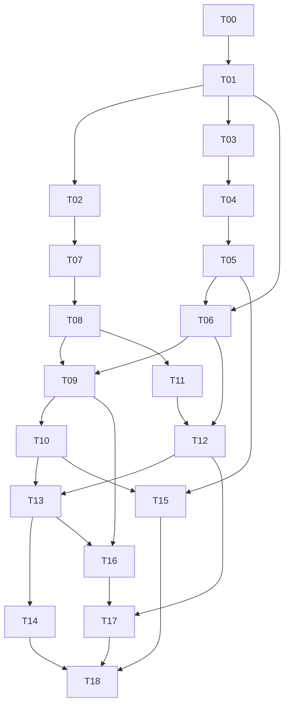

# AnatoBind-MRI v5.1 增量实施计划

> **For agentic workers:** REQUIRED SUB-SKILL: Use superpowers:subagent-driven-development (recommended) or superpowers:executing-plans to implement this plan task-by-task. Steps use checkbox (`- [ ]`) syntax for tracking.

**Goal:** 在已审查的 v4.1 实现上，交付同一观察、同一 checkpoint 的 A/U/S/核心 R 统一输出，并建立独立参照、二维/三维八项能力及范围化科学结论的可执行验收链。

**Architecture:** 保留 `anatobind/v41/` 代码包与既有安全运行设施，以版本化适配层新增 v5.1 契约、正负资格、固定参照评价和状态输出。先形成评价与模块运行闭环；专家参照、H1/H2、双模式按依赖推进；锁定阶段实际运行多个预登记方法，而不是接收调用方自报结果。

**Tech Stack:** 已核验 Python 3.11.15、PyTorch 2.5.1+cu121、NumPy 2.4.4、SciPy 1.17.1、nibabel 5.4.2、h5py 3.16.0、pytest 9.1.1；现有 PyYAML。SQLite 使用 Python 标准库；不执行 pip/conda 升级，不新增运行时包依赖。

**Spec:** [Proposal_v5.md](Proposal_v5.md)，v5.1，2026-11-03；本分支附带从 `d7cbd5b` 原样取得的副本，SHA256 为 `b25b0e1beae512320b29beeba2b0eac367cf62e94304d70c28100da1fb006dbf`。其 §1–12 是本计划的科学依据。旧根目录 `spec.md` / `plan.md` 继续解释 v4.1，不覆盖本计划的 v5.1 规则；不回写旧结果。

**Execution base:** `02a2447219612f9bf060c41b94388647708f17c2`，原 `v41-implementation` 已审查代码。上游旧 `plan_v5.md` 的审计基线是 `9bef283`，不能据其 TODO 重做本地已完成工程。本计划保留 T00–T18 以对应 Proposal 的追踪表，并用实际代码更新工作范围。

**Planning status:** 本文件仅为待执行计划。v4.1 的历史最终结果为 1094 passed / 1 skipped；它不是 v5.1 验收结果。本轮只核对源码、环境和小型合成探针，未实施以下任务、训练、发布专家参照或解封测试。

## Global Constraints

1. 原始数据和旧派生只读；新医学数据、逐例记录、权重、预测、读者材料仅写获准的 `$PRIVATE_ROOT` 独占版本，目录 700、文件 600；不改既有目录权限，不覆盖旧版本。
2. Git 只接纳代码、合成测试、脱敏汇总和模板；无真实路径、病例标识、原始 manifest、医学数组或凭据。提交仅暂存列出的文件并扫描完整暂存内容，运行 `git diff --cached --check`；禁止 `git add .`。
3. 人工批准只能由实际负责人填写。模板的临床定义、阈值、范围、读者、资源、独立性和解封签核保持 null，不能由 Agent、测试 fixture 或历史报告补值。
4. 任务只要求本次 scope 必需的证据；A-only 不等待 U/H3，H2 不等待 SKM 精标，H1 锁定不等待无关 H3。批准缺失保留 blocker，不停止无依赖的软件工作。
5. 每个正式 run 绑定 `ActiveScope`、实际模态、观察模式、版本化参照/可见性政策、源代码、本体、数据与模型哈希；未知状态不得自动迁成已批准或 visible。
6. 推理只接收影像、valid_fov、合法几何/模式；资格、GT、读者图、真实组织身份和隐藏参照只在训练或评价角色使用。A 不确定不能删除 U 或把异常变正常。
7. `annotation_unknown`、`not_observable`、`predictive_uncertain` 分开。observable_target 与 released_reference 两条轨道显式登记；后者不能产生全范围可观察或正常排除主张。
8. 正/负监督按任务、类别、复核区域、可见性、FOV 和 padding 组合。框不产生密集正负真值；positive-only 不给阴性；pseudo 与人工通道分开，不作为专家评价参照。
9. 患者是独立统计单位。参照集合在预测前固定；漏检、拒判、空关系不能删分母。空分母返回 None；病灶池化仅作为另名次要统计。
10. 同患者、回波、随访和派生组不跨划分；曝光 unknown 不因重命名、重新初始化或换随机种子而消失。试点与独立锁定队列隔离。
11. 正式 H3 非劣要求预注册差异区间越过负容差，不能用 p>0.05 或单独点估计证明。训练种子、bootstrap 次数和临床容差均须正式登记；17/29/43、2000、0.95 只是来源中的候选。
12. CPU 构建器仅 seed CPU generator；CUDA 只捕获/恢复已分配设备。需要 GPU 时刷新可见设备、当前利用率、显存和进程，优先合规空闲设备，保持既有负载和调度分配。
13. 模块复用在原包内完成，不复制整包，不动态导入另一 checkout；旧 v41 数据/协议/权重不通过补版本号冒充 v5.1。T01–T18 分别登记代码、测试、真实运行、批准和科学状态。
14. 正式 run 越权、NaN、OOM、预算耗尽均停止并存证；不无限重试。合成 checkpoint 和测试签核显式标为 fixture，不作为真实训练或解封依据。
15. 已选择原生 subagent 执行模式；实施时新任务使用新的 coder 和 reviewer，独占写文件，同一修复复用原代理。最多三个并发子线程、实质审查修复最多三轮；本次撰写只做计划自检，不调度实现。
16. 本次写计划不授权新的代码推送、外部数据下载、临床定义变更或真实测试解封。已批准预算和资源可按其范围执行，不重复索取已有授权。

## Review Focus

| 高风险输入或条件 | 预期行为与责任测试 |
| --- | --- |
| A 拒判但 U 有已接受阳性；另一 U 类拒判 | U/实例保留；阳性不被抹去，不能凭缺类判正常；T09/T13 |
| 漏检、无预测关系、全拒判或错误预测 A | J 与 S 的参照分母不变；不能靠拒判/裁预测组织提高结果；T04/T06 |
| 六个低 IoU 合格匹配对五个高 IoU 匹配 | 必须先得到最大配对数 6，再优化 IoU 与稳定次序；T03 |
| 不同 mode/scope/grid/checkpoint 的数组或只有六格证据 | 联合输出拒绝混合；3D-S 不填 2D-S，缺 S 不通过八格；T01/T16/T17 |
| 部分复核裁出人工表面、缺物理几何、二维要求体积 | 不伪造毫米表面/体积；记录 NA、覆盖和原因，其他合法指标继续；T06/T07/T13 |

## 0. 接手依据与工作边界

### 0.1 本轮已经观察到的差异

| 模块 | `02a2447` 的事实 | v5.1 处理 |
| --- | --- | --- |
| 登记、受控读取、训练/恢复、设备准入 | 已有实际实现及合成 CLI 测试；双模式设备入口已修复 | T09 适配，不重建训练器 |
| 融合、实例头、双模式、专家发布、H2 隔离 | 均有实现，真实专家与科学操作仍阻塞 | T11/T13/T15/T16 复用并验证新契约 |
| 患者 bootstrap | 不均衡 100:1 行数的探针得到患者均值 0.5 | T05 保留等权，补显式配对、种子聚合与可变置信水平 |
| 实例匹配 | 六对反例当前返回 5；代价仍是 `-(2+IoU)` | T03 必须修复最大基数优先；不因 docstring 声称正确就复用 |
| 联合分母 | 两个真实有参照病灶，漏检行 relation_ok=None 时旧接口分母为 1 | T04 独立冻结 ReferenceLesion，废除以预测值判断参照存在 |
| 状态、核心关系、八格完成 | 无统一 v5.1 输出或直接 S 评价 | T01/T06/T09/T13/T17/T18 新增 |
| 表面指标 | 旧 NSD 是无权距离比例；当前未安装 surface-distance | T06 固定参考源码，保留旧 metric_version |
| 解封与证书 | 已有永久 claim、跨进程重放、本体与 READY 绑定、完整合成 R_geo 链 | T18 保留安全性质，改为相关 scope 的多方法批次与组级曝光账本 |

以上是规划核对，不是已执行 T00 或 v5.1 PASS。未重读真实医学数据，未重跑旧实验。

### 0.2 文件结构与职责

所有 Python 路径均从仓库根开始；新增模块保持一个职责，既有大文件只增加薄入口。

| 新增或适配位置 | 责任 |
| --- | --- |
| `contracts_v5.py`、`migration_v5.py` | v5.1 内存类型/验证及显式旧记录迁移 |
| `gates_v5.py` | 按任务与 scope 的证据/批准需求；不混入运行或评分 |
| `evaluation/{reference,policy,state,surface_v5,capability}.py` | 固定参照、必要指标政策、直接 S、表面适配和八格规则 |
| `perception.py`、`perception_io.py` | 无 GT 的 S 组合与统一输出；受限原子落盘/回读 |
| `access_v5.py`、`observations_v5.py`、`engine/{registration_v5,trainer_v5,inference_v5}.py` | v5.1 数据/运行适配；调用现有受控读取、优化器、恢复和滑窗 |
| `annotation_v5.py`、`reference_release_v5.py` | 既有标注包与新可见性/StateReference/核心 R 参照的桥接 |
| `experiments/{h1_v5,h2_v5,h3_v5}.py` | 新版实验和冻结评价绑定，旧 H1/H2/H3 行为保持版本化 |
| `engine/locked_v5.py`、`evidence_store_v5.py`、`evidence_v5.py` | 实际锁定批次、事务性一次 claim/曝光、受控证书与公共结论 |
| `schemas/v5/*.schema.json`、`configs/v5/*.yaml` | 封闭契约和空签核模板；schema 目录 v5、版本值 v5.1 |
| `tests/v5/`、`reports/v5/` | 合成新测试、实际状态与脱敏证据；不复制既有测试/私有材料 |

上表省略的 Python 前缀统一为 `anatobind/v41/`。不得创建第二个完整模型包。

### 0.3 全局接口和数组约定

- `SampleV5`/`AnnotationV5`：显式包含旧记录字段及 scope、reference_policy、annotation_modalities/model_modalities、visibility_evidence/region、index/physical geometry status；`schema_version='v5.1'`。`migrate_v41` 不修改传入对象，不猜患者、可见性、临床范围或物理几何。
- `ActiveScope`：Proposal §2.2 的全部字段，含非空的 joint 目标类别和 state_anatomy_classes、relation_contract；模块 scope 可以明确禁用 U/S/R。契约记录版本与规范 JSON hash。
- `PerceptionOutput`：Proposal §2.1 全部字段，`output_kind='joint'`、`output_version='v5.1'`；A/S 为 `[Z,Y,X]` 或 `[Y,X]`，U/逐类接受为 `[C,*spatial]`；A 组织 ID 背景 0、未接受 -1；S 为 0/1/2，分别表示目标阴性/阳性/不可评价。
- `ModuleOutput`：`output_kind='module'`、同版本及来源绑定，`enabled_tasks/disabled_tasks` 与类型化 predictions 一致；缺失任务 disabled，不能生成假 S/R 或进入 joint gate。
- 数组内存为 ndarray；磁盘字段使用封闭 `ArrayRef={path,sha256,shape,dtype}`，经 `perception_io` 受控读写。不是把 ndarray 塞进 JSON，也不是只存无校验字符串路径。所有字段共享 observation/mode/grid/scope/checkpoint/state_policy 身份。
- `StateReference`：Proposal §4.1 的九个字段；`ReferenceLesion` 含 patient_uid、instance_uid、明确的 A/U/R 可用性、eligibility、visibility、排除原因、truth_relation_set 与 reference_set_hash。空关系集合与缺关系参照不同。
- `LesionOutcome`：reference_instance_uid、detected、extent_ok、relation_correct、accepted、prediction_status；没有 outcome 的有参照病灶算未成功，不产生删参照权限。
- `PatientContrast`：patient_uid、method_value、comparator_value、delta、seed_policy_id；每患者一行。CompletionDecision 使用 Proposal §11 的八格状态、可空 core_target_validated、三项假设状态、study_package_complete、证据和 blockers。
- v5.1 Batch：`image,valid_fov,a_target,u_target,e_a_pos,e_a_neg,e_u_pos,e_u_neg,metadata`，训练 `[B,C,D,Y,X]`；二维输入只接收当前平面，在内部变为 D=1；缺任务返回零资格而非补背景。
- `reason` 为封闭bitset-v1编码：anatomy/state为uint8空间图，abnormality为uint8类别空间图，relations按instance_uid记录位集；out_of_fov=1、out_of_scope=2、anatomy_uncertain=4、abnormality_uncertain=8、input_insufficient=16，可按位组合。内存数组/磁盘ArrayRef沿用同一编码，0表示无拒判原因；不能加入annotation_unknown。
- `identity` 参数只含 observation_uid、mode、scope_id/hash、checkpoint_sha256、state_policy_hash 和部署来源哈希；不得放入 GT、review、可见性真值或 patient-level 参照。
- 临床语义资格、真值资格与部署拒判分开；不要把 annotation_unknown 编入预测状态 S。

### 0.4 验证、证据和提交约定

核验已有解释器后设置 `$PY`；不在公共文档写真实解释器路径。下文 `pytest_cpu` 是以下 shell 函数，每个新 shell 先定义它：

```bash
pytest_cpu() {
  env PYTHONNOUSERSITE=1 CUDA_VISIBLE_DEVICES= PYTHONPATH=. \
    "$PY" -m pytest -q -p no:cacheprovider "$@"
}
```

CPU 验证清空可见设备仅用于测试，不作为正式 GPU 训练的资源绕过手段。每项先运行列出的目标红测；已有正确功能只做回归，不人为破坏来制造红测。再最小实现、受影响回归、独立审查、指定文件提交。最终运行 `pytest_cpu tests/v41 tests/v5`；不因一次既有检查通过就无变化重复全库。

所有任务产物记录 task_id/code_status/test_evidence/data_run_status/approval_status/scientific_conclusion/input_hashes/output_hashes/command/exit_code/blockers/next_task。未运行的能力初始 NOT_EVALUATED，core=null，study=false；缺专家以 blocker_code=BLOCKED_EXPERT_REVIEW 表示，不伪造新状态枚举。

## 1. 依赖与可交付阶段



图中 T18 的三条 READY 输入按所选批次取必要子集，不是同时等待全部。依赖箭头首先表示软件接口前置；真实队列与批准是相应 data_run 的额外gate，不能据此阻止下游合成软件实现。T16 的基础单层边界测试可在 T09 后先做；接入完整 S/R 待 T13。T11 专家协调/只读准备可在软件接口前并行，真实导出仍依赖合格冻结与几何。并行任务共享文件时由父代理串行交接，禁止两个 coder 同时写它。

- 阶段 A（T00–T06）：契约、严格资格、可靠评价，可独立验收。
- 阶段 B（T07–T10）：合法模块数据/登记/训练闭环，真实运行按批准条件放行。
- 阶段 C（T11–T14）：合格同例参照、S 与核心 R 部署、H1_READY。
- 并行支线（T15、T16）：H2 与双模式工程，不能替代同例科学证据。
- 最终阶段（T17–T18）：八项能力与相关范围的实际锁定评价、证据和完成判定。

## 2. 分任务实施

### T00：冻结接手基线与增量清单

**Files:** Create `reports/v5/status.md`、`reports/v5/traceability.md`；只读核对现有代码、历史证据、环境和 Git 状态。
**Interfaces:** 产出带输入 commit/spec hash 的任务映射表和私有 task_record，不新增训练接口。

- [ ] Step 1：记录实际 HEAD、starting diff、Proposal hash；必须确认包含 `02a2447` 的已审查实现，或逐项解释代码差异，不能拿远端旧基础包代替本计划基线。
- [ ] Step 2：将本计划 §0.1 的“已存在/需增量/需重验/真实阻塞”映射到实际函数与测试；核对25项历史记录，不重新触发旧审计/训练。
- [ ] Step 3：检查解释器版本、已有依赖、存储读写边界；不读取凭据内容、不初始化 GPU、不将原始路径和病例值写公共状态。
- [ ] Step 4：状态文档必须包含 `code_status`、`data_run_status`、`approval_status`、`scientific_conclusion`；v5.1 初始科学状态仍为 NOT_EVALUATED，历史1094通过标为历史而非新运行。
- [ ] Step 5：运行 `git diff --check`，核对文档无敏感字段；只提交两份状态文档：`git add reports/v5/status.md reports/v5/traceability.md`；commit `Record v5.1 migration baseline and evidence gaps`。


**关键断言契约：** 以下变量由本任务步骤明确的合成输入及真实待测调用产生；将其写入同名测试，不使用裸常量替代被测输出。
```python
# test_historical_evidence_not_v51_pass
assert status['scientific_conclusion'] == 'NOT_EVALUATED'
assert status['core_target_validated'] is None
```

**Acceptance:** 后续执行者能判断复用哪些代码、哪些真实操作仍阻塞；不将文档发布写成软件或科学验收完成。

### T01：封闭 v5.1 契约、迁移与任务级 gate

**Depends:** T00。
**Files:** Create `anatobind/v41/{contracts_v5,migration_v5,gates_v5}.py`；Create `schemas/v5/{sample,annotation,scope,reference,state_reference,outcome,array_ref,perception_output,module_output,completion,run,approval,gate,locked_batch,state_policy,metric_policy,capability_policy,visibility_policy}.schema.json`；Create `configs/v5/{scope_isles_u,scope_skm_a,scope_skm_joint,policy_observable,policy_released_reference,state_policy.template,capability_policy.template,approvals.template}.yaml`；Create `tests/v5/{__init__,factories,test_contracts_gates}.py`。
**Interfaces:** `validate_contract_v5(kind: str, record: dict)->dict`（kind固定为本任务schema枚举，禁止任意路径/远端ref）；`validate_sample_v5(record: dict)->SampleV5`、`validate_perception_output_v5(output: dict)->PerceptionOutput`、`validate_module_output_v5(output: dict)->ModuleOutput` in contracts；`migrate_v41(record: dict, decisions: dict)->SampleV5` in migration；`evaluate_gate_v5(gate_id: str, scope: ActiveScope, evidence: dict, approvals: dict)->dict` in gates。

- [ ] Step 1：定义合成工厂 `make_scope(**overrides)`、`make_sample(**overrides)`、`make_annotation(**overrides)`、`make_joint_output(**overrides)`、`make_policy(kind: str, **overrides)`，集中在 factories.py。仅合成 tissue_a/tissue_b、target_a/target_b；人名/签核使用显式 synthetic-fixture；I/O 测试哈希来自实际临时字节。后续任务按所属契约扩展工厂，不能引用未定义 fixture。
- [ ] Step 2：写失败测试，固定如下断言：
  ```python
  def test_joint_requires_state_and_identity():
      output = make_joint_output()
      output.pop('tissue_state_map')
      with pytest.raises(ValueError): validate_perception_output_v5(output)
  # 另测 scope/mode/grid/checkpoint 不一致、GT/review 字段、未知字段拒绝；
  # 合法 module 禁用 S/R 可通过 module 验证，但 joint gate 必须 BLOCKED。
  ```
  另测 accepted 质量与 adjudicated 仲裁分开；旧可见性缺失迁为 unknown；A-only 不因 U签核/near_mm/H3容差缺失而阻塞；仅 auxiliary_spatial 不可通过核心 R；S/能力/假设/研究完成字段不能互代。
- [ ] Step 3：Run `pytest_cpu tests/v5/test_contracts_gates.py`，确认缺新接口或目标语义失败；不要把 import 环境错误当预期反例。
- [ ] Step 4：实现 §0.3 类型和内存/磁盘双形态验证、显式迁移与 gate 需求表。G-DATA/G-BASE-A/G-BASE-U/G-ANNOTATION/G-JOINT/G-H2/G-H3-ENG/G-H3-SCI/G-LOCKED 仅检查 Proposal §9 对应必需证据；所有模板真实签核/临床阈值 null。
- [ ] Step 5：Run `pytest_cpu tests/v5/test_contracts_gates.py tests/v41/test_schema.py tests/v41/test_registry.py`。证明输入旧字典未修改、未知键报错不回显值；测试记录的迁移不是正式数据发布。
- [ ] Step 6：逐项git add本任务三个模块、逐个schema、逐个配置及三个tests/v5文件（不得git add目录或通配）；commit `Add strict v5.1 contracts and scoped admission gates`。

**Acceptance:** 各后续任务使用同一套闭合字段与版本；scope 不是总本体，数组/模型身份不可拼接；不复制旧 schema 后只改版本号。

### T02：严格正负资格与真实损失路径

**Depends:** T01。
**Files:** Modify `anatobind/v41/{eligibility,losses}.py`；Create `tests/v5/test_eligibility_gradients.py`；Modify `tests/v5/factories.py` 的资格用例。
**Interfaces:** `build_eligibility_v5(record: SampleV5, task: str, classes: list[str], targets: dict, review_regions: dict, visibility_regions: dict, valid_fov: np.ndarray, policy: dict, channel: str)->tuple[np.ndarray,np.ndarray]`；`masked_objective_v5(logits, target, e_pos, e_neg, task_spec: dict)->torch.Tensor`；旧入口保持 legacy 兼容。

- [ ] Step 1：写8体素用例：unknown/unobservable 在 observable_target 下正负资格与梯度全0；limited 仅独立可见区域有效；padding 即使 target_complete 也无资格。两类 positive-only `[1,2]` 必须产生 c1正支持`[1,0]`、c2`[0,1]`且负资格全0，无类别映射拒绝。
- [ ] Step 2：写 pseudo_only 仅显式 pseudo 通道可用、专家评价拒绝；released_reference 的 unknown 仅绑定批准政策才可监督，字段仍 unknown，不生成可靠正常主张。Run `pytest_cpu tests/v5/test_eligibility_gradients.py`，记录目标失败。
- [ ] Step 3：实现任务/类/区域/visibility/FOV 的资格交集与人工/pseudo 分路。U 用 masked BCE/Dice；互斥 A 用 softmax CE/Dice，背景仅完整 A6/合格全类别支持；不经原合并资格入口丢掉正负符号。
- [ ] Step 4：测 ignore logit 扰动不改 loss、支持0不稀释、全ignore graph-connected有限零、零权重与非有限输入明确拒绝；不能重新引入 `sum()*0` 溢出问题。
- [ ] Step 5：Run `pytest_cpu tests/v5/test_eligibility_gradients.py tests/v41/test_eligibility_losses.py tests/v41/test_h2_arms.py`；逐类人工/pseudo支持独立统计。
- [ ] Step 6：`git add anatobind/v41/eligibility.py anatobind/v41/losses.py tests/v5/test_eligibility_gradients.py tests/v5/factories.py`；commit `Add visibility-aware signed supervision for v5.1`。


**关键断言契约：** 以下变量由本任务步骤明确的合成输入及真实待测调用产生；将其写入同名测试，不使用裸常量替代被测输出。
```python
# test_positive_only_is_class_specific
assert e_pos[:, 0].tolist() == [True, False]
assert e_pos[:, 1].tolist() == [False, True]
assert not e_neg.any()
```

**Acceptance:** 正式 v5 入口不能绕回宽松 legacy 资格；positive-only 不跨类，复核/可见区域不能通过预测生成。

### T03：最大基数优先的确定性一对一匹配

**Depends:** T01。
**Files:** Modify `anatobind/v41/evaluation/instances.py`；Create `tests/v5/test_matching_cardinality.py`。
**Interfaces:** `match_instances_v5(pred: list[dict], truth: list[dict], policy: dict)->list[tuple[int,int]]`；索引对仍可供 detection_counts 使用，ID 用于稳定平局。

- [ ] Step 1：以六个长度100的真值区间 `100*i:100*i+100` 和预测区间 `100*i+80:100*i+180` 构造 `[680,1,1]` mask，i=0..5、阈值0.1；断言匹配数6。现有 match_instances 探针为5，保留其历史结果，不重命名成新指标。
- [ ] Step 2：Run `pytest_cpu tests/v5/test_matching_cardinality.py`；另测类别不符、重复预测、分裂/合并、空集、阈值边界、0/NaN/大于1阈值、shape不符；非法政策即使空输入也拒绝。
- [ ] Step 3：采用两阶段优化：先最大合格匹配数，再在该基数下最大 IoU，最后稳定 ID 顺序；若使用线性分配权重，固定 `M=min(n_pred,n_ref)+1` 并证明基数优势，平局不得扰动前两级最优。
- [ ] Step 4：对最多4×4合成允许图穷举所有匹配，逐项核对基数/IoU/稳定顺序；输入重排后比较 ID 对而非数组位置。
- [ ] Step 5：Run `pytest_cpu tests/v5/test_matching_cardinality.py tests/v41/test_metrics.py tests/v41/test_hardening_metrics.py tests/v41/test_relation_pipeline.py`；v5 评分必须显式调用新入口。
- [ ] Step 6：`git add anatobind/v41/evaluation/instances.py tests/v5/test_matching_cardinality.py`；commit `Add cardinality-first instance matching with stable ties`。


**关键断言契约：** 以下变量由本任务步骤明确的合成输入及真实待测调用产生；将其写入同名测试，不使用裸常量替代被测输出。
```python
# test_six_eligible_matches_beat_five_high_iou
assert len(pairs) == 6
assert len({i for i, j in pairs}) == len({j for i, j in pairs}) == 6
```

**Acceptance:** 六对反例与穷举 oracle 都通过；不能降低阈值或改输入真值来获得6对。

### T04：冻结参照与预测结果分离的联合评价

**Depends:** T01、T03。
**Files:** Create `anatobind/v41/evaluation/reference.py`；Modify `anatobind/v41/evaluation/{joint,relations}.py`；Create `tests/v5/test_joint_reference_denominator.py`；Modify factories 的独立参照工厂。
**Interfaces:** `freeze_reference_set(refs: list[ReferenceLesion], policy: dict)->dict`；`joint_score_v5(refs: list[ReferenceLesion], outcomes: list[LesionOutcome], reference_hash: str)->dict`；`relation_scores_v5(refs: list[ReferenceLesion], outcomes: list[dict], policy: dict)->dict`。

- [ ] Step 1：固定两个 eligible 且 R 可用的病灶，仅一个成功；断言 `j_denominator==2`、`patient_mean_j==0.5`。将第二个 outcome 置缺失、漏检、拒判或无关系，分母仍2；禁止用 relation_correct=None 推断参照不存在。
- [ ] Step 2：测 `truth_relation_set=[]` 且可用与 `r_reference_available=False` 分别计数；无病灶患者不进阳性 J、进入独立 FP/特异性统计；空 J 返回 None。Run `pytest_cpu tests/v5/test_joint_reference_denominator.py`。
- [ ] Step 3：实现预测前 canonical 参照 hash；对 refs 中固定 G_i 汇总。未知/重复 ID、错 reference_hash 拒绝；缺 outcome 计失败。分项 U/参照覆盖照常报告，无 R 不删除整个病例。
- [ ] Step 4：提供 patient_mean_j、lesion_pooled_j、每患者分子分母、排除原因与参考覆盖；关系正确性使用明确谓词/集合，不把空集合等同无标注。
- [ ] Step 5：Run `pytest_cpu tests/v5/test_joint_reference_denominator.py tests/v41/test_metrics.py tests/v41/test_hardening_metrics.py tests/v41/test_evidence_release.py`；旧 joint_score 保留旧版本，不静默改写历史报告。
- [ ] Step 6：`git add anatobind/v41/evaluation/reference.py anatobind/v41/evaluation/joint.py anatobind/v41/evaluation/relations.py tests/v5/test_joint_reference_denominator.py tests/v5/factories.py`；commit `Separate frozen reference availability from prediction outcomes`。


**关键断言契约：** 以下变量由本任务步骤明确的合成输入及真实待测调用产生；将其写入同名测试，不使用裸常量替代被测输出。
```python
# test_missing_outcome_keeps_frozen_denominator
assert result['j_denominator'] == 2
assert result['patient_mean_j'] == 0.5
assert result['reference_set_hash'] == frozen['reference_set_hash']
```

**Acceptance:** 预测全退化也不改变 reference_set_hash/G_i；参照字段中不能出现模型预测或置信度。

### T05：患者配对、种子聚合与可配置置信区间

**Depends:** T04。
**Files:** Modify `anatobind/v41/evaluation/statistics.py`；Create `tests/v5/test_patient_statistics.py`。
**Interfaces:** `make_patient_contrasts(method_rows: list[dict], comparator_rows: list[dict], policy: dict)->list[PatientContrast]`；`paired_patient_bootstrap_v5(rows: list[PatientContrast], seed: int, n_boot: int, ci_level: float)->dict`；`seed_variation_v5(rows: list[dict], policy: dict)->dict`。

- [ ] Step 1：保持已有等权行为：患者一100病灶值1、患者二1病灶值0，断言患者估计0.5，另名池化100/101；重复同患者等值记录不能改患者均值。
- [ ] Step 2：新增红测：方法/对照须按 patient/scan/seed 配对，先每患者每seed按固定参照合并扫描，再对预注册 seeds 等权，最后每患者一行 delta。缺配对/重复行/缺seed不得静默丢弃，seed不能增加n_patients。
- [ ] Step 3：Run `pytest_cpu tests/v5/test_patient_statistics.py`；实现新入口，复用现有 RNG/bootstrap 结构。`n_boot<=0`、`ci_level`不在(0,1)、非有限delta拒绝；空输入 estimate/ci 为 None。
- [ ] Step 4：输出 `estimate,ci,ci_level,n_patients,n_boot,seed,statistic_version`；置信界取 `(1-ci_level)/2` 与其补数；不沿用硬编码ci95键冒充其他置信水平。种子变异单列，不另当患者重复抽样。
- [ ] Step 5：Run `pytest_cpu tests/v5/test_patient_statistics.py tests/v41/test_hardening_metrics.py tests/v41/test_h1_protocol.py tests/v41/test_h2_evaluation.py`；保持旧调用兼容，注明未运行新的科学统计。
- [ ] Step 6：`git add anatobind/v41/evaluation/statistics.py tests/v5/test_patient_statistics.py`；commit `Add explicit patient contrasts and registered interval policies`。


**关键断言契约：** 以下变量由本任务步骤明确的合成输入及真实待测调用产生；将其写入同名测试，不使用裸常量替代被测输出。
```python
# test_unequal_lesion_counts_preserve_patient_mean
assert result['estimate'] == 0.5
assert result['n_patients'] == 2
assert len(contrasts) == 2
```

**Acceptance:** 主 J 的点估计和区间针对同一个患者等权目标；行数、病灶、回波和训练种子不能扩增独立n。

### T06.a：任务级指标政策与可信表面度量

**Depends:** T01；与T06.b可独立审查。
**Files:** Create `anatobind/v41/evaluation/{policy,surface_v5}.py`、`anatobind/v41/_vendor/{__init__.py,surface_distance/__init__.py,surface_distance/metrics.py,surface_distance/lookup_tables.py,surface_distance/LICENSE,surface_distance/SOURCE.json}`、`configs/v5/metrics.template.yaml`、`tests/v5/test_metric_policy.py`；Modify `anatobind/v41/evaluation/{segmentation,selective}.py` 与所需工厂。
**Interfaces:** `validate_metric_policy(task: str, stage: str, policy: dict)->dict`；`segmentation_metrics_v5(pred,truth,eligible,geometry: dict,policy: dict)->dict`；`normal_state_metrics_v5(rows: list[dict], policy: dict)->dict`。

- [ ] Step 1：写 A-only Dice 无 near_mm/H3容差仍可评价；缺物理几何 HD95/NSD 为 None 并记原因，不能把无关 null 传播成所有任务失败。真空GT、无合格区域、单边空、全padding分别计数。
- [ ] Step 2：写各向异性2D/3D面积权重反例、partial-review裁边反例和两个false-normal分母手算例；全拒判风险None、覆盖0。Run `pytest_cpu tests/v5/test_metric_policy.py`。
- [ ] Step 3：将Google DeepMind surface-distance固定在commit `1f805cea446805e559badc80dd27f34175e4173d`；仅按上述路径原文复用该包的初始化、metrics、lookup_tables及Apache-2.0许可证，SOURCE.json记录commit和实际文件SHA。保留归属/NOTICE（若源版本提供）；不pip安装、不依赖master漂移。来源：[官方源码](https://github.com/google-deepmind/surface-distance/tree/1f805cea446805e559badc80dd27f34175e4173d)。
- [ ] Step 4：surface_v5薄适配调用compute_surface_distances、compute_surface_dice_at_tolerance、compute_robust_hausdorff(percent=95)。metric_version绑定源码版本、面积/长度权重、两向最大加权分位数和空值约定；v5单边空返回None并记失败，不直接公开inf。
- [ ] Step 5：partial review采用保守正式政策：任一mask触及不可评价区域的1格邻域时，该例表面距离None/SURFACE_REFERENCE_INCOMPLETE；保留区域Dice与表面覆盖。禁止先裁mask再当真实边界。与固定原文参考函数在完整合格2D/3D形状上差分，容差`rtol=1e-10,atol=1e-10`。
- [ ] Step 6：Run `pytest_cpu tests/v5/test_metric_policy.py tests/v41/test_metrics.py tests/v41/test_hardening_metrics.py`；旧结果标旧metric_version不重算。逐文件暂存本任务列出的surface适配、vendored文件、policy、两项原模块、测试和模板；commit `Add scoped metric policies and versioned surface measures`。


**关键断言契约：** 以下变量由本任务步骤明确的合成输入及真实待测调用产生；将其写入同名测试，不使用裸常量替代被测输出。
```python
# test_unknown_geometry_does_not_block_dice_or_invent_mm
assert metrics['dice'] == 1.0
assert metrics['hd95_mm'] is None
assert metrics['surface_reason'] == 'PHYSICAL_GEOMETRY_UNKNOWN'
```

**Acceptance:** 无权边界比例不冒充正式NSD；unknown物理几何不造毫米；参考源码未能核验时对应表面指标阻塞，不安装替代包冒充通过。

### T06.b：独立 StateReference 与直接组织状态评价

**Depends:** T01、T04、T05、T06.a。
**Files:** Create `anatobind/v41/evaluation/state.py`、`tests/v5/test_tissue_state_metrics.py`；Modify `configs/v5/capability_policy.template.yaml`、factories。
**Interfaces:** `build_state_reference_v5(record: SampleV5, reference_arrays: dict, scope: ActiveScope)->StateReference`；`tissue_state_metrics_v5(pred: PerceptionOutput, reference: StateReference, policy: dict)->dict`，返回reference_count、per_tissue_state[tissue][state]的充分统计/度量、参照区域u_dice、覆盖/拒判/患者摘要。

- [ ] Step 1：合成A/U均合格、C完整、已复核/可见/FOV交集内可派生状态阴性；positive-only、未复核、范围外不能为正常。二维ref必须独立单层可判读，3D资格不能自动继承。改变预测不改变reference_set_hash。
- [ ] Step 2：写 `test_correct_u_wrong_a_fails_joint_state`：U正确、A组织身份全错时U结果保留，对应组织—状态联合召回0；预测把难例组织改范围外仍保留GT分母。写 `test_rejection_keeps_state_denominator`：全拒判使覆盖0、接受风险None，S不通过。
- [ ] Step 3：Run `pytest_cpu tests/v5/test_tissue_state_metrics.py`；按 Proposal §8.5 固定G_kz/P_kz，输出每组织/状态的TP/FP/FN、Dice/precision/recall、正常FP、false-normal、拒判原因和参照支持。空类None，不补0/1。
- [ ] Step 4：患者内按冻结组织/状态权重汇总，再调用T05形成患者等权统计。与部署S组合模块无反向依赖；部署入口不能导入本参照构造器。
- [ ] Step 5：Run `pytest_cpu tests/v5/test_tissue_state_metrics.py tests/v5/test_patient_statistics.py tests/v41/test_metrics.py`；模板中的required_tissues/required_states/min_reference_support/metric_bounds/min_coverage/uncertainty_rule均需显式冻结，真实值null。
- [ ] Step 6：`git add anatobind/v41/evaluation/state.py tests/v5/test_tissue_state_metrics.py tests/v5/factories.py configs/v5/capability_policy.template.yaml`；commit `Evaluate tissue identity and state against frozen references`。


**关键断言契约：** 以下变量由本任务步骤明确的合成输入及真实待测调用产生；将其写入同名测试，不使用裸常量替代被测输出。
```python
# test_correct_u_wrong_a_fails_joint_state
assert result['u_dice'] == 1.0
assert result['per_tissue_state']['tissue_a']['target_positive']['recall'] == 0.0
assert result['reference_count'] == reference_count_before
```

**Acceptance:** 多数正常体素的总体准确率、J上升或接受集风险改善，都不能替代必需组织/状态直接达标。

### T07：来源、双轨可见性与真实空间链

**Depends:** T01、T02、T06.a；真实数据只读核验按已有访问授权。
**Files:** Create `anatobind/v41/source_policy_v5.py`、`configs/v5/sources.yaml`、`tests/v5/test_source_visibility_geometry.py`；Modify `adapters/{isles,skm}.py`、`{geometry_qc,audits,ontology}.py` 的薄适配。
**Interfaces:** `audit_source_v5(records: list[SampleV5], source_policy: dict)->dict`；`resolve_geometry_chain(record: SampleV5)->dict`；`validate_visibility_policy_v5(record: SampleV5, policy: dict)->dict`。

- [ ] Step 1：写同shape但翻轴/仿射错配不通过、缺仿射只可获索引证据、unknown单位不能静默改header；E1/E2—H5seg—独立参照轨道—框必须有显式变换证据。
- [ ] Step 2：写ISLES annotation_modalities与model_modalities分列，三序列辅助专家标签不能自动证明双序列可见；两轨道分别计数，released_reference许可不把unknown改visible。Run `pytest_cpu tests/v5/test_source_visibility_geometry.py`。
- [ ] Step 3：实现源政策和几何证据分级；标签保留NIfTI scaling、近整数容差`1e-5`，拒绝概率图；不从标签头获取推理影像几何。历史被截断/全零资产须从原源创建新导出，不能修header伪造一致。
- [ ] Step 4：在获准读取时只读检查版本/哈希/模态配对/原图—标签变换，私有叠加样例含小病变、边缘、变形；不可读则data=NOT_VERIFIED，不重复旧2288文件审计冒充新空间证据。
- [ ] Step 5：Run `pytest_cpu tests/v5/test_source_visibility_geometry.py tests/v41/test_geometry_labels.py tests/v41/test_geometry_qc.py tests/v41/test_adapters_pairing.py tests/v41/test_p1_adapters.py`。匿名汇总区分索引可靠与物理可靠，P1原始整数不变成细解剖GT。
- [ ] Step 6：仅暂存本任务列明的source政策模块、3份配置/测试及实际改动的两适配器/三个原模块；commit `Separate reference visibility from model inputs and geometry evidence`。


**关键断言契约：** 以下变量由本任务步骤明确的合成输入及真实待测调用产生；将其写入同名测试，不使用裸常量替代被测输出。
```python
# test_index_alignment_is_not_physical_geometry
assert report['index_alignment_status'] == 'verified'
assert report['physical_geometry_status'] == 'unknown'
assert record['annotation_records'][0]['input_visibility'] == 'unknown'
```

**Acceptance:** 对应来源/任务可独立准入；SKM缺物理几何不妨碍合规索引基线，但不能产生毫米、方向或患者坐标结论。

### T08：模型谱系曝光、患者组与正式划分

**Depends:** T01、T07。
**Files:** Create `anatobind/v41/exposure_v5.py`、`configs/v5/split_policy.template.yaml`、`tests/v5/test_exposure_split.py`；Modify `identity.py,splits.py,legacy_exposure.py` 的版本化入口。
**Interfaces:** `audit_exposure_v5(records: list[SampleV5], evidence: list[dict])->list[dict]`；`freeze_splits_v5(records: list[SampleV5], policy: dict, approvals: dict, out: Path)->dict`；每行返回exposure_kinds、strict_locked_eligible、身份锚点和实际证据hash；产出冻结身份注册表及稳定patient/group成员锚点摘要供T18使用。

- [ ] Step 1：写回波/随访/父扫描/派生资产跨split拒绝、跨队列同号不盲合并、改seed或初始化不抹去曝光。administrative_qc与training/unlabeled_pretraining/model_selection/test_results_seen分列，unknown仍未知。
- [ ] Step 2：Run `pytest_cpu tests/v5/test_exposure_split.py`；版本化读取旧谱系证据，不从文件名匹配成功就认证checkpoint未曝光；保留原曝光历史和来源依据。
- [ ] Step 3：官方SKM患者组优先，ISLES比例/seed/稀疏层政策须先批准；缺中心不猜，不机械将少数阴性拆入多维稀疏格。历史/内部验证属性与split枚举分开。
- [ ] Step 4：仅在实际曝光和划分签核齐备时发布新版本；正反检查每患者组只属于一个split。身份锚点来自版本化注册表，不以本次候选列表hash冒充稳定组身份。
- [ ] Step 5：Run `pytest_cpu tests/v5/test_exposure_split.py tests/v41/test_identity_splits.py tests/v41/test_split_policy.py tests/v41/test_legacy_exposure.py`；真实冻结缺条件写BLOCKED，不能以合成证书补值。
- [ ] Step 6：暂存新exposure模块、split模板、测试及上述三个原模块实际改动；commit `Track scoped exposure and freeze patient-independent v5.1 splits`。


**关键断言契约：** 以下变量由本任务步骤明确的合成输入及真实待测调用产生；将其写入同名测试，不使用裸常量替代被测输出。
```python
# test_model_selection_exposure_survives_new_split_seed
assert 'model_selection' in result[0]['exposure_kinds']
assert result[0]['strict_locked_eligible'] is False
```

**Acceptance:** 已曝光队列不会通过换名/换seed恢复盲测；无明确身份/独立性时仅允许收窄的历史验证主张。

### T09.a：版本化登记与公共协议冻结

**Depends:** T01、T02、T06.a、T07、T08的软件接口；真实登记另需对应gate和批准。
**Files:** Create `anatobind/v41/engine/registration_v5.py`、`configs/v5/run.template.yaml`、`tests/v5/test_registration_v5.py`；Modify `cli.py` 注册新命令及必要薄入口。
**Interfaces:** `register_run_v5(config: dict, evidence: dict, approvals: dict, out: Path, *, dry_run: bool)->RunV5`；`freeze_protocol_v5(config: dict, evidence: dict, approvals: dict, out: Path)->dict`；`verify_run_bundle_v5(path: Path)->tuple[RunV5,dict]`。

- [ ] Step 1：写A-only不等U签核、H2不等H1、H3工程不等全部精标；本scope必需threshold/审批缺失时正式登记BLOCKED，dry-run输出实际缺项而不是伪造哈希。Run `pytest_cpu tests/v5/test_registration_v5.py`。
- [ ] Step 2：冻结内容包括scope/track、样本/身份/split、参照、实际源码（含v5 schema与vendored源码）、本体/度量/状态/关系政策、模型/初始化谱系、预算、设备、种子、相关READY需求；配置文件及缓存单独验证，不假定现有source_tree覆盖所有配置。
- [ ] Step 3：冻结hash为规范内容而非自含hash文件字节；区分原始制品字节hash和逻辑split hash。所需键由gate/metric明确展开，禁止“所有null一律失败”或反向“全部忽略null”。
- [ ] Step 4：保持已审查独占写入/700/600/原子发布。公共冻结供H1/H2/H3共同调用，不能依赖某个实验已完成；旧协议保持旧版本，不补字段重标。
- [ ] Step 5：Run `pytest_cpu tests/v5/test_registration_v5.py tests/v41/test_run_registration.py tests/v41/test_access.py`；变更任一已消费策略/本体/源码/签核必须使旧binding拒绝。
- [ ] Step 6：`git add anatobind/v41/engine/registration_v5.py anatobind/v41/cli.py configs/v5/run.template.yaml tests/v5/test_registration_v5.py`；commit `Register scoped v5.1 runs and freeze consumed policies`。


**关键断言契约：** 以下变量由本任务步骤明确的合成输入及真实待测调用产生；将其写入同名测试，不使用裸常量替代被测输出。
```python
# test_a_only_gate_ignores_unrelated_h3_nulls
assert decision['engineering_status'] == 'PASS'
assert decision['scientific_conclusion'] == 'NOT_EVALUATED'
```

**Acceptance:** CLI的v5后缀入口只在实现后出现，help不加载nibabel/PIL；真实值缺失不自动从开发分数填补。

### T09.b：受控 v5.1 Batch、实际损失和可恢复训练

**Depends:** T02、T09.a。
**Files:** Create `anatobind/v41/{access_v5,observations_v5}.py`、`engine/{training_core,trainer_v5}.py`、`tests/v5/test_training_runtime.py`；Modify `engine/trainer.py,datasets.py,cli.py`。
**Interfaces:** `v5_access_entries(records: list[SampleV5], raw_root: Path)->list[dict]` in access_v5；`build_observation_v5(record: SampleV5, scope: ActiveScope, *, whitelist, log, policy: dict)->dict`；`run_training_v5(run: RunV5, model, data, out: Path, resume: Path|None=None)->dict`；共享内部 `run_training_core(binding: RuntimeRun, model, data, out: Path, resume: Path|None)->dict`。

- [ ] Step 1：写v5正负资格真正进入loss、DEV可读但不优化、缺模态/错来源binding/隐藏角色读取拒绝；全ignore无优化步但记录已消费batch；Run `pytest_cpu tests/v5/test_training_runtime.py`。
- [ ] Step 2：受控加载复用现有来源读器和alias否决；access_v5只将已验证的影像/注释/复核/visibility/私有sidecar明确文件映射为现有RoleWhitelist所需投影，保留全部未选中角色的alias否决，不递归授权；适配旧读器时只投影字段，v5完整原记录及其hash仍保留绑定。v5加载标签时单独调用T02，不把e_pos/e_neg合并回旧宽松资格。padding的图像/资格同步；ModuleOutput任务缺失不触发另一个GT读取；visibility_region与sidecar路径同样受显式白名单控制，隐藏角色别名仍否决。
- [ ] Step 3：从已审查run_training提取优化/采样器/RNG/AMP/预算/保存恢复内核到training_core，保留v41外层preflight与format2原样语义；不复制第二个训练loop。RuntimeRun是定义在training_core.py的内部dataclass，包含budget、seeds、numerical_settings、完整registration字典、固定loss_kind和checkpoint_format；不接受配置指定任意Python回调。
- [ ] Step 4：v5外层选择静态signed_v51 loss与format3 checkpoint，保存完整v5运行/模型/激活语义/来源绑定；v41仍format2。v5 resume拒绝v41或不一致binding，旧权重仅按显式获准初始化谱系使用，不能只改标签当v5科学模型。
- [ ] Step 5：测CPU checkpoint边界中断后与连续训练参数/优化器/采样器/RNG一致；预算跨分段累计，选中GPU RNG不触碰其他设备。Run `pytest_cpu tests/v5/test_training_runtime.py tests/v41/test_trainer_inference.py tests/v41/test_h2_arms.py tests/v41/test_devices.py`。
- [ ] Step 6：暂存本任务新training_core/trainer_v5/access_v5/observations_v5、测试与trainer/datasets/cli薄改动；commit `Adapt signed v5.1 batches to the shared recoverable training core`。


**关键断言契约：** 以下变量由本任务步骤明确的合成输入及真实待测调用产生；将其写入同名测试，不使用裸常量替代被测输出。
```python
# test_only_train_is_optimized_and_resume_is_exact
assert optimized_roles == {'train'}
assert resumed_parameters_equal_continuous is True
assert forbidden_device_rng_calls == []
```

**Acceptance:** 实际forward只见image/FOV/mode；新监督走真实优化路径；恢复哈希和旧H2来源约束不因抽取内核弱化。

### T09.c：无GT状态组合、统一输出与私有落盘

**Depends:** T01、T06.b、T09.a；模型端到端由T13完成，本项先用可信合成预测数组/实例/关系测compose与落盘，不把伪造GT当部署输入。
**Files:** Create `anatobind/v41/{perception,perception_io}.py`、`engine/inference_v5.py`、`tests/v5/test_perception_output.py`；Modify `cli.py`。
**Interfaces:** `compose_perception_v5(a_prob, u_prob, acceptance: dict, geometry: dict, scope: ActiveScope, policy: dict, identity: dict, *, instances: list[dict], relations: list[dict])->PerceptionOutput`；`save_perception_v5(output: PerceptionOutput|ModuleOutput, out: Path)->dict`；`load_perception_v5(manifest: Path, *, whitelist, log)->PerceptionOutput|ModuleOutput`；`infer_v5(model, observation: dict, policy: dict)->PerceptionOutput|ModuleOutput`。

- [ ] Step 1：写四条逐体素真值表：A已接受+C全部已接受阴性→S=0；A已接受+至少一已接受阳性→S=1，即使其他类拒判；无已接受阳性+某类拒判→S=2；A拒判或范围外/FOV无效→S=2。A拒判但U阳性时U及实例原样保留。
- [ ] Step 2：写`test_state_composition_never_reads_reference`，禁止GT/review/visibility真值参数或参照模块导入；A背景0与身份拒判-1不同。Run `pytest_cpu tests/v5/test_perception_output.py`。
- [ ] Step 3：明确互斥A使用softmax及版本化接受政策，U使用sigmoid；不能直接沿用旧infer_observation对所有头统一sigmoid的序列化输出。复用滑窗原网格logit恢复，不重算tile局部归一化，不把A_prob*U_prob称联合概率。
- [ ] Step 4：根据启用任务返回joint或module；T13尚未注册真实core驱动时，infer_v5的joint请求明确CORE_DRIVER_UNAVAILABLE，不能返回缺实例/R的伪joint。纯compose测试显式传入合成预测instances/relations，不从参照模块取值；module推理可先完成。joint缺S或身份/grid/hash错配必须在落盘前拒绝。新推理模块从不导入evaluation.state；只保存合法预测与部署原因码，未知/非有限数组拒绝。
- [ ] Step 5：ArrayRef落盘与hash校验，资产先写、manifest最后原子发布；重复out拒绝，失败保留私有失败版本，不chmod既有parent。Run `pytest_cpu tests/v5/test_perception_output.py tests/v41/test_trainer_inference.py tests/v41/test_h3_boundary.py`。
- [ ] Step 6：`git add anatobind/v41/perception.py anatobind/v41/perception_io.py anatobind/v41/engine/inference_v5.py anatobind/v41/cli.py tests/v5/test_perception_output.py`；commit `Deliver native tissue-state outputs without reference leakage`。


**关键断言契约：** 以下变量由本任务步骤明确的合成输入及真实待测调用产生；将其写入同名测试，不使用裸常量替代被测输出。
```python
# test_anatomy_rejection_preserves_accepted_u
assert output['tissue_state_map'].tolist() == [[2]]
assert output['abnormality_map'][0].tolist() == [[True]]
assert int(output['reason']['state'][0, 0]) == 4  # 此fixture仅A拒判
```

**Acceptance:** S是正式推理返回并保存的字段，不是可视化或评价时临时产物；ModuleOutput绝不冒充完整核心能力。

### T10：迁移现有 ISLES U 与 SKM A 强基线

**Depends:** T07–T09，对应G-BASE-U或G-BASE-A。
**Files:** Create `configs/v5/{isles_u,skm_a,baselines}.yaml`、`tests/v5/test_baseline_runtime.py`；Modify `models/core.py` 与 trainer_v5/inference_v5 的固定工厂适配。
**Interfaces:** `build_baseline_v5(config: dict)->nn.Module`；通过T09统一run与ModuleOutput返回，不另建训练框架。

- [ ] Step 1：写A-only不读U、U-only不读A，空目标U loss有限；比较shared-AU与independent-AU实际参数/数据/预算，无标注不产生对应梯度。Run `pytest_cpu tests/v5/test_baseline_runtime.py`。
- [ ] Step 2：复用现有残差UNet和受控运行，登记A7含背景互斥/U多标签激活；显式记录是否各头独立、参数/算量、初始化/监督曝光和预算。外部nnU-Net仅作版本/许可/适配核验后的额外对照，环境无依赖则不自动安装。
- [ ] Step 3：完成两个来源的合成CLI register/smoke/train/infer/format3恢复与私有输出回读；ModuleOutput明确禁用S/R，raw U结果不能宣称核心目标。
- [ ] Step 4：真实来源smoke只在获准划分/角色下只读执行；正式训练需实际gate和预算，缺失记录BLOCKED。首次资源测量之前不得沿用旧卡号/耗时。
- [ ] Step 5：Run `pytest_cpu tests/v5/test_baseline_runtime.py tests/v41/test_baselines.py tests/v41/test_devices.py tests/v41/test_trainer_inference.py`。
- [ ] Step 6：暂存本任务三个baseline配置、测试及实际变更的core/trainer_v5/inference_v5；commit `Run v5.1 module baselines through the validated runtime`。


**关键断言契约：** 以下变量由本任务步骤明确的合成输入及真实待测调用产生；将其写入同名测试，不使用裸常量替代被测输出。
```python
# test_module_baseline_cannot_claim_joint_output
assert output['output_kind'] == 'module'
assert {'S', 'R'} <= set(output['disabled_tasks'])
```

**Acceptance:** 既有基线复用而非重建；合成测试PASS与真实基线结果分栏，不预设Dice下限或方法收益。

### T11：专家标注软件桥接与真实资源先决条件

**Depends:** T01、T07、T08的软件接口；真实导出另需签署协议、几何和非锁定试点。
**Files:** Create `anatobind/v41/annotation_v5.py`、`configs/v5/annotation_protocol.template.yaml`、`tests/v5/test_annotation_roundtrip.py`；Modify `annotation.py` 仅增加可复用底层入口。
**Interfaces:** `export_review_package_v5(records: list[SampleV5], protocol: dict, out: Path)->dict`；`import_review_package_v5(package: Path, protocol: dict)->list[AnnotationV5]`。

- [ ] Step 1：写试点不含locked及其亲属、独占读者版本、默认不带预测、框不能转voxel、额外序列分列、正确quality=accepted与adjudication=adjudicated；Run `pytest_cpu tests/v5/test_annotation_roundtrip.py`。
- [ ] Step 2：复用既有随机token、私有registry、NIfTI/JSON、A修订与网格变换；新增独立可见范围、U不确定带、完整目标阴性复核、核心关系依据及二维读者资格字段，不伪造物理仿射。
- [ ] Step 3：辅助预分割若启用，保持既有盲评/辅助子集区分和实际版本/provenance，不能把模型修饰成manual。无已验证的读者裁决证据时导入needs_review；已有真实绑定裁决与批准政策的accepted返回按签署结果导入，不能由Agent升级，不能把合法accepted裁决一律丢弃。
- [ ] Step 4：真实负责人、读者、仲裁者、时间预算和临床边界未落实时写BLOCKED_EXPERT_REVIEW；20–30次扫描只是试点规划起点，不是已完成数量，也不进入正式盲测。
- [ ] Step 5：Run `pytest_cpu tests/v5/test_annotation_roundtrip.py tests/v41/test_annotation.py tests/v41/test_joint_release.py`；真实读者的一致性、时间、不可判读/阴性支持只存私有版本。
- [ ] Step 6：`git add anatobind/v41/annotation_v5.py anatobind/v41/annotation.py configs/v5/annotation_protocol.template.yaml tests/v5/test_annotation_roundtrip.py`；commit `Bridge reviewed annotations to v5.1 visibility and state references`。


**关键断言契约：** 以下变量由本任务步骤明确的合成输入及真实待测调用产生；将其写入同名测试，不使用裸常量替代被测输出。
```python
# test_unadjudicated_return_is_not_accepted_reference
assert imported[0]['quality_status'] == 'needs_review'
assert imported[0]['adjudication_status'] != 'accepted'
```

**Acceptance:** 不重复标冗余正常mask；由合格A/U和复核证据派生状态，但单层资格、组织支持、实际临床边界须独立记录。

### T12：联合参照发布、StateReference与核心归属冻结

**Depends:** T03–T08、T11软件；正式发布需实际专家试点结果。
**Files:** Create `anatobind/v41/reference_release_v5.py`、`configs/v5/joint_cohort.template.yaml`、`tests/v5/test_joint_cohort_release.py`；Modify `annotation_v5.py` 和必要的registry桥接。
**Interfaces:** `release_joint_cohort_v5(records: list[SampleV5], annotations: list[AnnotationV5], protocol: dict, approvals: dict, out: Path)->dict`；复用T04 freeze_reference_set与T06.b build_state_reference_v5。

- [ ] Step 1：写独立A/U、review/visibility/C完整性不足时核心资格BLOCKED，但已合格模块参照可发布；临床R无依据不能由几何补齐。Run `pytest_cpu tests/v5/test_joint_cohort_release.py`。
- [ ] Step 2：写只有near/nearest/abuts等auxiliary_spatial不能通过核心R；core_host_binding要求非空target_question/predicate/reference_method/display_name、独立依据及scope一致。overlaps仅在该合同确实支持组织归属且获批时用于核心R，不改名成临床侵袭。
- [ ] Step 3：发布前固定实例/病灶参照、StateReference、组织阳性/阴性支持、排除原因和hash；明确空host集合不等于无R。继承既有版本化发布/alias否决和实际修订A来源，不退回H5替代人工修订。
- [ ] Step 4：用试点患者变异、可判读率和目标区间精度做情景计算；60–100扫描/20–30测试患者仍为候选，不能代替规模依据。阴性不足缩窄特异性主张，不补假阴性病例。
- [ ] Step 5：Run `pytest_cpu tests/v5/test_joint_cohort_release.py tests/v5/test_tissue_state_metrics.py tests/v41/test_joint_release.py`；至少一个真实同例场景可验证或明确BLOCKED，不强制所有训练数据完整精标。
- [ ] Step 6：暂存reference_release_v5、cohort模板、测试及annotation_v5/registry实际变更；commit `Freeze qualified same-case state and core-relation references`。


**关键断言契约：** 以下变量由本任务步骤明确的合成输入及真实待测调用产生；将其写入同名测试，不使用裸常量替代被测输出。
```python
# test_auxiliary_relation_does_not_certify_core_cohort
assert release['module_reference_status'] == 'PASS'
assert release['core_reference_status'] == 'BLOCKED'
assert 'CORE_RELATION_REFERENCE_REQUIRED' in release['blockers']
```

**Acceptance:** 参照在预测前固定且不含预测字段；私有清单/数组不入Git，公共仅统计实际支持和未核实项。

### T13：复用联合模型并实现二维/三维核心归属

**Depends:** T02–T06、T09–T12的软件接口；真实联合开发另需G-JOINT。
**Files:** Create `anatobind/v41/models/relation_v5.py`、`configs/v5/joint_models.yaml`、`tests/v5/{test_joint_models,test_core_relations,test_perception_end_to_end}.py`；Modify `models/{core,anatomy_fusion}.py` 和 inference_v5/perception。
**Interfaces:** `build_joint_model_v5(config: dict)->nn.Module`；`extract_instances_v5(u_mask: np.ndarray, geometry: dict, policy: dict, *, mode: str)->list[dict]`；`bind_core_relation_v5(instances: list[dict], anatomy_map: np.ndarray, anatomy_accepted: np.ndarray, scope: ActiveScope, policy: dict)->list[dict]`。

- [ ] Step 1：写shared/independent/AnatoBind实际model→infer_v5→save/load产生一致A/U/S/R；默认detach、融合关闭恒等、零残差仍可学习、CAP无A泄漏且参数/计算如实记录；Run `pytest_cpu tests/v5/test_joint_models.py tests/v5/test_perception_end_to_end.py`。
- [ ] Step 2：写U正确但A不确定时不抹掉U或实例；R保留unknown而非确定no_host。仅辅助near不能通过核心R。允许核心overlaps的前提是预注册core_host_binding语义及独立参照方法，不自动宣称临床累及。
- [ ] Step 3：新增dimension-aware实例/归属适配，复用模型与RelationHead，不改变ROI信息边界。实例字段为instance_uid/class_name/mask/bbox/candidate_set_hash/acceptance；调用T03时显式转换为稳定id+mask，不丢失reference UID映射。
- [ ] Step 4：实现2D平面连通和overlap核心归属，策略固定min_pixels及拆并规则；无可靠毫米时只用索引支持，禁止min_mm3/三维near/伪体积。3D物理策略复用现有几何并验证单位，均对A/U应用实际FOV。临床involves等无独立参照/实现时scope BLOCKED，绝不退回几何冒充。
- [ ] Step 5：R由整观察原网格候选计算，滑窗不拼接窗口实例ID；学得R仅在标签支持下启用，oracle GT-A/GT-ROI仅诊断非primary。Run `pytest_cpu tests/v5/test_core_relations.py tests/v5/test_perception_end_to_end.py tests/v41/test_anatomy_fusion.py tests/v41/test_relation_pipeline.py tests/v41/test_h3_boundary.py`。
- [ ] Step 6：暂存本任务relation_v5、joint配置、3份测试与实际改动的core/fusion/inference_v5/perception；commit `Deliver same-observation state and core host binding from joint models`。


**关键断言契约：** 以下变量由本任务步骤明确的合成输入及真实待测调用产生；将其写入同名测试，不使用裸常量替代被测输出。
```python
# test_2d_overlap_has_no_fabricated_volume
assert output['mode'] == '2d'
assert output['tissue_relations'][0]['predicate'] == 'overlaps'
assert 'volume_mm3' not in output['abnormal_instances'][0]
```

**Acceptance:** 普通联合模型也可以成为合格能力模型；融合无额外增益不自动判核心能力失败。缺S或核心R则不能用A/U高分替代。

### T14：H1开发比较、状态标准与协议冻结

**Depends:** T05/T06、T12、T13。
**Files:** Create `anatobind/v41/experiments/h1_v5.py`、`configs/v5/h1.template.yaml`、`tests/v5/test_h1_protocol.py`；复用既有h1模型/关系臂构建器及T09.a公共冻结，不改旧H1版本的历史输出。
**Interfaces:** `build_h1_matrix_v5(config: dict)->list[dict]`；`calibrate_working_point_v5(dev_results: list[dict], policy: dict)->dict`；`evaluate_h1_v5(arm_results: list[dict], protocol: dict)->dict`；`freeze_h1_v5(protocol: dict, summary: dict, approvals: dict, out: Path)->dict`。

- [ ] Step 1：写同数据/输入/预算/初始化与监督曝光可比、共享候选hash一致、oracle/GT privileged不可primary、locked不能进校准。阈值变化或换实例/状态/核心关系政策使evaluated_binding失效。Run `pytest_cpu tests/v5/test_h1_protocol.py`。
- [ ] Step 2：复用现有13臂/PERT/CPU RNG隔离与已修复FP资格，不要求所有诊断重训。主比较候选含ordinary shared-AU、independent-AU+core geometric R、AnatoBind及CAP；开发选择规则先登记，不能看测试挑弱对照。
- [ ] Step 3：开发阈值搜索的候选集/可行规则/FP判据冻结，无可行点返回NO_FEASIBLE_POINT并披露，不能用锁定数据找点。选择1–2主终点及患者J、A保持性、真实FP约束，同时所有非oracle臂直接评价S。
- [ ] Step 4：写 `test_j_gain_does_not_certify_state`：J增加但任一必需组织状态的false-normal、FP、支持/覆盖或批准界限不合格，S不能VALIDATED；不能用总体准确率替代。正式S capability policy含required_tissues/states、min_reference_support、metric_bounds、min_coverage、uncertainty_rule及患者统计。
- [ ] Step 5：冻结最终能力模型选择、核心谓词、类别范围、接受/extent/表面政策、多重比较范围和各门实际证据，生成H1_READY；实际专家/预算不全时只代码PASS/data BLOCKED。Run `pytest_cpu tests/v5/test_h1_protocol.py tests/v5/test_tissue_state_metrics.py tests/v41/test_h1_protocol.py`。
- [ ] Step 6：`git add anatobind/v41/experiments/h1_v5.py configs/v5/h1.template.yaml tests/v5/test_h1_protocol.py`；commit `Register H1 comparisons with independent state capability criteria`。


**关键断言契约：** 以下变量由本任务步骤明确的合成输入及真实待测调用产生；将其写入同名测试，不使用裸常量替代被测输出。
```python
# test_j_gain_does_not_certify_state
assert result['j_difference'] > 0
assert result['state_capability'] != 'VALIDATED'
```

**Acceptance:** H1方法增益和核心能力分开取证；固定参照与合格FP分母不被新接口绕开，v4摘要不能直接充当v5评价。

### T15：现实缺标与同信息H2的 v5.1 接入

**Depends:** T02/T03/T05/T06、T09、T10(ISLES)；不依赖SKM专家或H1完成。
**Files:** Create `anatobind/v41/experiments/h2_v5.py`、`configs/v5/h2.template.yaml`、`tests/v5/test_h2_information_boundary.py`；Modify `experiments/missingness.py` 的版本化生成入口及trainer_v5静态loss路由。
**Interfaces:** `create_missingness_release_v5(records: list[SampleV5], policy: dict, visible_out: Path, restricted_out: Path)->dict`；`build_h2_arms_v5(config: dict, visible_release: dict)->list[dict]`；`evaluate_h2_v5(rows: list[dict], protocol: dict)->dict`。

- [ ] Step 1：构造两套隐藏完整参照不同而公开上下文相同的全管线输入，断言visible manifest/资格/信息hash不泄露完整标签路径、删除实例ID或精确ignore洞；不能只调用同一个函数两次证明相等。Run `pytest_cpu tests/v5/test_h2_information_boundary.py`。
- [ ] Step 2：复用既有独占missingness发布、区域复核、实例/大小遗漏、MIL与upper同图像队列校验；保留真实曝光历史，v5显式track/正负资格经过实际训练入口，不能只在descriptor写公平。
- [ ] Step 3：必须有missing-as-background诊断、同资格masked BCE/Dice、完整训练监督上界；非oracle完全同可见信息，上界privileged。候选25/50/75%指遗漏率，真实选择须登记；类别先验不来自隐藏/测试标签。
- [ ] Step 4：可信阴性区域独立于删除mask抽样。实际worker/subprocess仅挂载允许的visible材料，用直接路径open负向测试隐藏参照；若环境只能流程隔离，报告PROCESS_ONLY，不签发强隔离证据，正式强边界run仍阻塞。
- [ ] Step 5：固定开发工作点并报告完整灵敏度—FP曲线、false-normal/覆盖/大小分层，FP仅合格完整目标分母；无新增机制只支持协议效应，不另命名算法。复用T09.a冻结H2_READY。Run `pytest_cpu tests/v5/test_h2_information_boundary.py tests/v41/test_missingness.py tests/v41/test_h2_arms.py tests/v41/test_h2_evaluation.py`。
- [ ] Step 6：暂存h2_v5、配置、测试与missingness/trainer_v5实际改动；commit `Run v5.1 missingness comparisons without hidden-reference leakage`。


**关键断言契约：** 以下变量由本任务步骤明确的合成输入及真实待测调用产生；将其写入同名测试，不使用裸常量替代被测输出。
```python
# test_deleted_reference_does_not_change_visible_information
assert release_a['visible_information_sha256'] == release_b['visible_information_sha256']
assert direct_hidden_open_was_denied is True
```

**Acceptance:** 生成器持完整GT不等于训练worker可读；完整上界仍是相同影像队列。H2有效不填补同例S/R缺项。

### T16：共享双模式模型的 v5.1 观察与输出

**Depends:** T09；基础单层工程可先做，完整S/R接入依赖T13。
**Files:** Create `tests/v5/test_dual_mode_boundary.py`；Modify `models/observation_adapter.py,observations_v5.py,datasets.py,engine/{trainer_v5,inference_v5}.py`；保持既有CPU/CUDA可信设备准入。
**Interfaces:** `build_single_slice_v5(image_2d: np.ndarray, geometry: dict, policy: dict)->dict`；复用 `ObservationAdaptiveModel.forward(image,valid_fov,mode)`；新增 `load_dual_mode_v5(checkpoint: Path, binding: dict)->tuple[ObservationAdaptiveModel,str]` 读取format3，旧 `load_dual_mode`/format2保持原语义。

- [ ] Step 1：写文件访问拦截：二维只读取当前准备好的[C,Y,X]平面；不接收volume/z索引、邻层/3D A/GT框/同患者缓存。相同切片+不同邻层背景合法输入bitwise相同；补零/复制observed_slices仍1。Run `pytest_cpu tests/v5/test_dual_mode_boundary.py`。
- [ ] Step 2：复用已有共享Conv2d/深度掩膜、ROI关系头及external_selected_v1归一化；切片或冻结TRAIN统计只在输入层用一次，不在模型/滑窗重算。恢复/checkpoint绑定不得通过改字段掩盖旧归一化语义。
- [ ] Step 3：将本模式真实A/U传入同一S组合与核心R适配；二维不读取另一模式S/实例。两模式输出均为合法PerceptionOutput或明确ModuleOutput，而不是概率文件凑成八格。
- [ ] Step 4：测试同一format3文件hash、参数共享、两模式有实际有效监督/反传、原网格回写与模型入口；3D教师若用于训练须合规谱系，推理不得读取教师结果。
- [ ] Step 5：Run `pytest_cpu tests/v5/test_dual_mode_boundary.py tests/v5/test_perception_end_to_end.py tests/v41/test_h3_boundary.py tests/v41/test_devices.py tests/v41/test_trainer_inference.py`；真实模块开发需合法数据/预算，但软件可先合成PASS。
- [ ] Step 6：仅暂存本任务列明的6个模型/观察/运行文件与测试；commit `Adapt shared dual-mode weights to native v5.1 perception outputs`。


**关键断言契约：** 以下变量由本任务步骤明确的合成输入及真实待测调用产生；将其写入同名测试，不使用裸常量替代被测输出。
```python
# test_two_modes_share_one_checkpoint_without_cross_mode_state
assert result_2d['checkpoint_sha256'] == result_3d['checkpoint_sha256']
assert result_2d['tissue_state_map'].ndim == 2
assert neighbor_or_cache_read_count == 0
```

**Acceptance:** 真正一份权重及严格单层信息边界；二维核心overlap可在索引域定义，绝不伪造体积/三维near/物理方向。

### T17：专用对照、八格能力及正式非劣验收准备

**Depends:** T05/T06、T12、T13、T16；真实比较还需各模式独立合格参照与预算。
**Files:** Create `anatobind/v41/evaluation/capability.py`、`experiments/h3_v5.py`、`configs/v5/h3.template.yaml`、`tests/v5/test_h3_capabilities.py`。
**Interfaces:** `build_h3_matrix_v5(config: dict)->list[dict]`；`assess_capability_v5(measurement: dict, policy: dict)->dict`；`summarize_capabilities_v5(rows: list[dict], protocol: dict)->dict`；`freeze_h3_v5(protocol: dict, summary: dict, approvals: dict, out: Path)->dict`。

- [ ] Step 1：写输出必须完整包含`2d/3d × A/U/S/R`，每格绑定scope/checkpoint/实际支持/metric/门槛/区间/结论；summary返回 `{capability_status:{2d:{A,U,S,R},3d:{A,U,S,R}},complete_dual_mode,evaluated_binding}`，不得将额外summary键当作能力格；六格旧结果缺S为NOT_EVALUATED，不升格。写3D-S不能填2D-S、GT切片不自动拥有单层可判读性、框不能验收像素U、辅助R不通过核心格。
- [ ] Step 2：Run `pytest_cpu tests/v5/test_h3_capabilities.py`；冻结policy.core_target={scene_id,source_release_id,scope_hashes_by_mode,shared_checkpoint_sha256,reference_cohort_hash}，逐格证据必须匹配。两模式scope各有自己的hash，核心投影中的A/state组织、U目标、输入和核心关系合同必须相同，不能强令含mode的scope_hash相等，也不能将两个来源的任务拼成八格。复用现有三臂矩阵与source/sequence/split配对，抽片含阴性、非质心，拒绝lesion_centroid_only；同一shared checkpoint，两个独立checkpoint不算shared。
- [ ] Step 3：每模式/任务须有批准绝对能力下限、参照支持/覆盖及相对专用模型的非劣政策。差异统一为“越大越好”（低为优指标先反号）；正式非劣要求CI下界严格大于负容差，不是point估计或p>0.05。缺容差/区间不能判VALIDATED。
- [ ] Step 4：使用显式冻结uncertainty_rule区分缺证据、确定失败和不确定；CI在批准界限同一侧通过/失败，跨界或恰触非劣边界为INCONCLUSIVE。测试合成margin0.1、差异CI[-0.09,0.1]可通过、[-0.1,0.1]不通过；真实margin仍null，人工批准前不运行科学比较。
- [ ] Step 5：记录每组织/状态必要支持、shared与专用预算/曝光量，生成H3_READY而非正式科学成功；原生二维跨来源泛化单列。Run `pytest_cpu tests/v5/test_h3_capabilities.py tests/v5/test_tissue_state_metrics.py tests/v41/test_h3_evaluation.py`。
- [ ] Step 6：`git add anatobind/v41/evaluation/capability.py anatobind/v41/experiments/h3_v5.py configs/v5/h3.template.yaml tests/v5/test_h3_capabilities.py`；commit `Prepare eight scoped capabilities with registered interval criteria`。


**关键断言契约：** 以下变量由本任务步骤明确的合成输入及真实待测调用产生；将其写入同名测试，不使用裸常量替代被测输出。
```python
# test_six_legacy_cells_do_not_become_eight_validated_cells
assert result['capability_status']['2d']['S']['status'] == 'NOT_EVALUATED'
assert result['capability_status']['3d']['S']['status'] == 'NOT_EVALUATED'
assert result['complete_dual_mode'] is False
```

**Acceptance:** 有分数不等于达标，相对低质量专用基线非劣也不替代绝对能力；单个模式结果不能认证最终核心目标。

### T18.a：范围化批次、一次性claim与跨协议曝光账本

**Depends:** T01/T08/T09.a；仅依赖本批所选实验的READY，不等无关阶段。
**Files:** Create `anatobind/v41/evidence_store_v5.py`、`tests/v5/test_locked_batch_store.py`；Modify `schemas/v5/locked_batch.schema.json`、gates_v5和私有授权模板。
**Interfaces:** `validate_locked_batch_v5(batch: dict, authorization: dict)->dict`；`claim_locked_batch_v5(batch: dict, authorization: dict)->dict`；`record_batch_result_v5(claim: dict, result: dict)->dict`。

- [ ] Step 1：冻结批次的job清单、每job的模型/threshold/scope/metric/state/reference/源码本体hash及READY实际制品；H1-only仅要求H1_READY；module-only仅检查对应G-BASE及本scope冻结，不等待联合H1/H3；多方法必须首次读取前同时登记。测试伪PASS、错签核人/时间、旧科学政策、错ontology文件/缓存与循环hash引用拒绝。
- [ ] Step 2：测试并发进程只一批获得claim、复制批准/换out/换ledger/换protocol不恢复同批或相同患者组的盲测资格；未知旧claim成员无法证明独立时BLOCKED。Run `pytest_cpu tests/v5/test_locked_batch_store.py`。
- [ ] Step 3：v5组级曝光账本用标准库SQLite事务、固定私有canonical数据库路径，`journal_mode=DELETE,synchronous=FULL`；数据库及journal新文件600、目录700且不改变既有parent权限，拒绝软链；batch_sha唯一、T08稳定patient/group锚点唯一，BEGIN IMMEDIATE内原子登记整个预声明批次的所有锚点。不是对本次候选列表算一个可变hash来躲开历史曝光。原v41账本只读，经有证据的适配计入独立性检查，不删除旧claim。授权类型区分first_unseal/certified_recompute/historical_evaluation：first_unseal拒绝任何已占用患者成员；certified_recompute必须绑定原claim、完全相同模型/队列/选择政策，仅批准的评价代码修复可变；historical不能作为未曝光核心证据。后二者不删除或改写既有组曝光，授权均一次性且真实签核。
- [ ] Step 4：提交claim后任何错误均消耗该授权；原批准不覆盖，新的used:true版本在任何受保护读取前排他发布并fsync。若该发布失败，不回滚已提交claim；直接protected-open计数必须0。旧READY的先前科学投影与最终storage/授权引用保持无循环、字节hash与逻辑hash区别明确。
- [ ] Step 5：组级记录保留未开始/已读取/失败差异，科学独立性采取保守状态，不能因新版本清除已看到结果。测试重启/并发/部分失败、源目录权限/软链和原批准字节不变；实际存储锁/持久化能力未验证则正式运行BLOCKED。
- [ ] Step 6：Run `pytest_cpu tests/v5/test_locked_batch_store.py tests/v41/test_evidence_release.py tests/v5/test_exposure_split.py`；只提交本项store、测试与schema/gate/模板增量，commit `Claim scoped locked batches with durable group exposure tracking`。


**关键断言契约：** 以下变量由本任务步骤明确的合成输入及真实待测调用产生；将其写入同名测试，不使用裸常量替代被测输出。
```python
# test_postclaim_failure_cannot_reissue_or_read
assert protected_read_count == 0
assert store['claim_committed'] is True
assert second_first_unseal_allowed is False
```

**Acceptance:** 新数据库是v5批次账本，不是另建Agent框架；不能声称同OS用户白名单能抵御任意调用方。独立性和审批按真实证据，不凭empty DB自动证明clean。

### T18.b：实际多方法锁定评分与证书链

**Depends:** T03–T06/T09、T18.a，按所需H1/H2/H3_READY取子集；真实运行需独立队列、完整冻结和人工解封。
**Files:** Create `anatobind/v41/engine/locked_v5.py`、`tests/v5/test_locked_drivers.py`；Modify cli.py和perception_io的受控评分入口。
**Interfaces:** `evaluate_locked_v5(protocol_lock: Path, authorization: Path, out: Path)->dict`；`score_locked_job_v5(job: dict, claim: dict, out: Path)->dict`，仅固定内建job种类 module/h1/h2/h3，禁止配置任意import/callback或以预计算行代替实际推理。

- [ ] Step 1：未授权、错模型/源码/ontology/metric/策略/ref hash在protected读取前拒绝；一批多方法共用冻结同例参照/分母，train/dev不读锁定参照。Run `pytest_cpu tests/v5/test_locked_drivers.py`。
- [ ] Step 2：从已hash绑定的实际format3 checkpoint安全weights_only加载，走infer_v5影像输入，再由独立评价角色读取StateReference/ReferenceLesion，调用T03–T06。module仅评价对应A或U，其他任务NOT_EVALUATED；H1执行冻结主臂/对照与消融，H2执行固定遗漏臂及独立完整测试，H3执行shared两模式和专用对照；不调用硬编码development_val的旧evaluate_dev来装作locked。
- [ ] Step 3：2D原生平面R_geo与S同层评分，3D使用本模式真实参照；核心R合同只允许有实现/资格的谓词，临床R未接入则相关scope明确BLOCKED，不静默退回几何。T03匹配id与ref instance_uid显式映射，遗漏outcome不丢分母。
- [ ] Step 4：患者配对J、每组织/状态直接S、A/U分项、合格FP、覆盖/拒判/false-normal、种子变异与实际偏离均保留；测试超预算不改阈值，不挑较弱对照，不因为已曝光结果另开clean批次。
- [ ] Step 5：写实际合成单病例/单patch发布→format3→H1双方法两次实际调用→证书，以及完整H2/H3小型实际模型路径；证书绑定claim/used授权/job/runtime/每例私有结果/访问日志的实际hash，不信任调用方声明的SUPPORTED。Run `pytest_cpu tests/v5/test_locked_drivers.py tests/v5/test_perception_end_to_end.py tests/v41/test_evidence_release.py`。
- [ ] Step 6：`git add anatobind/v41/engine/locked_v5.py anatobind/v41/cli.py anatobind/v41/perception_io.py tests/v5/test_locked_drivers.py`；commit `Score registered H1 H2 and H3 jobs from actual locked inference`。


**关键断言契约：** 以下变量由本任务步骤明确的合成输入及真实待测调用产生；将其写入同名测试，不使用裸常量替代被测输出。
```python
# test_locked_comparison_is_computed_from_actual_models
assert certificate['actual_model_invocations'] == 2
assert certificate['reference_set_hash'] == frozen_reference_hash
assert caller_supplied_summary_was_used is False
```

**Acceptance:** 比较性锁定driver在代码中真实可运行，不留下v4只支持绝对A/U和单类3D R的隐含限制；无真实解封则软件PASS/data BLOCKED。

### T18.c：能力、假设与研究包的独立结论及公共发布

**Depends:** T17规则、T18.b证书；可以先用合法合成证书测真值表，正式结论只来自实际批准的证据。
**Files:** Create `anatobind/v41/evidence_v5.py`、`tests/v5/test_completion_release.py`、`reports/v5/{CLAIMS,EVIDENCE_INDEX}.md`；Modify cli.py。
**Interfaces:** `assess_completion_v5(capability_results: dict, hypothesis_results: dict, study_evidence: dict, policy: dict)->CompletionDecision`；`release_evidence_v5(protocol: dict, runs: list[dict], results: dict, out: Path)->dict`。

- [ ] Step 1：固定完成真值表：同scope、同checkpoint八格均VALIDATED且输入/语义约束通过→core=true；H1 NOT_SUPPORTED不改变它。只有3D或仅H2成功、S/R缺证据→core=null；合格实测必需项NOT_VALIDATED→core=false；INCONCLUSIVE且无确定失败→core=null。
- [ ] Step 2：所有预定必需H1/H2/H3实际完成、含负结果→study=true可以成立；DEFERRED/缺必要实验→false。研究包完成但核心能力失败允许study=true/core=false。Run `pytest_cpu tests/v5/test_completion_release.py`。
- [ ] Step 3：三项hypothesis_supported只从各自真实比较证书读取，不从工程PASS/任务勾选推断。caps需要实际scope/checkpoint/ref/metric/bounds/CI/批准来源并匹配T17冻结core_target，六格旧结果、仅辅助R、缺S不能升为八格。
- [ ] Step 4：公共输出仅受控枚举、数字、hash、覆盖、失败/偏离计数；嵌套自由文本、路径、患者ID不复制。oracle/pseudo/privileged不可primary，只有日志、裸布尔值或伪证书均NOT_EVALUATED，不能补成功。
- [ ] Step 5：Run `pytest_cpu tests/v5/test_completion_release.py tests/v5/test_locked_drivers.py tests/v41/test_evidence_release.py`；最终 `pytest_cpu tests/v41 tests/v5`，独立整分支审查、修复后定向复审。真实状态与代码/测试分栏，证据修bug重算保留旧输出与曝光，不借机换模型。
- [ ] Step 6：`git add anatobind/v41/evidence_v5.py anatobind/v41/cli.py tests/v5/test_completion_release.py reports/v5/CLAIMS.md reports/v5/EVIDENCE_INDEX.md`；commit `Release independent capability hypothesis and study decisions`。任何代码/报告对外push按当次明确授权执行。


**关键断言契约：** 以下变量由本任务步骤明确的合成输入及真实待测调用产生；将其写入同名测试，不使用裸常量替代被测输出。
```python
# test_capability_can_pass_without_h1_gain
assert decision['core_target_validated'] is True
assert decision['hypothesis_supported']['H1'] == 'NOT_SUPPORTED'
assert decision['study_package_complete'] is False  # 本fixture的H2尚未完成
```

**Acceptance:** 最终交付八格表、core_target_validated/hypothesis_supported/study_package_complete和证据索引，不能用单一project_complete隐藏缺证据或负结果。

## 3. CLI合同与任务所有权

下列是待实施命令，不是当前已存在功能；注册必须保持help只载入元数据，医学/渲染依赖在执行函数内导入。CLI原始异常转换成受控错误码，不能回显私有值。

| 命令 | 任务与必需参数 |
| --- | --- |
| validate-v5 / gate-v5 | T01；kind+input / gate+scope+evidence+approvals+out |
| register-run-v5 | T09.a；config+evidence+approvals+out，支持dry-run |
| freeze-protocol-v5 | T09.a；config+evidence+approvals+out |
| smoke-v5 | T09.b；config+synthetic，仅合成诊断，不认证正式run |
| train-v5 | T09.b；registration+out，可选resume |
| infer-v5 | T09.c；registration+checkpoint+out，记录取自冻结manifest，不能在此开放locked角色 |
| annotation-pack-v5 / annotation-import-v5 | T11；records+protocol+out / package+protocol+out |
| release-joint-v5 | T12；records+annotations+protocol+approvals+out |
| prepare-missingness-v5 | T15；records+policy+visible-out+restricted-out |
| run-matrix-v5 | T10/T14/T15/T17；experiment=module/h1/h2/h3+config+out，可dry-run；实际run逐项通过gate |
| evaluate-locked-v5 | T18.b；protocol+authorization+out；授权文件私有，不在argv放secret token |
| release-evidence-v5 | T18.c；protocol+certificate+runs+out；results只承载可验证证书定位，不接受自报分数 |

代码入口映射由拥有任务实现；不加入一个绕过gate的全库训练脚本。已有v41命令继续沿用旧契约，不静默改其科学含义。

## 4. Proposal覆盖与交接检查

| 科学条款/风险 | 计划责任 |
| --- | --- |
| §0版本与事实，V5-01 | T00/T01；明确02a2447而非旧144项基线 |
| §1–2 A/U/S/R、ActiveScope、三类未知、双轨道；V5-15/17 | T01/T02/T07/T09.c/T13 |
| §3身份、空间、曝光；V5-07/08 | T07/T08，T18.a跨协议稳定组锚点 |
| §4签名资格与loss；V5-02 | T02/T09.b的实际优化路径 |
| §5专家与独立同例；V5-09/16 | T11/T12/T06.b，不用预测决定资格 |
| §6模型、真实输出/恢复；V5-10/15 | T09–T13/T16 |
| §7 H1/H2/H3；V5-11/12/13 | T14/T15/T17及T18.b真实比较driver |
| §8匹配/分母/统计/表面/S；V5-03/04/05/06/16 | T03–T06，T17区间与八格 |
| §9按任务放行、分期锁定；V5-14 | T01/T09.a/T18，不等无关READY |
| §10版本/隐私/隔离/资源 | T00/T01/T09/T15/T18；CPU与已分配GPU隔离 |
| §11完成定义与负结果；V5-18 | T17/T18.c真值表，能力/假设/研究包分开 |
| §12全部18条复核追踪 | 本表与各T00–T18反例一一对应，不把旧修复当v5认证 |

### 4.1 实施时必须保留的真实BLOCKED项

- 实际临床边界、state_anatomy_classes、核心关系语义、读者与仲裁、不确定带和单层可判读资格。
- 正式曝光/独立性与冻结患者划分；405条保守曝光记录不证明任何特定checkpoint已训练，也不构成clean盲测池。
- 真实物理几何证据、参照支持与样本精度设计；索引可靠不自动证明毫米可靠。
- 预算/设备/训练种子/阈值、FP、表面容差、非劣及状态能力政策的实际批准。
- 真实READY、研究者解封与必要数据隔离；外部数据/代码发布分别按已有明确授权。

这些项缺失时模板null、真实运行BLOCKED，软件任务仍按可用接口进行合成实现/审查；不得为了清空待办删掉S、核心R、二维或任何必需实验。

### 4.2 本计划自检与执行交接

- [ ] 执行者T00核验本分支代码、附带Proposal、环境及已有未提交修改，读取本计划全局约束。
- [ ] 各任务先对照已实现功能，只为缺陷/新增契约写目标红测；不制造既有正确功能失败。
- [ ] 类型、函数名、输出字段、mode/shape、版本/hash及依赖在任务之间一致；共享文件串行交接。
- [ ] 独立reviewer检查实际代码与完整diff；代码/测试/实际运行/批准/科学五类状态分别交接。
- [ ] 最终整分支审查与完整tests/v41+tests/v5后，先交付工程证据，再由实际负责人解决真实BLOCKED项；不自动merge/push或解封。

**审阅后执行方式：** 保留用户此前选择的原生subagent模式。先请用户审阅本计划是否准确，再进入T00；本次撰写不执行T00–T18，不用已保存文档冒充实现完成。
